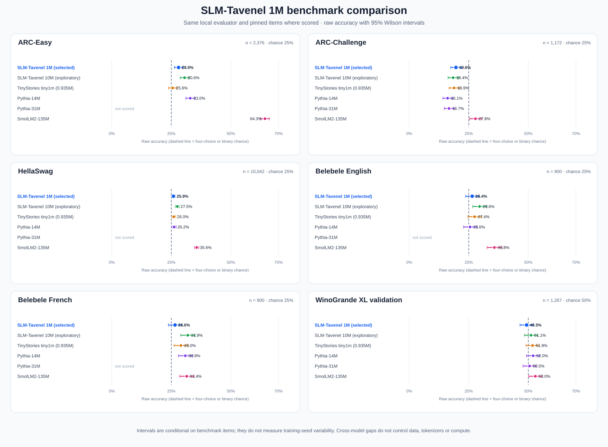

# SLM-Tavenel

SLM-Tavenel is an open research project building and studying small English/French **base language models** under limited compute. The models predict continuations; they are not instruction-tuned assistants. This repository records model artifacts, training data lineage, experiments, evaluations, and known limitations.

[Model catalog](#published-models) · [Main study](#current-research-result) · [Run a model](#quickstart) · [Research docs](#research-and-reproducibility)

## Published models

The canonical Hugging Face repositories use names without experiment suffixes. Older experiment-specific repositories remain useful as historical records and are linked from their reports.

| Model | Parameters | Training lineage | Evidence and status |
|---|---:|---|---|
| [SLM-Tavenel 1M](https://huggingface.co/athenista/slm-tavenel-1m) | 1,181,920 | Trained from scratch on a filtered English/French science subset | Selected checkpoint from a ten-pair gated-versus-ungated study. The strongest controlled evidence in the family; it does not establish a general benchmark win. |
| [SLM-Tavenel 10M](https://huggingface.co/athenista/slm-tavenel-10m) | 9,978,368 | Trained from scratch on French-Science-Commons | Single-seed pilot; exploratory. |
| [SLM-Tavenel 25M](https://huggingface.co/athenista/slm-tavenel-25m) | 25,723,648 | Grown from the trained 10M checkpoint, then continued on French-Science-Commons | Historical single-run scale-up. It is not a size-only comparison because training history and token budget also changed. |
| [SLM-Tavenel 25M HPLT 10%](https://huggingface.co/athenista/slm-tavenel-25m-hplt-10pct) | 25,723,648 | Continued from the 25M checkpoint with a 90/10 FSC/HPLT mixture | Domain-specific held-out HPLT BPB improvement; no established general accuracy gain. |
| [SLM-Tavenel 124M](https://huggingface.co/athenista/slm-tavenel-124m) | 124,038,144 | Independent run with a different tokenizer and data recipe | Separate exploratory checkpoint; compare its card's protocol and limitations before interpreting scores alongside the smaller models. |

See each model card for architecture, tokenizer, training details, benchmark protocol, inference measurements, data provenance, and limits. The cards document declared dataset terms and provenance; they do not independently establish rights to every source document.

## Current research result

The main controlled study is [EXP-0010](experiments/EXP-0010-1m-paired-replication-2026-10-22.md). It compares ten matched training-seed pairs of the 1.18M gated model and a corresponding ungated model, holding initialization and data order fixed. On the preregistered English/French held-out bits-per-byte outcome, the gate reduced BPB by **0.0275** (95% hierarchical interval **0.0168–0.0395**) for this corpus, tokenizer, architecture, and one-pass budget.

This result supports the gate under that specific setup. It does not show that gating always helps, that larger SLM-Tavenel models are better, or that SLM-Tavenel wins downstream benchmarks. The six-task comparison is descriptive and uses different models' published training data and budgets.



The figure reports accuracy with item-sampling intervals; it does not capture variation across training seeds. Read the [results and paired intervals](experiments/EXP-0010-results-2026-10-22.md) for task-level scores and protocol details.

## Quickstart

The example loads the public 1M checkpoint and pins the model code revision used in the recorded inference checks. The model card lists the tested software versions and additional setup details.

```bash
pip install "torch==2.10.0" "transformers==4.57.6" "tokenizers==0.22.2" "safetensors==0.8.0"
```

```python
import torch
from transformers import AutoModelForCausalLM, AutoTokenizer

model_id = "athenista/slm-tavenel-1m"
revision = "33ddccd588a693efeaceae9ae239fa0fbd0c94b6"
tokenizer = AutoTokenizer.from_pretrained(
    model_id, revision=revision, trust_remote_code=True
)
model = AutoModelForCausalLM.from_pretrained(
    model_id, revision=revision, trust_remote_code=True
).eval()

inputs = tokenizer("La recherche scientifique", return_tensors="pt")
with torch.no_grad():
    output = model.generate(**inputs, max_new_tokens=48, do_sample=False)
new_tokens = output[0, inputs["input_ids"].shape[1]:]
print(tokenizer.decode(new_tokens, skip_special_tokens=True))
```

These repositories contain custom Transformers code. Review the pinned `hf_model.py` and `hf_config.py` before enabling `trust_remote_code`. The model is a base text predictor, not a chat assistant.

## Data, openness, and safety

The released weights and project code use MIT terms. Data sources keep their own terms; an MIT model license is not a rights clearance for the source material. Source-rights and manual privacy reviews remain incomplete for parts of the training lineage and are disclosed in the model cards and review records. The OSAID documents in this repository are project self-assessments, not OSI certification.

No comprehensive safety evaluation has been completed. Do not use these research checkpoints for consequential decisions, factual advice, or unsupervised human-facing services. See each model card for its specific intended use and limitations.

## Research and reproducibility

- [Research overview](docs/SLM-TAVENEL-RESEARCH-OVERVIEW.md): accessible account of the 1M study, data, results, and limitations.
- [Architecture and checkpoint configurations](docs/SLM-TAVENEL-MODEL-ARCHITECTURE.md): diagrams and model dimensions.
- [EXP-0010 protocol and results](experiments/EXP-0010-1m-paired-replication-2026-10-22.md) · [results report](experiments/EXP-0010-results-2026-10-22.md).
- [Experiment archive](experiments/): preregistrations, completed studies, negative results, and historical pilots.
- [Source and privacy review](docs/reviews/EXP-0010-SOURCE-PRIVACY-REVIEW.md) · [OSAID self-assessment](docs/reviews/OSAID-1.0-EXP0010-ASSESSMENT.md).
- [Initial roadmap draft (historical)](docs/ROADMAP.md) · [GitHub releases](https://github.com/thekester/slm-tavenel/releases).

To develop the training code, follow the [developer guide](docs/DEVELOPING.md). Real training corpora are not bundled with this source repository.

## License

The repository code is MIT licensed. Individual datasets and model artifacts have separate provenance and terms documented in their respective cards. See [LICENSE](LICENSE) and the model cards before reuse.
