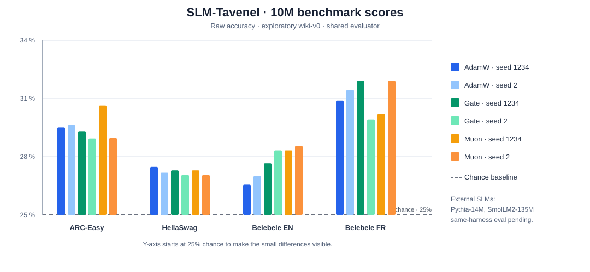

# SLM-1B Challenge

An open research project exploring how much a language model with approximately one billion parameters can achieve through better data, efficient computation, reasoning, and tools.

The central question is simple: how far can we push a compact model while keeping its development reproducible, its behavior observable, and its artifacts openly reusable?

The project aims to develop a useful model for local deployment and to understand which techniques improve its capabilities under realistic resource constraints. Success means measurable progress in task completion, reliability, and efficiency, supported by experiments that others can inspect and reproduce.

## Current status

The project has moved beyond infrastructure-only work: it has exploratory training results at about
10M parameters, reproducible run records, and evaluation scripts for held-out text and multiple-choice
benchmarks. The Wikipedia sources used so far are still under review. These runs are research
prototypes, not release-ready weights or evidence about the 1B target. See the [experiment reports](experiments/)
and [roadmap](docs/ROADMAP.md) for scope and next steps. The current source review pins the wiki-v1
input shards and records the publisher's dual CC BY-SA/GFDL declaration; privacy and model-weight
license implications remain unresolved in [the review record](docs/reviews/WIKIPEDIA-WIKI-V1.md).
The alternative-corpus review compares open-license candidates, including a filtered French science
collection and Common Pile, and records the remaining rights checks in
[docs/reviews/ALTERNATIVE-CORPORA.md](docs/reviews/ALTERNATIVE-CORPORA.md).
An EN/FR French-Science-Commons candidate has been filtered, deduplicated, decontaminated against
the pinned benchmark files, split by document, and balanced to within 0.08% of the same tokenizer
budget in train and validation. It remains exploratory and is not independently rights-cleared.
The 1M and 10M runs are complete, the grown-25M run is paused, and same-harness evaluations are
underway; see the [pilot review](docs/reviews/FSC-PILOT-2026-10-20.md) and [EXP-0009](experiments/EXP-0009-fsc-scaling-and-references.md).

The head-wise attention gate has a consistent bits-per-byte improvement and removes the observed
attention sinks across two 10M seeds; its multiple-choice scores remain close to chance. The Muon
seed-1 result is promising but provisional. Seed 2 has completed training and evaluation; its fixed-
document bits-per-byte gain repeats while multiple-choice scores remain inconclusive. The earlier
gated+Muon queue remains stopped. The wiki-v1 replication in
[EXP-0008](experiments/EXP-0008-wiki-v1-clean-replication.md) is paused after AdamW seed 1234 reached
step 2,000; the checkpoint is retained. A gated scaling series on the frozen FSC pilot corpus is
documented under [EXP-0009](experiments/EXP-0009-fsc-scaling-and-references.md): 1M and 10M are complete;
25M-grown is paused at step 3,050 and will resume from its latest durable step 3,000 checkpoint.
25M-from-scratch is deferred. Same-harness evaluations of the completed 1M and 10M checkpoints and the
TinyStories-0.9M, Pythia-14M and SmolLM2-135M references are underway while 25M is paused.
These corpus-based results remain exploratory pending rights and privacy review.

An additional evaluation wave is queued after the current GPU queue: ARC-Challenge and WinoGrande XL,
scored for SLM-Tavenel 1M/10M and the pinned TinyStories-0.9M, Pythia-14M, Pythia-31M and
SmolLM2-135M references. Pythia-31M adds a general-domain checkpoint near the paused 25M scale.
ARC-Challenge uses the test split; WinoGrande's public test labels are withheld, so its labeled XL
validation split is explicitly exploratory. An exact 13-gram overlap audit against the FSC training
split runs before scoring. These post-hoc results cannot be treated as clean held-out evidence for
the already-trained models, and external pretraining exposure is unknown. The separate
[FSC-pilot-v2 pipeline](configs/data/pipeline-fsc-pilot-v2.yaml) includes both tasks for future
training corpora; it does not change existing v1 checkpoints.

## Current FSC benchmark round

The current round uses the repository evaluator on the same four pinned benchmark files for completed
SLM-Tavenel 1M/10M checkpoints and pinned TinyStories-0.9M, Pythia-14M and SmolLM2-135M checkpoints.
The 25M-grown run is paused and excluded until it reaches its final checkpoint. Results and the chart
will be published from validated item-level outputs in [EXP-0009](experiments/EXP-0009-fsc-scaling-and-references.md).

| Model | Parameters | Current state | Comparison role |
|---|---:|---|---|
| SLM-Tavenel 1M | 1.2M | Checkpoint and evaluation complete | Internal small-scale point |
| SLM-Tavenel 10M | 10M | Checkpoint complete; evaluation pending in queue | Internal size scaling |
| SLM-Tavenel 25M grown | 25M | Paused at step 3,050; excluded from this round | Resume and evaluate later |
| TinyStories tiny1m | 0.896M | Evaluation pending in queue | Near-1M parameter-count reference; English story training |
| Pythia-14M | 14M | Evaluation pending in queue | Closest established size reference to 10M |
| SmolLM2-135M | 135M | Evaluation pending in queue | Larger SLM reference |
| [Pythia-31M](https://huggingface.co/EleutherAI/pythia-31m) | 31M | Queued in supplementary wave | General-domain reference near paused 25M scale |

<!-- BEGIN FSC SCALING BENCHMARK RESULTS -->
_Validated item-level results and the comparison chart will be inserted here when the current evaluation queue completes._
<!-- END FSC SCALING BENCHMARK RESULTS -->

Using one evaluator makes scoring more consistent; it does not make the reference models' training
conditions equivalent. The references differ in data, tokenization, language mix, context limits,
training tokens, compute and possible benchmark exposure. SLM-Tavenel's FSC pipeline records exact
benchmark filtering, which reduces detectable overlap but cannot establish complete decontamination.
The FSC source and derivative-weight rights review remains open. The internal 1M/10M comparison shares
corpus, tokenizer, split and token budget, but currently has one seed at each scale. Paired item-level
bootstrap intervals describe uncertainty conditional on those evaluated checkpoints and benchmark
items; they do not measure variation across training runs. Treat differences as exploratory.

### Supplementary benchmark results

ARC-Challenge and WinoGrande add a harder science-question set and a binary coreference/commonsense
task. OpenBookQA is excluded because its official Hugging Face card lists its license as unknown.
FrenchBench is not included yet: its MIT wrapper does not resolve rights for the underlying questions
collected from external sites. A French benchmark with item-level provenance and clear redistribution
terms is still needed.

<!-- BEGIN FSC ADDITIONAL BENCHMARK RESULTS -->
_Supplementary evaluations are queued after the current GPU evaluation finishes._
<!-- END FSC ADDITIONAL BENCHMARK RESULTS -->

The additional tasks use the same local log-likelihood scorer, but they do not extend the original
four-task decontamination for already-trained checkpoints. The FSC training split receives a
post-hoc exact word 13-gram audit before scores are reported; no exact match does not rule out
paraphrases or indirect exposure. The future v2 pipeline filters these evaluation files during
preprocessing. External models' training corpora and benchmark exposure are not controlled.

## Legacy wiki-v0 benchmark snapshot

The table reports raw multiple-choice accuracy (`acc`) from the project evaluator. Each run used the
same prompts, scoring code and pinned dataset revisions. ARC-Easy has 2,376 items; HellaSwag 10,042;
each Belebele language split 900. Chance is about 25% for all four-choice sets.

**These scores are exploratory, not clean held-out estimates.** The models were trained on wiki-v0,
whose pipeline did not remove benchmark overlaps. wiki-v1 applies exact word 13-gram filtering to
the four benchmark files and logged five removed training documents: three matching Belebele EN and
two matching Belebele FR. This does not detect paraphrase or translation exposure, and the current
Wikipedia sources remain under review. The wiki-v0 table is retained as experiment history; a new
same-corpus replication is preregistered in [EXP-0008](experiments/EXP-0008-wiki-v1-clean-replication.md).
That replication retrains the tokenizer on the filtered training split, keeps its BPB holdout out of
tokenizer/model training, and records item-level benchmark outcomes for paired uncertainty estimates.
Do not present the old table as a clean benchmark result.

| 10M model | Training seed | ARC-Easy | HellaSwag | Belebele EN | Belebele FR |
|---|---:|---:|---:|---:|---:|
| AdamW baseline | 1234 | 0.295 | 0.275 | 0.266 | 0.309 |
| AdamW baseline | 2 | 0.296 | 0.272 | 0.270 | 0.314 |
| Head-wise gate | 1234 | 0.293 | 0.273 | 0.277 | 0.319 |
| Head-wise gate | 2 | 0.289 | 0.271 | 0.283 | 0.299 |
| Muon | 1234 | 0.306 | 0.273 | 0.283 | 0.302 |
| Muon | 2 | 0.290 | 0.270 | 0.286 | 0.319 |



The small differences between these 10M runs are within the benchmarks' sampling uncertainty; these
scores do not establish a downstream-task winner. The gate's current case rests on its repeated
bits-per-byte gain and sink measurements, documented in [EXP-0003](experiments/EXP-0003-gated-attention-10m.md)
and [EXP-0004](experiments/EXP-0004-gated-attention-seed2.md).

| Existing SLM reference | Parameters | ARC-Easy | HellaSwag | Belebele EN | Belebele FR | Role |
|---|---:|---:|---:|---:|---:|---|
| [Pythia-14M](https://huggingface.co/EleutherAI/pythia-14m) | 14M | queued | queued | queued | queued | Primary size-near reference |
| [SmolLM2-135M](https://huggingface.co/HuggingFaceTB/SmolLM2-135M) | 135M | queued | queued | queued | queued | Secondary larger SLM reference |
| [TinyStories tiny1m](https://huggingface.co/shibatch/tiny1m) | 0.896M | queued | queued | queued | queued | Near-1M scale reference; English story-training corpus |

Pythia-14M is the closest established open checkpoint in size to SLM-Tavenel 10M. Its model card
identifies it as English-only and trained on the Pile, so English benchmark results are the most
like-for-like; Belebele French is a cross-lingual probe. The evaluation pins revision
`d31f659f077f9ea500c4d7faa999893d7f28cbdf`. SmolLM2-135M adds a larger, modern SLM point, with the
size difference stated rather than treated as a controlled comparison. TinyStories tiny1m gives a
closer parameter-count reference for the current 1M run; its model card reports 896,256 parameters,
MIT licensing, an English TinyStories training corpus, a 512-token vocabulary and 256-token context.
It is not a general-domain or bilingual peer. All references use this
repository's evaluator, prompts, scoring rules and pinned benchmark files; published scores from
other harnesses are not mixed into the chart. Same-harness scoring controls evaluation procedure, but
not training data, token budget or contamination history, so external results are outcome references,
not causal tests of architecture or training method. FSC's recorded filtering reduces detectable benchmark overlap, but cannot rule out paraphrase, translation or latent exposure; source and weight-release rights review also remains open. Within SLM-Tavenel, 1M versus 10M shares the corpus, tokenizer, held-out split and token budget, but uses one seed and different compute and tokens-per-parameter. The grown 25M condition has a distinct inherited training history. Paired intervals quantify uncertainty across benchmark items conditional on these checkpoints; repeated training seeds are needed to estimate training variability. Treat all current results as exploratory. See the [Pythia model card](https://huggingface.co/EleutherAI/pythia-14m)
and [Pythia repository](https://github.com/EleutherAI/pythia) for its model and evaluation details.

Detailed SLM-Tavenel run data and decisions are in [EXP-0001](experiments/EXP-0001-slm-10m-wiki.md),
[EXP-0003](experiments/EXP-0003-gated-attention-10m.md), [EXP-0004](experiments/EXP-0004-gated-attention-seed2.md)
and [EXP-0005](experiments/EXP-0005-muon-10m.md); raw evaluator outputs are stored under each run's
`analysis/mc.json`.

The `eval bpb` and `eval mc` commands accept `--hf-model` and `--hf-revision` for reference models.
The [wiki-v1 pipeline](configs/data/pipeline-wiki-v1.yaml) expands the exploratory corpus and adds
benchmark decontamination. EXP-0008 is paused while the candidate French-Science-Commons corpus is
reviewed; 1M/25M scaling comparisons remain postponed. Model growth is available through `slm grow`; the
[1M](configs/model/slm-1m-gated.yaml) and [25M](configs/model/slm-25m-gated.yaml) configurations
remain available for later work.

What exists today:

- **Model.** A decoder-only transformer with grouped-query attention, QK normalisation, SwiGLU and RoPE, configured at 135M, 300M and 1.04B parameters, plus ablation variants with gated attention and local/global layers. Every intermediate activation passes through a named hook point. See [docs/ARCHITECTURE.md](docs/ARCHITECTURE.md).
- **Causal analysis.** Capture and intervention on any hook point, head ablation, activation patching, logit lens, and attention sink measurements, also logged during training.
- **Open Data Factory.** A source registry with an enforced license policy, and a pipeline for normalisation, quality filtering, privacy redaction, exact and MinHash deduplication, and benchmark decontamination. Every removal is logged with its reason, and every kept document carries its source, revision and hash. See [docs/DATA_POLICY.md](docs/DATA_POLICY.md).
- **Reproducible training.** Batches are a function of seed and step, checkpoints carry optimiser and RNG state, and run manifests record configuration hashes, data hashes, code revision and environment. A resumed run matches an uninterrupted run exactly in deterministic mode. Optional Muon optimiser and per-document attention masking, each an ablation in the plan.
- **Evaluation and cost.** Bits per byte, multiple-choice benchmarks by log-likelihood at pinned revisions (ARC-Easy, HellaSwag, Belebele in English and French), verified task completion with cost per solved task, latency, memory, GPU energy, and a controlled throughput benchmark (`slm bench`).
- **First results.** Experiments at 10M parameters on Wikipedia are recorded in [`experiments/`](experiments/), including causal tests of attention sinks and a gated-attention ablation.
- **Open weights in standard formats.** Export to Hugging Face Llama or Qwen3 format, checked to give identical logits in `transformers`, with a provenance file linking weights to their run and data.
- **Agent traces.** A span schema linking tasks, model calls, tool calls, verification results and costs.

## Getting started

Requires Python 3.10 or newer and PyTorch 2.3 or newer. A GPU is optional for the smoke run.

```bash
pip install -e ".[dev,hf,energy]"
pytest

# Smoke run on synthetic data, from the repository root (a few minutes)
python -m slm sources audit -v
python -m slm data synth --kind prose --n 3000 --out data/raw/smoke/prose.jsonl
python -m slm data synth --kind arithmetic --n 200 --seed 1 --out data/raw/smoke/arith-eval.jsonl
python -m slm data run configs/data/pipeline-smoke.yaml
python -m slm tokenizer train --inputs data/processed/smoke/documents.jsonl --out data/tokenizer/smoke --vocab-size 4096
python -m slm data encode --tokenizer data/tokenizer/smoke --inputs data/processed/smoke/documents.jsonl --out data/tokens/smoke --val-fraction 0.05
python -m slm train configs/train/smoke.yaml
python -m slm eval bpb --checkpoint runs/smoke/checkpoints/step_00000300.pt --tokenizer data/tokenizer/smoke --data data/processed/smoke/documents.jsonl --limit 50
python -m slm eval cost --checkpoint runs/smoke/checkpoints/step_00000300.pt --tokenizer data/tokenizer/smoke
python -m slm export --checkpoint runs/smoke/checkpoints/step_00000300.pt --tokenizer data/tokenizer/smoke --out exports/smoke-hf

# Size and compute estimate of the 1B target
python -m slm model info configs/model/slm-1b.yaml --tokens 1e12

# Benchmarks at pinned revisions, and a controlled throughput measurement
python -m slm eval fetch-benchmarks --out data/benchmarks
python -m slm eval mc --checkpoint runs/smoke/checkpoints/step_00000300.pt --tokenizer data/tokenizer/smoke --benchmarks data/benchmarks/arc_easy.jsonl --limit 200
python -m slm bench configs/train/smoke.yaml --set optimizer=muon
```

Training configurations accept overrides, for example `python -m slm train configs/train/smoke.yaml --set max_steps=100 seed=7`. Multi-GPU runs use `torchrun --nproc_per_node=N -m slm train ...`.

## Repository layout

| Path | Contents |
|---|---|
| `src/slm/model.py` | Transformer with hook points, KV cache and generation |
| `src/slm/observe.py`, `src/slm/interp.py` | Capture, interventions and causal analyses |
| `src/slm/data/` | Source registry and policy, filters, deduplication, privacy, decontamination, pipeline, token shards, synthetic data |
| `src/slm/tokenizer.py` | Byte-level BPE training with a provenance manifest |
| `src/slm/train.py` | Deterministic, resumable, instrumented training loop |
| `src/slm/evaluation.py` | Bits per byte, verified tasks, cost and energy |
| `src/slm/export.py` | Hugging Face export with provenance |
| `src/slm/trace.py` | Agent trace spans |
| `configs/` | Model, training, data source and pipeline configurations |
| `docs/` | Architecture, data policy, experiment protocol, roadmap, and card templates |
| `tests/` | Unit and end-to-end tests |

## Open science as a design requirement

The ambition is to release the source code, model weights, tokenizer, configurations, training recipes, and evaluation procedures. Dataset provenance, preparation scripts, experiment logs, and both positive and negative findings should make the development process inspectable.

Openness must be documented for each component. A public download alone does not establish that an artifact meets the project's reuse requirements. The intended core corpus will require identifiable sources, recorded permissions, and a review of applicable obligations before inclusion.

The original code and documentation in this repository are released under the [MIT License](LICENSE), with copyright attributed to Théophile Avenel. Third party materials retain their applicable terms. Future model weights and datasets will document their licensing separately when released.

## Research directions

### Reasoning and adaptive computation

We plan to compare explicit reasoning, latent reasoning, and combinations of the two. [Coconut](https://arxiv.org/abs/2412.06769) and [HybridAgent](https://arxiv.org/abs/2610.18861) are starting points for this investigation. [Recurrent depth](https://arxiv.org/abs/2502.05171) and adaptive computation are additional directions for studying whether a compact model can benefit from spending more computation on difficult tasks.

The [Laguna technical report](https://arxiv.org/abs/2605.27605) provides a separate reference for architecture, agentic coding, and the integration of data, training, evaluation, and inference. Its Model Factory approach informs our interest in reproducible experiment infrastructure.

Experiments will measure answer quality, task completion, latency, memory use, and total inference cost. Reducing visible tokens is useful only when the resulting system remains effective and its total cost supports the claimed improvement.

### Attention and information flow

This track will examine how attention mechanisms affect information flow, representation similarity, and performance as context length increases. Candidate experiments include comparisons between standard dot product attention, gated alternatives, and configurations that vary across layers.

Attention sinks are a phenomenon to investigate rather than an assumed defect. [Bismuth's study of attention sinks](https://arxiv.org/abs/2610.19324), which examines [GRIT](https://arxiv.org/abs/2305.17589), motivates questions about attention scoring. Findings from graph models do not establish benefits for an autoregressive language model. Initial architecture experiments are planned at roughly 100 million to 300 million parameters before considering a transfer to the one billion parameter target.

### Tools, memory, and adaptive agent environments

The agent environment includes instructions, tools, memory, skills, scripts, plugins, execution rules, and optional specialized agents. We plan to compare the model alone, the model with a fixed environment, and the model with an environment that can propose and evaluate changes to its configuration.

[Harness²](https://arxiv.org/abs/2610.14224) motivates this research direction. A central question is whether a compact model can improve its own environment reliably and economically. Any adaptation must be evaluated for transfer to unseen tasks, regressions, and the computation consumed while searching for improvements.

Agent experiments will begin in controlled environments with explicit permissions, recorded actions, and verifiable outcomes.

### Causal explainability and observability

Readable explanations and attention visualizations do not, by themselves, establish why a model made a decision. We plan to test explanatory claims through interventions such as removing, replacing, or perturbing selected internal states and measuring changes in behavior.

Agent traces should connect task inputs, relevant execution context, tool calls, observable decisions, verification results, and resource costs. Experiments will assess whether those traces help locate failures and support recovery when tools return incorrect information, time out, or introduce conflicting instructions.

## Open Data Factory

The data pipeline is intended to be a reproducible research artifact in its own right. It will track source revisions, licenses, attribution requirements, transformations, filtering decisions, and dataset splits.

[Common Pile](https://arxiv.org/abs/2506.05209) and selected [SmolTalk2](https://huggingface.co/datasets/HuggingFaceTB/smoltalk2) subsets are initial candidates for review. [FineWeb and FineWeb-Edu](https://arxiv.org/abs/2406.17557), [FineWeb2](https://arxiv.org/abs/2506.20920), [Dolma](https://arxiv.org/abs/2402.00159), [The Stack v2](https://arxiv.org/abs/2402.19173), and [Tülu 3](https://arxiv.org/abs/2411.15124) mixtures are additional candidates for comparison or selective use. These names form a research shortlist, not an approved training corpus. Inclusion will depend on review of the specific sources and subsets used.

Preparation will include quality filtering, exact and approximate deduplication, privacy review, and checks for benchmark contamination. [DataTrove](https://github.com/huggingface/datatrove) is a reference implementation for investigating these processing pipelines. The intended core corpus excludes sources with unidentified provenance or restrictions incompatible with the project's reuse goals, including NonCommercial and NoDerivatives restrictions.

We also plan to create synthetic tasks with verifiable outcomes, including code exercises with tests, simulated API calls, document retrieval, and operations on fictional files. Their records should preserve the generator, any teacher model, the generation conditions, and the verification procedure.

Data mixtures and curricula will be experimental variables. General text, science, mathematics, code, French, and English are areas of interest; instruction and agent trajectories will be considered separately for post training. No mixture is currently established as the training recipe.

## Experimental approach

Two development paths will support the research. Experiments with an existing checkpoint can test reasoning and agent methods sooner, subject to review of its terms and provenance. Training from scratch offers greater control over architecture, data, and the resulting scientific claims. Results from these paths will be reported separately.

Each experiment should define a baseline, a hypothesis, a controlled change, and a reproducible evaluation procedure. Comparisons will account for training data, parameter count, available tools, and computation budgets. Where practical, repeated runs will help distinguish consistent gains from variation.

Evaluation will measure accuracy, verified task completion, robustness, latency, peak memory, tokens, tool calls, retries, and energy where it can be measured. Cost per successfully completed task will include failed attempts and environment adaptation overhead. Training and preparation costs will also be reported so that cheaper inference is not mistaken for lower total cost.

Memory experiments will vary context length, introduce contradictory information, and test retrieval failures. Agent experiments will include tool errors and unfamiliar tasks. Final evaluation data must remain separate from training and from the tasks used to optimize the agent environment.

## Planned progression

The first milestone is a reproducible baseline with a documented data selection process and evaluation suite. Small architecture experiments and controlled agent tasks will then establish which directions justify larger runs.

Promising methods will be tested individually before being combined at the target scale. A release should include the artifacts and documentation needed to reproduce its reported results, together with known limitations and unsuccessful experiments.

## Research references

This bibliography covers the papers named in our research notes and the primary publications associated with the models and datasets discussed there. GRIT is included as background for the attention sink study. SmolTalk2 and DataTrove are documented separately as dataset and software resources. These references motivate experiments; their inclusion does not establish results for SLM-1B or approve their artifacts for use in training.

### Reasoning, architecture, and agent systems

**HybridAgent.** Jiaru Zou et al. (2026). [Hybrid Reasoning Agents](https://arxiv.org/abs/2610.18861). arXiv:2610.18861. Explores transitions between latent reasoning and textual interaction through HybridLink, with working memory across tool interactions. It motivates our experiments on reasoning efficiency, agent traces, and causal inspection. [Official code](https://github.com/togethercomputer/HybridAgent).

**Coconut.** Shibo Hao et al. (2024). [Training Large Language Models to Reason in a Continuous Latent Space](https://arxiv.org/abs/2412.06769). arXiv:2412.06769. Introduces continuous thoughts by feeding hidden states back as input embeddings. It provides a starting point for comparing textual and latent reasoning.

**Recurrent depth.** Jonas Geiping et al. (2025). [Scaling up Test-Time Compute with Latent Reasoning: A Recurrent Depth Approach](https://arxiv.org/abs/2502.05171). arXiv:2502.05171. Studies additional inference computation through repeated application of a recurrent block. It motivates experiments that vary computation depth while tracking quality and resource use.

**Laguna.** Julien Abadji et al., Poolside Team (2026). [Laguna M.1/XS.2 Technical Report](https://arxiv.org/abs/2605.27605). arXiv:2605.27605. Documents mixture of experts models for agentic coding and the Model Factory used to develop them. It informs our architecture and experiment infrastructure research; its models are substantially larger than our target.

**Harness².** Ruiyao Xu et al. (2026). [Harness²: Recursive Agent Harnessing for an Open World](https://arxiv.org/abs/2610.14224). arXiv:2610.14224. Studies adaptation of an agent's execution environment within a task and across tasks. Its evaluations on WorkBuddy-Bench, JobBench, and LAB motivate comparisons between fixed and adaptive environments, including the cost of adaptation. [Official code](https://github.com/google-research/harness2).

### Attention and graph models

**Attention sinks in Graph Transformers.** Alexandre Bismuth (2026). [Why don't Graph Transformers attend to the same token?](https://arxiv.org/abs/2610.19324). arXiv:2610.19324. Investigates graph symmetry, locality, and attention scoring as factors in sink formation. It motivates controlled attention experiments without assuming that graph results transfer to language models.

**GRIT, supporting background.** Liheng Ma et al. (2023). [Graph Inductive Biases in Transformers without Message Passing](https://arxiv.org/abs/2305.17589). arXiv:2305.17589. Introduces the Graph Inductive bias Transformer examined in the attention sink study. It supplies architectural context for the graph attention mechanisms discussed in our notes.

### Data and open training recipes

**Common Pile and Comma.** Nikhil Kandpal et al. (2025). [The Common Pile v0.1: An 8TB Dataset of Public Domain and Openly Licensed Text](https://arxiv.org/abs/2506.05209). arXiv:2506.05209. Documents corpus construction and the Comma models used to evaluate it. It is a central reference for studying training with documented data provenance.

**FineWeb and FineWeb-Edu.** Guilherme Penedo et al. (2024). [The FineWeb Datasets: Decanting the Web for the Finest Text Data at Scale](https://arxiv.org/abs/2406.17557). arXiv:2406.17557. Studies filtering, deduplication, and educational text selection. It informs our data preparation ablations and quality comparisons.

**FineWeb2.** Guilherme Penedo et al. (2025). [FineWeb2: One Pipeline to Scale Them All: Adapting Pre-Training Data Processing to Every Language](https://arxiv.org/abs/2506.20920). arXiv:2506.20920. Extends data processing to multilingual corpora. It informs our proposed French and multilingual experiments.

**Dolma.** Luca Soldaini et al. (2024). [Dolma: an Open Corpus of Three Trillion Tokens for Language Model Pretraining Research](https://arxiv.org/abs/2402.00159). arXiv:2402.00159. Documents corpus composition, curation, and data processing experiments. It provides a comparison point for transparent pretraining data development.

**The Stack v2 and StarCoder2.** Anton Lozhkov et al. (2024). [StarCoder 2 and The Stack v2: The Next Generation](https://arxiv.org/abs/2402.19173). arXiv:2402.19173. Describes the code corpus and models trained with it. It informs our investigation of code data, source tracking, and programming evaluation.

**Tülu 3.** Nathan Lambert et al. (2024). [Tulu 3: Pushing Frontiers in Open Language Model Post-Training](https://arxiv.org/abs/2411.15124). arXiv:2411.15124. Documents supervised fine tuning, preference optimization, reinforcement learning with verifiable rewards, and evaluation practices. It informs our post training experiments and separation of development tasks from final evaluation.

### Dataset and software resources

**SmolTalk2.** Hugging Face. [Official dataset card](https://huggingface.co/datasets/HuggingFaceTB/smoltalk2). Documents the data mixtures used for SmolLM3 post training, including reasoning, instruction following, and tool calling examples. This is the primary resource for reviewing candidate subsets and their provenance.

**DataTrove.** Hugging Face. [Official repository](https://github.com/huggingface/datatrove). Provides reusable data processing components, including filtering and deduplication. It is an implementation reference for the Open Data Factory.

The public comments discussed in our notes raise additional questions about explanation faithfulness, debugging, memory robustness, and cost per successful task. We treat those questions as proposed research hypotheses, rather than additional papers or established experimental findings.

## License and attribution

Copyright (c) 2026 Théophile Avenel.

This project's original code and documentation are available under the [MIT License](LICENSE). You may use, copy, modify, merge, publish, distribute, sublicense, and sell them, including as part of commercial or proprietary projects, subject to the license terms.

Copies or substantial portions must retain the copyright notice naming Théophile Avenel and the MIT permission notice. The license does not require a separate academic citation or a visible credit in a product interface. If you discuss this project in a publication, an acknowledgement of Théophile Avenel and a link to this repository are appreciated.

## Contributing

Useful contributions include reproducible baselines, dataset provenance reviews, controlled ablations, evaluation environments, and tools for inspecting failures. Research proposals should explain the question, the comparison, the expected resource requirements, and the evidence that would support or reject the hypothesis.

The project's guiding question remains open: what capabilities can a transparent, reproducible model of one billion parameters achieve when its data, computation, and tools are developed and evaluated together?
