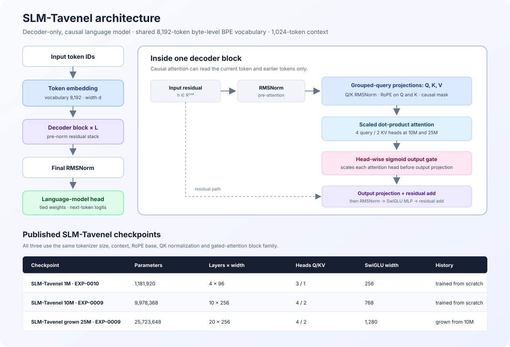

# SLM-Tavenel architecture

This note describes the three published SLM-Tavenel research checkpoints. The configuration values below come from the archived model configs shipped with each Hub artifact. The 1M, 10M and 25M checkpoints use the same decoder-block family, but differ in width, depth and MLP size.

## Shared decoder block

1. Token IDs are mapped through an 8,192-entry byte-level BPE embedding table. The context window is 1,024 tokens.
2. Each transformer block is pre-normalized with RMSNorm. Grouped-query attention produces queries, keys and values; Q and K receive per-head RMSNorm, and rotary position embeddings are applied to Q and K. Attention is causal.
3. A learned sigmoid gate scales each attention head's output before the attention output projection. The gated attention output is added to the residual stream.
4. A second RMSNorm feeds a SwiGLU MLP. The MLP output is added to the residual stream.
5. A final RMSNorm and a vocabulary projection produce next-token logits. Input and output embeddings are tied in the recorded model configuration.

The head-wise gate adds a learned scalar per head and token position. Its presence identifies the released 1M/10M/25M variants shown here; it is not a claim that gating is universally better. EXP-0010 directly tested the gate only at 1M under its specific corpus and token budget.

## Checkpoint configurations

| Hub checkpoint | Parameters | Layers | Width | Query heads | KV heads | Head dimension | SwiGLU width | Context | Training lineage |
|---|---:|---:|---:|---:|---:|---:|---:|---:|---|
| [SLM-Tavenel 1M EXP-0010](https://huggingface.co/athenista/slm-tavenel-1m-exp0010) | 1,181,920 | 4 | 96 | 3 | 1 | 32 | 256 | 1,024 | Trained from scratch; selected gated seed from ten paired seeds |
| [SLM-Tavenel 10M EXP-0009](https://huggingface.co/athenista/slm-tavenel-10m-exp0009) | 9,978,368 | 10 | 256 | 4 | 2 | 64 | 768 | 1,024 | Trained from scratch; one seed |
| [SLM-Tavenel grown 25M EXP-0009](https://huggingface.co/athenista/slm-tavenel-25m-exp0009) | 25,723,648 | 20 | 256 | 4 | 2 | 64 | 1,280 | 1,024 | Grown from the trained 10M model, then continued for 15,000 steps |

All three use QK normalization, RoPE with θ = 10,000, head-wise sigmoid attention gating, RMSNorm, SwiGLU, and tied embeddings. The parameter totals include embeddings and the full output-vocabulary projection as implemented by the model.

## Reading the benchmark results across sizes

The 25M checkpoint is not a controlled “same model, more parameters” comparison. It inherits the trained 10M weights, doubles the depth, widens the MLP and receives an additional 491.52M token positions. The current comparison has one training trajectory at each size.

On the six shared multiple-choice tasks, all paired 95% item-bootstrap intervals for 25M minus 10M include zero. The raw scores move in both directions. The 25M checkpoint does have lower held-out English/French BPB on the FSC validation text, but that measures next-token prediction on those texts and does not imply a general benchmark gain. The item bootstrap is conditional on these saved checkpoints and does not capture training-seed variability.

The published 10M and 25M pilots also used the earlier mixed-license FSC pipeline. The reported source-license and privacy reviews remain incomplete; this architecture note does not change that status. See the [25M scaling results](../experiments/EXP-0009-25m-scaling-results-2026-10-22.md) and the [data review records](reviews/).

## Source files

- 1M config: `configs/model/slm-1m-gated.yaml`
- 10M config: `configs/model/ablations/slm-10m-gated-headwise.yaml`
- 25M config: `configs/model/slm-25m-gated.yaml`
- Implementation: `src/slm/model.py`
- Figure source: `scripts/prepare_exp0009_25m_results.py` (benchmark comparison), with the architecture figure checked in as SVG.
