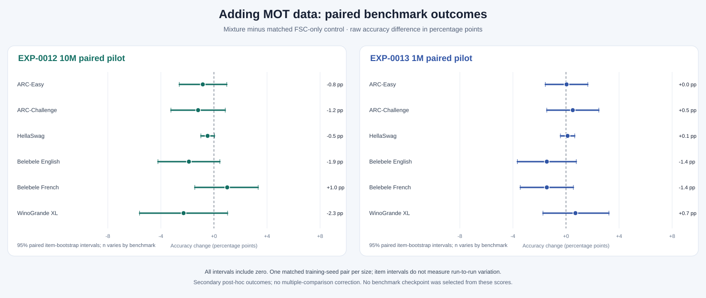

# SLM-Tavenel: a small bilingual model, studied carefully

> **In one sentence:** SLM-Tavenel is a small English/French base language model and a research project about reproducible training, measurable behavior, and honest evaluation at limited compute.

This page is the accessible entry point to the project. It follows the reader-friendly flow of Hugging Face's [SmolLM article](https://huggingface.co/blog/smollm), while using only SLM-Tavenel's own methods, records, and results. It is not a claim that the two projects used comparable data or compute.

## On this page

- [What is SLM-Tavenel?](#what-is-slm-tavenel)
- [The data](#the-data-what-went-into-training)
- [How the main experiment was run](#how-was-the-main-experiment-run)
- [What the study found](#what-did-the-study-find)
- [Benchmark comparison](#how-does-the-1m-model-compare-on-benchmarks)
- [Measurements and unknowns](#what-is-measured-and-what-remains-unknown)
- [Reproduction and release status](#reproduction-and-release-status)

## At a glance

- **Model described here:** one selected SLM-Tavenel 1M checkpoint, with 1,181,920 parameters. It is a base model, not an instruction-tuned assistant.
- **Main completed study:** ten matched training-seed pairs compared a head-wise attention gate with a model that had no gate.
- **Primary result:** the gate improved the equal-language English/French held-out bits-per-byte score by **0.0275 BPB** (95% hierarchical bootstrap interval **[0.0168, 0.0395]**) in this specific setup.
- **Scope:** the result supports the predeclared +0.01 BPB threshold for this corpus, tokenizer, model size, and one-pass training budget. It does not establish general language ability or a universal benefit from attention gates.
- **Release status:** the public [EXP-0010 package on Hugging Face](https://huggingface.co/athenista/slm-tavenel-1m-exp0010) passes the project's core OSAID 1.0 self-assessment for terms and required artifacts. This is not OSI certification. Source-rights and privacy limitations are disclosed separately and are not OSAID signature requirements.

## What is SLM-Tavenel?

SLM-Tavenel is a decoder-only language model trained from scratch for English and French text. The selected 1M model has four transformer layers, grouped-query attention, QK normalization, SwiGLU, rotary position embeddings, a head-wise attention gate, an 8,192-token byte-level BPE vocabulary, and a 1,024-token context window.

The project focuses on how small models train and behave under a limited compute budget. It records training curves, gradient and update statistics, attention measurements, gate values, and benchmark outputs so that a result can be inspected and reproduced. These measurements improve observability; measurements alone do not explain why a model produced a particular answer.

## The data: what went into training?

The completed EXP-0010 study used the `french_open_science` subset of [PleIAs/French-Science-Commons](https://huggingface.co/datasets/PleIAs/French-Science-Commons), pinned to revision `bfa114c09d7c28dcd0a8a47fe445c64b4a3c6156`. The dataset and an audit of HAL metadata label the selected source records CC0. That metadata trail does **not** independently verify that every depositor had authority to apply those terms.

The initial 3,450 English/French records were filtered to 1,229 documents: 748 English and 481 French. Documents, rather than passages from the same document, were assigned to training, development, and test splits. The training split contains 15,976,924 tokens; the development split 931,435; and the held-out test split 2,032,436 across 69 English and 47 French documents.

The processing pipeline records source IDs and URIs, declared license labels, filtering decisions, text hashes, split assignments, and privacy-pattern scans. It redacted email-shaped, phone-shaped, and IP-pattern strings, and excluded documents with specified residual patterns. These automated checks and a small excerpt review are limited checks, not a guarantee that all personal or sensitive information has been removed. Source-rights review and manual privacy sign-off remain unsigned. Source article text is not included in the model package.

*The split chart shows document counts after filtering. Token counts differ by language and split; see the [data card](model-cards/slm-tavenel-1m-exp0010-data-card.md) for the complete record.*

## How was the main experiment run?

EXP-0010 tested one narrow question: under a matched training setup, does adding a head-wise attention gate improve held-out text modeling for this 1M architecture?

The study trained ten gated models and ten ungated controls. Within each seed pair, both models shared the same initialization for common parameters and consumed the same seed-indexed training batches. Each run used 488 optimizer steps of 32,768 token positions, or 15,990,784 token presentations, close to one pass over the training split. The gated seed `421101` was selected in the protocol before the results were observed; it is the single 1M checkpoint shown as the candidate model.

The primary outcome was the equal-weight average of English and French bits per byte on document-held-out text. The paired effect is defined as **ungated BPB minus gated BPB**, so a positive effect favors the gate. The study predeclared a practical threshold of +0.01 BPB. A hierarchical bootstrap resampled both seed pairs and held-out documents within language.

## What did the study find?

The estimated paired effect was **+0.0275 BPB**, with a 95% hierarchical bootstrap interval of **[+0.0168, +0.0395]**. The interval is above the predeclared +0.01 threshold. In this experiment, the result supports a practical held-out BPB gain from the gate.

*Positive effects favor the gate. Each point is one matched seed pair; the pooled interval also accounts for document sampling within English and French. This is evidence about the tested corpus, tokenizer, architecture, and token budget.*

The finding is not evidence that the gate will help every model, dataset, training duration, or downstream task. It also does not explain a model's internal behavior. The full seed-level outcomes and analysis choices are in the [EXP-0010 results report](../experiments/EXP-0010-results-2026-10-22.md), with the prospective [protocol](../experiments/EXP-0010-1m-paired-replication-2026-10-22.md) and [amendment](../experiments/EXP-0010-amendment-2026-10-22.md).

The separate EXP-0009 scaling pilot used a larger mixed-license version of the FSC corpus. A post-training HAL check found 31,262 of 31,417 source IDs whose current main-file and document-file license fields match the pinned dataset label; 155 IDs have mismatches, conflicts, missing file metadata or no HAL result. That check does not prove rights-holder authority or historical license status. The 10M and grown 25M results remain exploratory and their source-rights and privacy review is incomplete. The grown 25M model was expanded from the trained 10M, then trained for 15,000 more steps. Its benchmark and held-out BPB results are reported separately in [EXP-0009](../experiments/EXP-0009-25m-scaling-results-2026-10-22.md); it is a single local research checkpoint, not part of the selected 1M release and not uploaded. See the [full 10M audit](reviews/EXP-0009-HAL-FILE-LICENSE-AUDIT-2026-10-22.md).

A 23 October recheck did not resolve any of the 155 HAL cases. A broader privacy-signal scan found four residual public-IP-pattern matches and flagged 20,808 documents for at least one review signal; the original 25M training pipeline did not use the later v4 publication-risk filters. These counts identify work for review and do not establish whether every flagged document contains personal data. The [25M source and privacy dossier](reviews/EXP-0009-25M-SOURCE-PRIVACY-REVIEW.md) records the evidence, limitations, and maintainer decision fields.

On the fixed held-out FSC validation documents, the paired equal-language 10M-minus-25M BPB difference is **+0.0557** (95% document-bootstrap interval **[+0.0548, +0.0567]**), favoring the grown 25M checkpoint because lower BPB is better. This interval resamples English and French documents within language and is conditional on these two saved checkpoints. With one training seed per scale, it does not estimate seed-to-seed variation or uncertainty about the source corpus. The bootstrap record (local artifact: `runs/fsc-scaling/comparisons/exp0009-bpb-document-bootstrap.json`) contains the scoring reproduction checks and hashes.

## How does the 1M model compare on benchmarks?

The selected SLM-Tavenel 1M checkpoint was scored with this repository's log-likelihood evaluator on six pinned multiple-choice benchmark files. The chart shows raw accuracy. It includes one SLM-Tavenel 1M model: the preselected EXP-0010 candidate. Older 1M pilots are retained as historical records, not presented as alternative current versions.

*Raw accuracy on ARC-Easy, ARC-Challenge, HellaSwag, Belebele English and French, and WinoGrande XL. Error bars in the underlying chart reflect uncertainty over benchmark items, not variation across training seeds.*

| Model | Parameters | ARC-Easy | ARC-Challenge | HellaSwag | Belebele EN | Belebele FR | WinoGrande XL |
|---|---:|---:|---:|---:|---:|---:|---:|
| **SLM-Tavenel 1M (selected candidate)** | **1.18M** | **0.280** | **0.196** | **0.259** | **0.264** | **0.266** | **0.493** |
| SLM-Tavenel 10M FSC pilot | 9.98M | 0.306 | 0.184 | 0.275 | 0.296 | 0.319 | 0.511 |
| [TinyStories tiny1m](https://huggingface.co/shibatch/tiny1m) | 0.935M | 0.256 | 0.189 | 0.260 | 0.274 | 0.290 | 0.518 |
| [Pythia-14M](https://huggingface.co/EleutherAI/pythia-14m) | 14.1M | 0.330 | 0.161 | 0.262 | 0.256 | 0.309 | 0.520 |
| [Pythia-31M](https://huggingface.co/EleutherAI/pythia-31m) | 30.5M | not scored | 0.167 | not scored | not scored | not scored | 0.505 |
| [SmolLM2-135M](https://huggingface.co/HuggingFaceTB/SmolLM2-135M) | 135M | 0.643 | 0.278 | 0.356 | 0.358 | 0.314 | 0.530 |

The references were evaluated with the same prompts, scoring code, and pinned benchmark files where results are available. This controls the evaluation procedure, but it does not make the models' training comparable: datasets, tokenizers, language mix, training tokens, compute, and possible benchmark exposure differ. Some reference cells are unscored. These post-hoc scores are descriptive checkpoint comparisons, not a controlled ranking or evidence that SLM-Tavenel is better or worse in general. The [results report](../experiments/EXP-0010-results-2026-10-22.md) includes item counts, paired intervals, reference revisions, and raw-record locations.

## What did the later data-mixture pilots find?

The follow-up [10M and 1M mixture pilots](../experiments/EXP-0012-0013-mixture-pilot-results-2026-10-22.md) each compared one FSC-only control with a matched arm that used 20% MOT news data. On the MOT development and temporal test splits, the mixture arms had lower BPB; on FSC evaluation splits, BPB was higher. This suggests a domain trade-off in these runs, not a general improvement. Across the six multiple-choice tasks, every paired item-bootstrap interval includes zero.

*The control in the 1M pilot is an experimental replay arm, not another promoted SLM-Tavenel 1M model. Each pilot has only one training-seed pair, so the item intervals shown here do not capture run-to-run variation. The MOT-containing weights are not cleared for public release.*

## What is measured, and what remains unknown?

The artifact records per-step losses, gradient norms, optimizer statistics, weight-update ratios, attention sink mass, attention entropy, residual statistics, and gate values. These can help identify when runs diverge or reveal patterns worth testing. They are **observability diagnostics**, not causal explanations. EXP-0010's matched intervention provides evidence about the gate's effect on its prespecified BPB outcome; it does not establish a mechanistic explanation of model outputs.

The study also does not establish broad English or French competence, scientific reasoning, absence of memorization, safety for deployment, or legal clearance of all training sources. The text test was document-held-out operationally, but the source texts are public and therefore not secret from possible prior training or exposure.

## Reproduction and release status

The local candidate package includes the selected checkpoint, runnable Transformers code, training configurations, the paired-run records, benchmark outputs, data provenance, processing scripts, metrics, and SHA-256 inventory. The paired training used a recorded clean code commit; the data pipeline was replayed separately and its retained-document hash, decision-file hash, and processing statistics matched the recorded values. The original preprocessing manifest still reports that its worktree was dirty.

Weights, included code and Data Information are offered under MIT, an OSI-approved license. The project self-assesses that the public package at [Hugging Face](https://huggingface.co/athenista/slm-tavenel-1m-exp0010) meets the core requirements of the [OSI Open Source AI Definition 1.0](https://opensource.org/ai/open-source-ai-definition); details and evidence are in the [OSAID assessment](reviews/OSAID-1.0-EXP0010-ASSESSMENT.md). This is not OSI certification or endorsement. The data card reports the source's CC0 metadata and its limits; it does not relicense source articles or independently prove each depositor's authority. Manual privacy review is a separate project risk control.

For details, start with the [model card](model-cards/slm-tavenel-1m-exp0010-candidate.md), [data card](model-cards/slm-tavenel-1m-exp0010-data-card.md), [protocol](../experiments/EXP-0010-1m-paired-replication-2026-10-22.md), and [results report](../experiments/EXP-0010-results-2026-10-22.md). [EXP-0012](../experiments/EXP-0012-10m-data-mixture-2026-10-22.md) and [EXP-0013](../experiments/EXP-0013-1m-data-mixture-2026-10-22.md) describe separate mixture pilots; their hypotheses and status should not be merged into EXP-0010's completed result.

## How to read the project

1. Read this overview for the study and its boundaries.
2. Read the [results report](../experiments/EXP-0010-results-2026-10-22.md) for full tables and analysis.
3. Read the [protocol and amendment](../experiments/EXP-0010-1m-paired-replication-2026-10-22.md) for the planned design and documented clarification.
4. Read the [model card](model-cards/slm-tavenel-1m-exp0010-candidate.md) and [data card](model-cards/slm-tavenel-1m-exp0010-data-card.md) for artifact use, provenance, privacy, and rights limitations.
