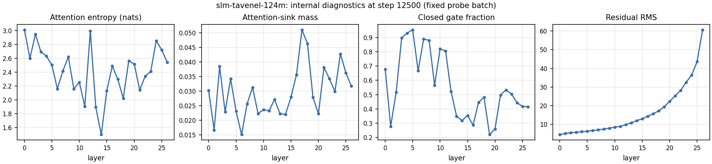

---
language:
- en
- fr
license: mit
library_name: transformers
pipeline_tag: text-generation
datasets:
- HuggingFaceFW/fineweb-edu
- epfml/FineWeb2-HQ
tags:
- slm-tavenel
- research-artifact
- base-model
- experimental
- 124m
model-index:
- name: slm-tavenel-124m
  results:
  - task: {type: multiple-choice, name: "Multiple choice (0-shot, log-likelihood)"}
    dataset: {name: ARC-Easy, type: allenai/ai2_arc, config: ARC-Easy, split: test, revision: 210d026faf9955653af8916fad021475a3f00453}
    metrics: [{type: accuracy, value: 0.4836, name: accuracy (SLM-Tavenel evaluator)}]
    source: {name: SLM-Tavenel EXP-0036, url: "https://github.com/thekester/slm-tavenel/blob/92c215f/experiments/EXP-0036-beat-gpt2-at-equal-parameters-2026-10-30.md"}
  - task: {type: multiple-choice, name: "Multiple choice (0-shot, log-likelihood)"}
    dataset: {name: ARC-Challenge, type: allenai/ai2_arc, config: ARC-Challenge, split: test, revision: 210d026faf9955653af8916fad021475a3f00453}
    metrics: [{type: accuracy, value: 0.2065, name: accuracy (SLM-Tavenel evaluator)}]
    source: {name: SLM-Tavenel EXP-0036, url: "https://github.com/thekester/slm-tavenel/blob/92c215f/experiments/EXP-0036-beat-gpt2-at-equal-parameters-2026-10-30.md"}
  - task: {type: multiple-choice, name: "Multiple choice (0-shot, log-likelihood)"}
    dataset: {name: HellaSwag, type: Rowan/hellaswag, split: validation, revision: 218ec52e09a7e7462a5400043bb9a69a41d06b76}
    metrics: [{type: accuracy, value: 0.2767, name: accuracy (SLM-Tavenel evaluator)}]
    source: {name: SLM-Tavenel EXP-0036, url: "https://github.com/thekester/slm-tavenel/blob/92c215f/experiments/EXP-0036-beat-gpt2-at-equal-parameters-2026-10-30.md"}
  - task: {type: multiple-choice, name: "Multiple choice (0-shot, log-likelihood)"}
    dataset: {name: Belebele (English), type: facebook/belebele, config: eng_Latn, split: test, revision: 7899cdfa4e1e0d733fd77c848e2c273cb1d32be2}
    metrics: [{type: accuracy, value: 0.3156, name: accuracy (SLM-Tavenel evaluator)}]
    source: {name: SLM-Tavenel EXP-0036, url: "https://github.com/thekester/slm-tavenel/blob/92c215f/experiments/EXP-0036-beat-gpt2-at-equal-parameters-2026-10-30.md"}
  - task: {type: multiple-choice, name: "Multiple choice (0-shot, log-likelihood)"}
    dataset: {name: Belebele (French), type: facebook/belebele, config: fra_Latn, split: test, revision: 7899cdfa4e1e0d733fd77c848e2c273cb1d32be2}
    metrics: [{type: accuracy, value: 0.3111, name: accuracy (SLM-Tavenel evaluator)}]
    source: {name: SLM-Tavenel EXP-0036, url: "https://github.com/thekester/slm-tavenel/blob/92c215f/experiments/EXP-0036-beat-gpt2-at-equal-parameters-2026-10-30.md"}
  - task: {type: multiple-choice, name: "Multiple choice (0-shot, log-likelihood)"}
    dataset: {name: "WinoGrande (XL, validation)", type: allenai/winogrande, config: winogrande_xl, split: validation, revision: 546d5aa0e42fc0fa9ad2c13260322ec969e083ee}
    metrics: [{type: accuracy, value: 0.5193, name: accuracy (SLM-Tavenel evaluator)}]
    source: {name: SLM-Tavenel EXP-0036, url: "https://github.com/thekester/slm-tavenel/blob/92c215f/experiments/EXP-0036-beat-gpt2-at-equal-parameters-2026-10-30.md"}
---

# SLM-Tavenel 124M

**Experimental English/French base model (124M parameters), trained from scratch at GPT-2 Small's
size.** Not instruction tuned; not a chat assistant. Compared with GPT-2 Small on the same six
benchmarks with the same evaluator: better on ARC-Easy, worse on HellaSwag, six-task mean not resolved;
the preregistered "overall win" criterion was **not met**. Every number below links to a file in this
repository or in the experiment record.

| At a glance | |
|---|---|
| Parameters | 124,038,144 total; 95,726,592 excluding token embeddings |
| Architecture | Decoder-only transformer, 27 layers, width 576, 9 query / 3 key-value heads, SwiGLU 1,536 |
| Tokenizer | SmolLM2 byte-level BPE, 49,152 tokens (tied input/output embeddings) |
| Context window | 2,048 tokens |
| Training precision | bfloat16 mixed precision |
| Published weights | `model.safetensors`, float32; bfloat16 copy staged in ariants/bf16/; CPU int8 recipe in Local inference |
| Training data | Filtered FineWeb-Edu (English) + FineWeb2-HQ (French), 983M token positions |
| Optimizer / seed | Muon (block matrices) + AdamW (embeddings, norms); seed 20261031 |
| Compute | One RTX 4060 Laptop GPU (8 GB), ~57 GPU-hours; energy not measured |
| License | MIT (weights and code); data sources keep their own terms |
| Hub revision described | `a4ccf8189c738eab28ab5d78990974e98930b9a7` |

## Contents

[Main result](#main-result) · [Benchmarks](#benchmarks) · [Local inference](#local-inference) ·
[Use](#use) · [Architecture](#architecture) · [Training](#training) ·
[Traceability and explainability](#traceability-and-explainability) ·
[Intended use and safety](#intended-use-out-of-scope-use-and-safety) · [Data, licenses and privacy](#data-licenses-and-privacy) ·
[Limitations](#limitations) · [License and citation](#license-and-citation) · [Model family](#the-slm-tavenel-family)

## Main result

[](gpt2-paired-accuracy.svg)

The preregistered criterion required higher HellaSwag accuracy **and** a higher six-task mean than
GPT-2 Small. It was not met: HellaSwag is lower (−1.5 points, interval excluding zero) and the six-task
mean difference (+0.7 points) has an interval that includes zero. ARC-Easy is higher (+3.6 points).
This is a descriptive same-harness comparison, not evidence that one model is generally better.

## Benchmarks

**Protocol.** Zero-shot multiple choice scored by log-likelihood (the answer is the choice with the
highest log-probability given the context; lm-evaluation-harness prompt templates for ARC, HellaSwag and
Belebele, cloze scoring for WinoGrande), implemented in the SLM-Tavenel evaluator. Both checkpoints were
scored on the same pinned items. Intervals: 95% paired bootstrap over items (10,000 draws); they measure
item-sampling uncertainty for these two checkpoints, not training-seed variation (one seed was trained).

| Task (dataset @ revision) | Items | Metric | GPT-2 124M | SLM-Tavenel 124M | Difference [95% paired interval] |
|---|---:|---|---:|---:|---|
| ARC-Easy (`allenai/ai2_arc@210d026f`, test) | 2,376 | accuracy | 0.447 | 0.484 | +0.036 [+0.018, +0.055] |
| ARC-Challenge (same, test) | 1,172 | accuracy | 0.185 | 0.206 | +0.021 [0.000, +0.044] |
| HellaSwag (`Rowan/hellaswag@218ec52e`, validation) | 10,042 | accuracy | 0.292 | 0.277 | −0.015 [−0.021, −0.010] |
| Belebele EN (`facebook/belebele@7899cdfa`) | 900 | accuracy | 0.310 | 0.316 | +0.006 [−0.021, +0.032] |
| Belebele FR (same) | 900 | accuracy | 0.318 | 0.311 | −0.007 [−0.038, +0.024] |
| WinoGrande XL (`allenai/winogrande@546d5aa0`, validation) | 1,267 | accuracy | 0.517 | 0.519 | +0.002 [−0.030, +0.036] |
| **Six-task mean** | — | accuracy | **0.345** | **0.352** | **+0.007 [−0.003, +0.017]** |

Length-normalised HellaSwag accuracy: GPT-2 0.316, SLM-Tavenel 0.289. Chance level: 0.25 for the four-
choice tasks, 0.50 for WinoGrande. Held-out bits per byte on this model's own corpus-v2 test split:
1.067 overall (English 1.085, French 1.040); GPT-2 was not scored on that split, so this is not a
comparison. Data, tokenizer and budget differ between the two models (GPT-2's training token count is
not disclosed), so the table compares checkpoints, not recipes.

Family and size-neighbour context (same evaluator and items):

| Model | Parameters | ARC-Easy | ARC-Challenge | HellaSwag | Belebele EN | Belebele FR | WinoGrande | Six-task mean |
|---|---:|---:|---:|---:|---:|---:|---:|---:|
| SLM-Tavenel 1M | 1.18M | 0.280 | 0.196 | 0.259 | 0.264 | 0.266 | 0.493 | 0.293 |
| SLM-Tavenel 10M | 9.98M | 0.306 | 0.184 | 0.275 | 0.296 | 0.319 | 0.511 | 0.315 |
| SLM-Tavenel 25M | 25.7M | 0.319 | 0.180 | 0.273 | 0.283 | 0.309 | 0.519 | 0.314 |
| SLM-Tavenel 25M HPLT 10% | 25.7M | 0.319 | 0.187 | 0.274 | 0.279 | 0.308 | 0.517 | 0.314 |
| SLM-Tavenel 124M | 124M | 0.484 | 0.206 | 0.277 | 0.316 | 0.311 | 0.519 | 0.352 |
| [TinyStories tiny1m](https://huggingface.co/shibatch/tiny1m) | 0.94M | 0.256 | 0.189 | 0.260 | 0.274 | 0.290 | 0.518 | 0.298 |
| [Pythia-14M](https://huggingface.co/EleutherAI/pythia-14m) | 14.1M | 0.330 | 0.161 | 0.262 | 0.256 | 0.309 | 0.520 | 0.306 |
| [Pythia-70M](https://huggingface.co/EleutherAI/pythia-70m) | 70M | 0.317 | 0.194 | 0.268 | 0.282 | 0.306 | 0.487 | 0.309 |
| [GPT-2 Small](https://huggingface.co/openai-community/gpt2) | 124M | 0.447 | 0.185 | 0.292 | 0.310 | 0.318 | 0.517 | 0.345 |
| [Pythia-160M](https://huggingface.co/EleutherAI/pythia-160m) | 160M | 0.386 | 0.187 | 0.285 | 0.288 | 0.309 | 0.493 | 0.324 |
| [SmolLM2-135M](https://huggingface.co/HuggingFaceTB/SmolLM2-135M) | 135M | 0.643 | 0.278 | 0.356 | 0.358 | 0.314 | 0.530 | 0.413 |
| Items | | 2,376 | 1,172 | 10,042 | 900 | 900 | 1,267 | |
| 95% binomial half-width (typical) | | ±0.019 | ±0.022 | ±0.009 | ±0.030 | ±0.030 | ±0.028 | |
| Chance | | 0.25 | 0.25 | 0.25 | 0.25 | 0.25 | 0.50 | |

Raw zero-shot accuracy, all rows scored by the SLM-Tavenel log-likelihood evaluator on the same pinned
items (ARC `allenai/ai2_arc@210d026f`, HellaSwag `Rowan/hellaswag@218ec52e` validation, Belebele
`facebook/belebele@7899cdfa`, WinoGrande XL `allenai/winogrande@546d5aa0` validation). Half-widths are
item-sampling intervals for one checkpoint; they do not include training-seed variation, and paired
intervals (in each card) are the right tool for comparing two models on the same items. The models
differ in data, tokenizer, training budget and possible benchmark exposure: this table describes
checkpoints, it is not a ranking of recipes.

## Local inference

<!-- generated:inference -->
<!-- /generated:inference -->

## Use

```bash
pip install -r requirements.txt   # versions recorded with this package
```

```python
from transformers import AutoModelForCausalLM, AutoTokenizer

model_id = "athenista/slm-tavenel-124m"
revision = "a4ccf8189c738eab28ab5d78990974e98930b9a7"  # revision whose weights this card describes
tokenizer = AutoTokenizer.from_pretrained(model_id, revision=revision, trust_remote_code=True)
model = AutoModelForCausalLM.from_pretrained(model_id, revision=revision, trust_remote_code=True)
inputs = tokenizer("La recherche scientifique", return_tensors="pt")
outputs = model.generate(**inputs, max_new_tokens=32, do_sample=False)
print(tokenizer.decode(outputs[0], skip_special_tokens=True))
```

`trust_remote_code=True` is required because the architecture is custom (code in `hf_model.py`,
`hf_config.py`; read it before running). Generation uses a KV cache (added 2026-11-06, verified token-identical to the original cache-free code); pass use_cache=False to recompute the full prefix.

## Architecture

[](architecture.svg)

Pre-RMSNorm decoder blocks with causal grouped-query attention, QK normalization, rotary position
embeddings, a sigmoid gate per attention head on the attention output, and a SwiGLU feed-forward
sublayer, with residual connections; input and output embeddings are tied; no biases.

## Training

| Setting | Value |
|---|---|
| Initialization | From scratch |
| Optimizer | Muon for block matrices (RMS-matched update), AdamW for embeddings and norms; β = (0.9, 0.95), weight decay 0.1, gradient clipping 1.0 |
| Schedule | Warmup–stable–decay: 300 warmup steps, peak 3e-3, final 20% linear decay to 3e-4 |
| Batch | 4 sequences × 2,048 tokens × 8 accumulation steps = 65,536 token positions per update |
| Steps / tokens | 15,000 updates, 983,040,000 token positions (about 0.46 epoch of the 2.14B-token training split) |
| Precision | bfloat16 autocast, activation checkpointing |
| Hardware | 1 × NVIDIA GeForce RTX 4060 Laptop GPU (8 GB), peak allocated 6.3 GB |
| Software | Python 3.11.9, PyTorch 2.10.0+cu130 |
| Compute | ~57 GPU-hours, summed from the logged throughput (includes segments recomputed after resumes) |
| Energy / emissions | **Not measured** for this run (no power log was recorded); not estimated here. Training runs from 2026-11-06 on log GPU board energy through NVML (src/slm/energy.py) |

The run was interrupted by computer shutdowns and resumed several times from checkpoints (deterministic
data order). Per-step metrics, validation losses and observability records are in `training_record/`.

## Traceability and explainability

**Traceability.** `training_record/run_manifest.json` (configuration, environment, Git commit, data and
tokenizer hashes), `training_record/corpus-manifest.json` (pinned source files and hashes, filter counts,
benchmark decontamination, split hashes), the tokenizer manifest, `provenance.json` (SHA-256 of every
file) and the paired benchmark summaries. The run manifest records Git commit
`21aaf6a03d1bab6770dfd37d358e144af62d67c9` with a **dirty worktree**; the exact uncommitted diff was not
archived, so byte-exact reproduction of the training code is not claimed. `inference-parity-report.json`:
a one-prompt CPU check where native and Transformers logits match exactly (max abs error 0.0).

**Explainability (observability, not causal explanation).** During training the network was probed on a
fixed batch every 2,500 updates; `training_record/observability.jsonl` stores, per layer, attention
entropy, attention-sink mass (attention put on the first token), head-wise gate statistics, residual-
stream norms, weight norms and update ratios. The last record (step 12,500):

[](slm-tavenel-124m-observability.svg)

Reading: many heads in layers 3–11 keep their gate closed (gate < 0.1) on most tokens, i.e. they are
largely switched off; later layers open more gates. Attention-sink mass stays low (≤ 0.05), consistent
with the gated design (Qiu et al., 2025, *Gated Attention for Large Language Models*), where a closed
gate rather than attention to the first token lets a head output nothing. The residual norm grows
steadily with depth. These are measurements on one probe batch; they do not explain any particular
output and were not validated by interventions.

## Intended use, out-of-scope use and safety

- **Intended**: research and teaching on small-model pretraining, optimizers, data provenance and
  observability; a same-size baseline for comparisons with GPT-2 Small.
- **Out of scope**: chat or assistant use, factual, medical, legal or financial advice, decisions about
  people, any consequential or safety-relevant use, and generation presented as authoritative.
- **Safety evaluation**: **none was performed** (no toxicity, bias, privacy-leakage or red-team
  evaluation). The model has no instruction, preference or safety tuning and can produce false, biased
  or offensive text, or reproduce web content. Evaluate it for your setting before any use beyond
  research.

## Data, licenses and privacy

Training used a locally filtered candidate corpus built from pinned subsets of
[FineWeb-Edu](https://huggingface.co/datasets/HuggingFaceFW/fineweb-edu/tree/87f09149ef4734204d70ed1d046ddc9ca3f2b8f9)
(English, educational-quality classifier score ≥ 3) and
[FineWeb2-HQ](https://huggingface.co/datasets/epfml/FineWeb2-HQ/tree/c0c06e94fd3a44ae9e802b2b0fc533817601eb5e)
(French, quality-filtered). Both dataset cards declare ODC-By 1.0 and refer to Common Crawl terms. Local
processing: length and character filters, regex PII redaction (email, phone, IPv4, IBAN), exact
deduplication, exact 13-gram decontamination against the six benchmarks, and a domain-hash
train/dev/test split. The tokenizer comes from
[SmolLM2-360M](https://huggingface.co/HuggingFaceTB/SmolLM2-360M/tree/f8027fd0eaeea54caa13c31d31b9fdc459c38b49)
(Apache-2.0; see `TOKENIZER-NOTICE.md`).

This is traceability of dataset declarations and processing, **not independent verification of rights
in each source page**. Regex redaction is not a complete privacy review. Exact 13-gram decontamination
does not rule out paraphrases, translations or prior exposure. No training text is included here.

## Limitations

- One training seed; intervals do not estimate seed-to-seed variation.
- Dirty worktree at training time (see above); resumed several times.
- Different data, tokenizer and budget from GPT-2: the comparison does not isolate architecture or data.
- Quantized variants are limited to bfloat16 weights and CPU int8 dynamic quantization (see Local inference); no 4-bit or GGUF version.
- Benchmarks and BPB do not establish broad language competence, absence of memorization, legal
  clearance or privacy certification.

## License and citation

Weights and the included SLM-Tavenel code: MIT (`LICENSE`). The tokenizer is attributed separately in
`TOKENIZER-NOTICE.md`. MIT does not relicense training sources or settle third-party claims over source
pages; no OSI certification or legal clearance is claimed. Experiment record:
[EXP-0036](https://github.com/thekester/slm-tavenel/blob/92c215f/experiments/EXP-0036-beat-gpt2-at-equal-parameters-2026-10-30.md).
Cite as **SLM-Tavenel 124M, EXP-0036, seed 20261031**, Hub revision
`a4ccf8189c738eab28ab5d78990974e98930b9a7`; no paper or DOI is assigned.

## The SLM-Tavenel family

| Model | Parameters | Data | Relation |
|---|---:|---|---|
| [slm-tavenel-1m](https://huggingface.co/athenista/slm-tavenel-1m) | 1.18M | French-Science-Commons (CC0 subset) | ten-seed gate study |
| [slm-tavenel-10m](https://huggingface.co/athenista/slm-tavenel-10m) | 9.98M | French-Science-Commons | trained from scratch |
| [slm-tavenel-25m](https://huggingface.co/athenista/slm-tavenel-25m) | 25.7M | French-Science-Commons | grown from 10M |
| [slm-tavenel-25m-hplt-10pct](https://huggingface.co/athenista/slm-tavenel-25m-hplt-10pct) | 25.7M | + 10% HPLT | continuation of 25M |
| **slm-tavenel-124m** | 124M | FineWeb-Edu + FineWeb2-HQ | trained from scratch, new tokenizer |
