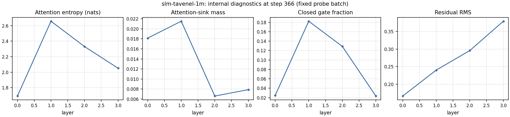

---
language:
- en
- fr
license: mit
library_name: transformers
pipeline_tag: text-generation
datasets:
- PleIAs/French-Science-Commons
tags:
- slm-tavenel
- research-artifact
- experimental
- base-model
- open-weights
model-index:
- name: slm-tavenel-1m
  results:
  - task: {type: multiple-choice, name: "Multiple choice (0-shot, log-likelihood)"}
    dataset: {name: ARC-Easy, type: allenai/ai2_arc, config: ARC-Easy, split: test, revision: 210d026faf9955653af8916fad021475a3f00453}
    metrics: [{type: accuracy, value: 0.280, name: accuracy (SLM-Tavenel evaluator)}]
    source: {name: SLM-Tavenel EXP-0010 benchmark comparisons, url: "https://huggingface.co/athenista/slm-tavenel-1m/blob/main/training_record/benchmark-comparisons.json"}
  - task: {type: multiple-choice, name: "Multiple choice (0-shot, log-likelihood)"}
    dataset: {name: ARC-Challenge, type: allenai/ai2_arc, config: ARC-Challenge, split: test, revision: 210d026faf9955653af8916fad021475a3f00453}
    metrics: [{type: accuracy, value: 0.196, name: accuracy (SLM-Tavenel evaluator)}]
    source: {name: SLM-Tavenel EXP-0010 benchmark comparisons, url: "https://huggingface.co/athenista/slm-tavenel-1m/blob/main/training_record/benchmark-comparisons.json"}
  - task: {type: multiple-choice, name: "Multiple choice (0-shot, log-likelihood)"}
    dataset: {name: HellaSwag, type: Rowan/hellaswag, split: validation, revision: 218ec52e09a7e7462a5400043bb9a69a41d06b76}
    metrics: [{type: accuracy, value: 0.259, name: accuracy (SLM-Tavenel evaluator)}]
    source: {name: SLM-Tavenel EXP-0010 benchmark comparisons, url: "https://huggingface.co/athenista/slm-tavenel-1m/blob/main/training_record/benchmark-comparisons.json"}
  - task: {type: multiple-choice, name: "Multiple choice (0-shot, log-likelihood)"}
    dataset: {name: Belebele (English), type: facebook/belebele, config: eng_Latn, split: test, revision: 7899cdfa4e1e0d733fd77c848e2c273cb1d32be2}
    metrics: [{type: accuracy, value: 0.264, name: accuracy (SLM-Tavenel evaluator)}]
    source: {name: SLM-Tavenel EXP-0010 benchmark comparisons, url: "https://huggingface.co/athenista/slm-tavenel-1m/blob/main/training_record/benchmark-comparisons.json"}
  - task: {type: multiple-choice, name: "Multiple choice (0-shot, log-likelihood)"}
    dataset: {name: Belebele (French), type: facebook/belebele, config: fra_Latn, split: test, revision: 7899cdfa4e1e0d733fd77c848e2c273cb1d32be2}
    metrics: [{type: accuracy, value: 0.266, name: accuracy (SLM-Tavenel evaluator)}]
    source: {name: SLM-Tavenel EXP-0010 benchmark comparisons, url: "https://huggingface.co/athenista/slm-tavenel-1m/blob/main/training_record/benchmark-comparisons.json"}
  - task: {type: multiple-choice, name: "Multiple choice (0-shot, log-likelihood)"}
    dataset: {name: "WinoGrande (XL, validation)", type: allenai/winogrande, config: winogrande_xl, split: validation, revision: 546d5aa0e42fc0fa9ad2c13260322ec969e083ee}
    metrics: [{type: accuracy, value: 0.493, name: accuracy (SLM-Tavenel evaluator)}]
    source: {name: SLM-Tavenel EXP-0010 benchmark comparisons, url: "https://huggingface.co/athenista/slm-tavenel-1m/blob/main/training_record/benchmark-comparisons.json"}
---

# SLM-Tavenel 1M

**Experimental English/French base model (1.18M parameters), trained from scratch** on a CC0 subset of
French-Science-Commons, released with a preregistered ten-seed study of its head-wise attention gate.
Not instruction tuned; not a chat assistant. Project self-assessment: the package meets the core
requirements of the Open Source AI Definition 1.0 under MIT terms for weights, code and Data Information
(`training_record/OSAID-1.0-SELF-ASSESSMENT.md`); this is not OSI certification. Source-license metadata
and privacy limitations are disclosed below.

| At a glance | |
|---|---|
| Parameters | 1,181,920 (ungated control: 1,180,768) |
| Architecture | Decoder-only transformer, 4 layers, width 96, 3 query / 1 key-value heads, SwiGLU 256, head-wise attention gate |
| Tokenizer | Project byte-level BPE, 8,192 tokens (tokenizers 0.22.2) |
| Context window | 1,024 tokens |
| Training precision | bfloat16 mixed precision, deterministic algorithms |
| Published weights | `model.safetensors`, float32 (SHA-256 `b2ef1606…`); all 20 study runs under `training_record/replicates/`; bfloat16 copy staged in `variants/bf16/` |
| Training data | 1,229 CC0-labelled French-Science-Commons documents (748 EN, 481 FR); 15.98M training-token positions (~one pass) |
| Optimizer / seed | AdamW; release seed 421101, preselected in the protocol |
| Compute | One RTX 4060 Laptop GPU (8 GB); ~0.06 GPU-hours for the released run (20 runs in the study); energy not measured |
| License | MIT (weights, code, Data Information) |
| Hub revision described | `33ddccd588a693efeaceae9ae239fa0fbd0c94b6` (weights identical at later revisions) |

## Contents

[Main result](#main-result) · [Benchmarks](#benchmarks) · [Local inference](#local-inference) ·
[Use](#use) · [Architecture](#architecture) · [Training](#training) ·
[Traceability and explainability](#traceability-and-explainability) ·
[Intended use and safety](#intended-use-out-of-scope-use-and-safety) · [Data, licenses and privacy](#data-licenses-and-privacy) ·
[Limitations](#limitations) · [License and citation](#license-and-citation) · [Model family](#the-slm-tavenel-family)

## Main result

Across ten paired seeds, the gated model reduced held-out bits per byte by **0.0275** relative to a
matched ungated model (hierarchical bootstrap 95% interval **[0.0168, 0.0395]**; predeclared practical
threshold 0.01 BPB). The primary metric is the equal-language macro-average of English and French BPB
on a document-disjoint test set; the effect is ungated minus gated BPB, so a positive value favors the
gate; the interval resamples paired seeds and test documents within language. The finding applies to
this corpus, tokenizer and one-pass budget only.

[](exp0010-paired-seed-effects.svg)

*Per-seed effects and the pooled interval. Per-seed values, document-hash-level scores and the locked
analysis: `training_record/sealed-test-bpb-results.json`.*

## Benchmarks

**Protocol.** Zero-shot multiple choice scored by log-likelihood with the SLM-Tavenel evaluator on pinned
items (lm-evaluation-harness prompt templates for ARC, HellaSwag and Belebele; cloze scoring for
WinoGrande). Post-hoc and descriptive: no family-wise correction. Paired item-bootstrap differences
against the 10M and four public references: `training_record/benchmark-comparisons.json`.

| Model | Parameters | ARC-Easy | ARC-Challenge | HellaSwag | Belebele EN | Belebele FR | WinoGrande | Six-task mean |
|---|---:|---:|---:|---:|---:|---:|---:|---:|
| SLM-Tavenel 1M | 1.18M | 0.280 | 0.196 | 0.259 | 0.264 | 0.266 | 0.493 | 0.293 |
| SLM-Tavenel 10M | 9.98M | 0.306 | 0.184 | 0.275 | 0.296 | 0.319 | 0.511 | 0.315 |
| SLM-Tavenel 25M | 25.7M | 0.319 | 0.180 | 0.273 | 0.283 | 0.309 | 0.519 | 0.314 |
| SLM-Tavenel 25M HPLT 10% | 25.7M | 0.319 | 0.187 | 0.274 | 0.279 | 0.308 | 0.517 | 0.314 |
| SLM-Tavenel 124M | 124M | 0.484 | 0.206 | 0.277 | 0.316 | 0.311 | 0.519 | 0.352 |
| [TinyStories tiny1m](https://huggingface.co/shibatch/tiny1m) | 0.94M | 0.256 | 0.189 | 0.260 | 0.274 | 0.290 | 0.518 | 0.298 |
| [Pythia-14M](https://huggingface.co/EleutherAI/pythia-14m) | 14.1M | 0.330 | 0.161 | 0.262 | 0.256 | 0.309 | 0.520 | 0.306 |
| [Pythia-70M](https://huggingface.co/EleutherAI/pythia-70m) | 70M | 0.317 | 0.194 | 0.268 | 0.282 | 0.306 | 0.487 | 0.309 |
| [GPT-2 Small](https://huggingface.co/openai-community/gpt2) | 124M | 0.447 | 0.185 | 0.292 | 0.310 | 0.318 | 0.517 | 0.345 |
| [Pythia-160M](https://huggingface.co/EleutherAI/pythia-160m) | 160M | 0.386 | 0.187 | 0.285 | 0.288 | 0.309 | 0.493 | 0.324 |
| [SmolLM2-135M](https://huggingface.co/HuggingFaceTB/SmolLM2-135M) | 135M | 0.643 | 0.278 | 0.356 | 0.358 | 0.314 | 0.530 | 0.413 |
| Items | | 2,376 | 1,172 | 10,042 | 900 | 900 | 1,267 | |
| 95% binomial half-width (typical) | | ±0.019 | ±0.022 | ±0.009 | ±0.030 | ±0.030 | ±0.028 | |
| Chance | | 0.25 | 0.25 | 0.25 | 0.25 | 0.25 | 0.50 | |

Raw zero-shot accuracy, all rows scored by the SLM-Tavenel log-likelihood evaluator on the same pinned
items (ARC `allenai/ai2_arc@210d026f`, HellaSwag `Rowan/hellaswag@218ec52e` validation, Belebele
`facebook/belebele@7899cdfa`, WinoGrande XL `allenai/winogrande@546d5aa0` validation). Half-widths are
item-sampling intervals for one checkpoint; they do not include training-seed variation, and paired
intervals (in each card) are the right tool for comparing two models on the same items. The models
differ in data, tokenizer, training budget and possible benchmark exposure: this table describes
checkpoints, it is not a ranking of recipes.

[](exp0010-benchmark-comparison.svg)

## Local inference

<!-- generated:inference -->
<!-- /generated:inference -->

## Use

```bash
pip install -r requirements.txt   # versions recorded with this package
```

```python
from transformers import AutoModelForCausalLM, AutoTokenizer

model_id = "athenista/slm-tavenel-1m"
revision = "33ddccd588a693efeaceae9ae239fa0fbd0c94b6"
tokenizer = AutoTokenizer.from_pretrained(model_id, revision=revision, trust_remote_code=True)
model = AutoModelForCausalLM.from_pretrained(model_id, revision=revision, trust_remote_code=True)
inputs = tokenizer("La recherche scientifique", return_tensors="pt")
outputs = model.generate(**inputs, max_new_tokens=48, do_sample=False)
print(tokenizer.decode(outputs[0], skip_special_tokens=True))
```

`trust_remote_code=True` is required (custom architecture; `hf_model.py`, `hf_config.py`; read it
before running). Generation uses a KV cache (added 2026-11-06, verified token-identical to the original cache-free code); pass use_cache=False to recompute the full prefix.

## Architecture

[](architecture.svg)

Four pre-RMSNorm decoder blocks with grouped-query causal attention, QK normalization, RoPE, a head-wise
sigmoid gate on attention outputs and a SwiGLU feed-forward sublayer, with residual connections.

## Training

| Setting | Value |
|---|---|
| Design | Ten paired seeds: gated vs ungated, identical initial tensors except gate parameters, identical seed-indexed batches |
| Optimizer | AdamW, β = (0.9, 0.95), weight decay 0.1, gradient clipping 1.0 |
| Schedule | Warmup–stable–decay: 48 warmup steps, peak 3e-3, final 20% decay to 3e-4 |
| Batch | 16 sequences × 1,024 tokens × 2 accumulation steps = 32,768 token positions per step |
| Steps / tokens | 488 steps, 15,990,784 token presentations |
| Precision | bfloat16 autocast, deterministic algorithms |
| Code revision | `02396acd15ef9bcdc453bcd53aade40819e2f69f`, clean worktree |
| Hardware | 1 × NVIDIA GeForce RTX 4060 Laptop GPU (8 GB), peak allocated 1.9 GB |
| Software | Python 3.11.9, PyTorch 2.10.0+cu130, CUDA 13.0, tokenizers 0.22.2 |
| Compute | ~0.06 GPU-hours for the released run, summed from the logged throughput (the 20-run study is about 20 times that) |
| Energy / emissions | **Not measured** for this run (no power log was recorded); not estimated here. Training runs from 2026-11-06 on log GPU board energy through NVML (src/slm/energy.py) |

[](exp0010-training-curves.svg)

## Traceability and explainability

**Traceability.** The bundle includes a record-level manifest (source IDs and URIs, titles, declared
authors, publication dates, DOI where supplied, declared license labels, language, split, pre/post-
processing text hashes), the source revision, HAL snapshot, filtering decisions, pipeline configuration,
split and tokenizer manifests, privacy-screen report, processing scripts and `provenance.json`. The data
pipeline ran in a dirty worktree; it was replayed from the recorded inputs into a scratch directory and
the retained-document file, decisions and statistics matched the original hashes exactly (replay
configuration, manifest and comparison report included). The training runs used a clean commit.

**Explainability (observability, not causal explanation).** Each run's
`training_record/replicates/<seed>/<arm>/observability.jsonl` records, on a fixed probe batch,
attention-sink mass, attention entropy, residual statistics, gate values, per-layer weight norms and
update ratios. The released gated run's last record:

[](slm-tavenel-1m-observability.svg)

The gated/ungated pairs make a controlled comparison of these diagnostics possible (same data,
initialization and steps). They are measurements, not explanations of particular outputs, and were not
validated by interventions.

## Intended use, out-of-scope use and safety

- **Intended**: research and teaching on small-model training, reproducibility, controlled architecture
  comparisons and observable optimization behavior.
- **Out of scope**: chat or assistant use, factual or scientific advice, decisions about people, any
  consequential use.
- **Safety evaluation**: **none was performed** (no toxicity, bias, privacy-leakage or red-team
  evaluation). No instruction, preference or safety tuning; continuations can be inaccurate, biased,
  private or otherwise unsuitable without review.

## Data, licenses and privacy

Source: the `french_open_science` subset of
[PleIAs/French-Science-Commons](https://huggingface.co/datasets/PleIAs/French-Science-Commons), revision
`bfa114c09d7c28dcd0a8a47fe445c64b4a3c6156`. Of 3,483 English/French records labelled CC0, a paginated HAL
audit (2026-10-22) found 3,450 whose `licence_s` main-file license and all reported `fileLicenses_s`
document-file licenses were CC0 across returned versions; 33 were excluded for missing, conflicting or
non-CC0 HAL records. The filters retained 1,229 documents (748 English, 481 French). Training split
15,976,924 tokens; development 931,435; document-held-out test 2,032,436 (69 English and 47 French
documents, text not included). The audit establishes metadata agreement, not depositor authority or
publisher permission ([HAL licence API announcement](https://www.ccsd.cnrs.fr/en/2026/02/no-hal-deposit-without-licence-the-essential-information-you-need-to-know/);
[audit note](training_record/hal-file-license-audit-2026-10-22.md)).

The pipeline redacted 2,579 email-shaped strings, 158 phone-shaped strings and three IP-pattern matches,
and excluded five documents with residual email-shaped strings and two with replacement characters. The
retained text had zero matches for the configured residual scan patterns; a deterministic screen
reviewed 10 short excerpts per language. These are limited checks, not proof that the corpus contains no
personal or sensitive information.

[](exp0010-data-splits.svg)

## Limitations

- Very small model, about one pass over 15.98M token positions of one science corpus: no broad language
  ability or general scientific competence.
- The primary experiment is a narrow gate-versus-no-gate comparison; it does not test general quality or
  explain internal behavior causally.
- Benchmark scores are post-hoc and descriptive; item intervals do not measure seed variation.
- CC0 labels cannot verify submitter authority; source-rights review and manual privacy attestation are
  unsigned.
- Quantized variants are limited to bfloat16 weights and CPU int8 dynamic quantization (see Local inference); no 4-bit or GGUF version.

## License and citation

Weights, inference implementation, training code and Data Information: MIT. The MIT notices do not
relicense source articles or guarantee the absence of third-party claims. Cite the SLM-Tavenel
repository, Hub revision `33ddccd588a693efeaceae9ae239fa0fbd0c94b6`, and `training_record/results-report.md`,
`training_record/protocol.md` and `training_record/replication-driver-record.json`. No paper or DOI is
assigned.

## The SLM-Tavenel family

| Model | Parameters | Data | Relation |
|---|---:|---|---|
| **slm-tavenel-1m** | 1.18M | French-Science-Commons (CC0 subset) | ten-seed gate study |
| [slm-tavenel-10m](https://huggingface.co/athenista/slm-tavenel-10m) | 9.98M | French-Science-Commons | trained from scratch |
| [slm-tavenel-25m](https://huggingface.co/athenista/slm-tavenel-25m) | 25.7M | French-Science-Commons | grown from 10M |
| [slm-tavenel-25m-hplt-10pct](https://huggingface.co/athenista/slm-tavenel-25m-hplt-10pct) | 25.7M | + 10% HPLT | continuation of 25M |
| [slm-tavenel-124m](https://huggingface.co/athenista/slm-tavenel-124m) | 124M | FineWeb-Edu + FineWeb2-HQ | trained from scratch, new tokenizer |
