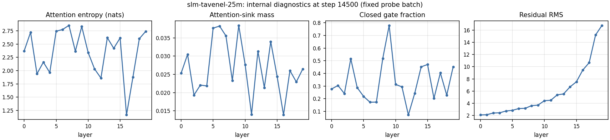

---
language:
- en
- fr
license: mit
library_name: transformers
pipeline_tag: text-generation
datasets:
- PleIAs/French-Science-Commons
tags:
- slm-tavenel
- experimental
- research-artifact
- base-model
- open-weights
model-index:
- name: slm-tavenel-25m
  results:
  - task: {type: multiple-choice, name: "Multiple choice (0-shot, log-likelihood)"}
    dataset: {name: ARC-Easy, type: allenai/ai2_arc, config: ARC-Easy, split: test, revision: 210d026faf9955653af8916fad021475a3f00453}
    metrics: [{type: accuracy, value: 0.319, name: accuracy (SLM-Tavenel evaluator)}]
    source: {name: SLM-Tavenel EXP-0009 grown 25M evaluation, url: "https://huggingface.co/athenista/slm-tavenel-25m/tree/main/training_record"}
  - task: {type: multiple-choice, name: "Multiple choice (0-shot, log-likelihood)"}
    dataset: {name: ARC-Challenge, type: allenai/ai2_arc, config: ARC-Challenge, split: test, revision: 210d026faf9955653af8916fad021475a3f00453}
    metrics: [{type: accuracy, value: 0.180, name: accuracy (SLM-Tavenel evaluator)}]
    source: {name: SLM-Tavenel EXP-0009 grown 25M evaluation, url: "https://huggingface.co/athenista/slm-tavenel-25m/tree/main/training_record"}
  - task: {type: multiple-choice, name: "Multiple choice (0-shot, log-likelihood)"}
    dataset: {name: HellaSwag, type: Rowan/hellaswag, split: validation, revision: 218ec52e09a7e7462a5400043bb9a69a41d06b76}
    metrics: [{type: accuracy, value: 0.273, name: accuracy (SLM-Tavenel evaluator)}]
    source: {name: SLM-Tavenel EXP-0009 grown 25M evaluation, url: "https://huggingface.co/athenista/slm-tavenel-25m/tree/main/training_record"}
  - task: {type: multiple-choice, name: "Multiple choice (0-shot, log-likelihood)"}
    dataset: {name: Belebele (English), type: facebook/belebele, config: eng_Latn, split: test, revision: 7899cdfa4e1e0d733fd77c848e2c273cb1d32be2}
    metrics: [{type: accuracy, value: 0.283, name: accuracy (SLM-Tavenel evaluator)}]
    source: {name: SLM-Tavenel EXP-0009 grown 25M evaluation, url: "https://huggingface.co/athenista/slm-tavenel-25m/tree/main/training_record"}
  - task: {type: multiple-choice, name: "Multiple choice (0-shot, log-likelihood)"}
    dataset: {name: Belebele (French), type: facebook/belebele, config: fra_Latn, split: test, revision: 7899cdfa4e1e0d733fd77c848e2c273cb1d32be2}
    metrics: [{type: accuracy, value: 0.309, name: accuracy (SLM-Tavenel evaluator)}]
    source: {name: SLM-Tavenel EXP-0009 grown 25M evaluation, url: "https://huggingface.co/athenista/slm-tavenel-25m/tree/main/training_record"}
  - task: {type: multiple-choice, name: "Multiple choice (0-shot, log-likelihood)"}
    dataset: {name: "WinoGrande (XL, validation)", type: allenai/winogrande, config: winogrande_xl, split: validation, revision: 546d5aa0e42fc0fa9ad2c13260322ec969e083ee}
    metrics: [{type: accuracy, value: 0.519, name: accuracy (SLM-Tavenel evaluator)}]
    source: {name: SLM-Tavenel EXP-0009 grown 25M evaluation, url: "https://huggingface.co/athenista/slm-tavenel-25m/tree/main/training_record"}
---

# SLM-Tavenel 25M

**Experimental English/French base model (25.7M parameters), grown from the trained SLM-Tavenel 10M and
trained for 15,000 more steps** on French-Science-Commons. Not instruction tuned; not a chat assistant.
One seed and one initialization path. Weights, code and project-authored Data Information are offered
under MIT; described as an **OSAID 1.0 aligned research artifact by project self-assessment**
(`docs/reviews/OSAID-1.0-EXP0009-25M-ASSESSMENT.md`), which is not OSI certification. Rights and
privacy review gaps for the mixed-license source corpus are disclosed below.

| At a glance | |
|---|---|
| Parameters | 25,723,648 |
| Architecture | Decoder-only transformer, 20 layers, width 256, 4 query / 2 key-value heads, SwiGLU 1,280, head-wise attention gate |
| Tokenizer | Project byte-level BPE, 8,192 tokens |
| Context window | 1,024 tokens |
| Training precision | bfloat16 mixed precision |
| Published weights | `model.safetensors`, float32 (SHA-256 `59c495cb…`); bfloat16 copy staged in ariants/bf16/; CPU int8 recipe in Local inference |
| Initialization | Grown from the trained 10M (depth and feed-forward expansion; new tensors initialized with seed 0) |
| Training data | `PleIAs/French-Science-Commons` (`french_open_science`); 491.52M additional token positions (~983M with the 10M ancestor) |
| Optimizer / seed | AdamW; training seed 1234 |
| Compute | One RTX 4060 Laptop GPU (8 GB), ~5.5 GPU-hours for this stage (plus ~2.5 for the 10M ancestor); energy not measured |
| Final train / validation loss | 2.14016 / 2.21816 |
| Held-out validation BPB, EN / FR | 1.1171 / 1.0367 |
| License | MIT (weights, code, Data Information); source records keep their own terms |
| Hub revision described | `a34c08d1bd4b91a244f170ae26096ff059afc37a` |

## Contents

[Main result](#main-result) · [Benchmarks](#benchmarks) · [Local inference](#local-inference) ·
[Use](#use) · [Architecture](#architecture) · [Training](#training) ·
[Traceability and explainability](#traceability-and-explainability) ·
[Intended use and safety](#intended-use-out-of-scope-use-and-safety) · [Data, licenses and privacy](#data-licenses-and-privacy) ·
[Limitations](#limitations) · [License and citation](#license-and-citation) · [Model family](#the-slm-tavenel-family)

## Main result

Growing the 10M model to 25M and training it further lowers held-out bits per byte on the FSC validation
text in both languages, with intervals well away from zero, but does **not** produce a resolved gain on
the six multiple-choice tasks.

| Paired comparison (10M minus 25M BPB; positive favors 25M) | Documents | Difference | 95% paired document-bootstrap interval |
|---|---:|---:|---:|
| English | 685 | +0.0585 | [+0.0570, +0.0602] |
| French | 678 | +0.0530 | [+0.0520, +0.0540] |
| Equal-language mean | 685 EN; 678 FR | +0.0557 | [+0.0548, +0.0567] |

[](docs/exp0009-25m-bpb-document-bootstrap.svg)

Because the 25M model inherits the trained 10M weights and receives another 491.52M token positions,
this does not isolate parameter count from initialization or extra training.

## Benchmarks

**Protocol.** Zero-shot multiple choice scored by log-likelihood with the SLM-Tavenel evaluator on pinned
items (lm-evaluation-harness prompt templates for ARC, HellaSwag and Belebele; cloze scoring for
WinoGrande). Paired intervals: 95% item bootstrap.

| Model | Parameters | ARC-Easy | ARC-Challenge | HellaSwag | Belebele EN | Belebele FR | WinoGrande | Six-task mean |
|---|---:|---:|---:|---:|---:|---:|---:|---:|
| SLM-Tavenel 1M | 1.18M | 0.280 | 0.196 | 0.259 | 0.264 | 0.266 | 0.493 | 0.293 |
| SLM-Tavenel 10M | 9.98M | 0.306 | 0.184 | 0.275 | 0.296 | 0.319 | 0.511 | 0.315 |
| SLM-Tavenel 25M | 25.7M | 0.319 | 0.180 | 0.273 | 0.283 | 0.309 | 0.519 | 0.314 |
| SLM-Tavenel 25M HPLT 10% | 25.7M | 0.319 | 0.187 | 0.274 | 0.279 | 0.308 | 0.517 | 0.314 |
| SLM-Tavenel 124M | 124M | 0.484 | 0.206 | 0.277 | 0.316 | 0.311 | 0.519 | 0.352 |
| [TinyStories tiny1m](https://huggingface.co/shibatch/tiny1m) | 0.94M | 0.256 | 0.189 | 0.260 | 0.274 | 0.290 | 0.518 | 0.298 |
| [Pythia-14M](https://huggingface.co/EleutherAI/pythia-14m) | 14.1M | 0.330 | 0.161 | 0.262 | 0.256 | 0.309 | 0.520 | 0.306 |
| [Pythia-70M](https://huggingface.co/EleutherAI/pythia-70m) | 70M | 0.317 | 0.194 | 0.268 | 0.282 | 0.306 | 0.487 | 0.309 |
| [GPT-2 Small](https://huggingface.co/openai-community/gpt2) | 124M | 0.447 | 0.185 | 0.292 | 0.310 | 0.318 | 0.517 | 0.345 |
| [Pythia-160M](https://huggingface.co/EleutherAI/pythia-160m) | 160M | 0.386 | 0.187 | 0.285 | 0.288 | 0.309 | 0.493 | 0.324 |
| [SmolLM2-135M](https://huggingface.co/HuggingFaceTB/SmolLM2-135M) | 135M | 0.643 | 0.278 | 0.356 | 0.358 | 0.314 | 0.530 | 0.413 |
| Items | | 2,376 | 1,172 | 10,042 | 900 | 900 | 1,267 | |
| 95% binomial half-width (typical) | | ±0.019 | ±0.022 | ±0.009 | ±0.030 | ±0.030 | ±0.028 | |
| Chance | | 0.25 | 0.25 | 0.25 | 0.25 | 0.25 | 0.50 | |

Raw zero-shot accuracy, all rows scored by the SLM-Tavenel log-likelihood evaluator on the same pinned
items (ARC `allenai/ai2_arc@210d026f`, HellaSwag `Rowan/hellaswag@218ec52e` validation, Belebele
`facebook/belebele@7899cdfa`, WinoGrande XL `allenai/winogrande@546d5aa0` validation). Half-widths are
item-sampling intervals for one checkpoint; they do not include training-seed variation, and paired
intervals (in each card) are the right tool for comparing two models on the same items. The models
differ in data, tokenizer, training budget and possible benchmark exposure: this table describes
checkpoints, it is not a ranking of recipes.

25M minus 10M, paired 95% item-bootstrap intervals (all include zero): ARC-Easy [−0.004, +0.030],
ARC-Challenge [−0.023, +0.015], HellaSwag [−0.006, +0.002], Belebele EN [−0.033, +0.009], Belebele FR
[−0.032, +0.011], WinoGrande [−0.018, +0.032]. Lower BPB measures next-token prediction on this text,
not broad task accuracy.

[](scaling-benchmark-comparison.svg)

## Local inference

<!-- generated:inference -->
<!-- /generated:inference -->

## Use

```bash
pip install -r requirements.txt   # versions recorded with this package
```

```python
from transformers import AutoModelForCausalLM, AutoTokenizer

model_id = "athenista/slm-tavenel-25m"
revision = "a34c08d1bd4b91a244f170ae26096ff059afc37a"
tokenizer = AutoTokenizer.from_pretrained(model_id, revision=revision, trust_remote_code=True)
model = AutoModelForCausalLM.from_pretrained(model_id, revision=revision, trust_remote_code=True)
inputs = tokenizer("La recherche scientifique", return_tensors="pt")
print(tokenizer.decode(model.generate(**inputs, max_new_tokens=48, do_sample=False)[0]))
```

`trust_remote_code=True` is required (custom architecture; `hf_model.py`, `hf_config.py`; read it
before running). Generation uses a KV cache (added 2026-11-06, verified token-identical to the original cache-free code); pass use_cache=False to recompute the full prefix.

## Architecture

[](architecture.svg)

Twenty pre-RMSNorm decoder blocks with grouped-query causal attention, QK normalization, RoPE, a
head-wise sigmoid gate and SwiGLU, with residual connections. Created by expanding the trained 10M model
(`grow_from` in the run manifest), then trained further; not trained from scratch.

## Training

| Setting | Value |
|---|---|
| Initialization | `runs/fsc-scaling/grown/25m-gated-from-10m.pt` (grown from the trained 10M) |
| Optimizer | AdamW, β = (0.9, 0.95), weight decay 0.1, gradient clipping 1.0 |
| Schedule | Warmup–stable–decay: 500 warmup steps, peak 3e-3, final 20% decay to 3e-4 |
| Batch | 16 sequences × 1,024 tokens × 2 accumulation steps = 32,768 token positions per step |
| Steps / tokens | 15,000 steps, 491,520,000 token positions |
| Precision | bfloat16 autocast |
| Hardware | 1 × NVIDIA GeForce RTX 4060 Laptop GPU (8 GB), peak allocated 2.9 GB |
| Software | Python 3.11.9, PyTorch 2.10.0+cu130 |
| Compute | ~5.5 GPU-hours, summed from the logged throughput |
| Energy / emissions | **Not measured** for this run (no power log was recorded); not estimated here. Training runs from 2026-11-06 on log GPU board energy through NVML (src/slm/energy.py) |

The run resumed from checkpoint 3,000 in the recorded environment after a mismatched-runtime attempt was
stopped and archived; recomputed validation at the resume point and the step-3,500 losses matched the
recorded trajectory ([resume diagnostic](docs/reviews/EXP-0009-25M-RESUME-DIAGNOSTIC-2026-10-22.md)).
The configuration is not bitwise deterministic.

## Traceability and explainability

**Traceability.** `training_record/` includes checkpoint provenance, the source manifest, data and token
manifests, training metrics, validation, benchmark outputs, paired item-bootstrap comparisons, model
code, configurations, audit reports and a SHA-256 inventory (`provenance.json`). A full tracked source
snapshot at the recorded Git commit is in `training_record/reproduction_source/`; the original worktree
was dirty, so exact source-state reproduction is not claimed.

**Explainability (observability, not causal explanation).** `training_record/observability.jsonl`
records per-layer attention entropy, attention-sink mass, head-wise gate statistics, residual-stream
norms, weight norms and update ratios on a fixed probe batch. Last record:

[](slm-tavenel-25m-observability.svg)

These are probe-batch measurements, not explanations of particular outputs, and were not validated by
interventions.

## Intended use, out-of-scope use and safety

- **Intended**: research and education on small-model training, model growth, bilingual text modeling,
  reproducibility and observability.
- **Out of scope**: chat or assistant use, factual or scientific advice, decisions about people, any
  consequential use.
- **Safety evaluation**: **none was performed** (no toxicity, bias, privacy-leakage or red-team
  evaluation). No instruction, preference or safety tuning.

## Data, licenses and privacy

Training used the `french_open_science` subset of
[PleIAs/French-Science-Commons](https://huggingface.co/datasets/PleIAs/French-Science-Commons), revision
`bfa114c09d7c28dcd0a8a47fe445c64b4a3c6156`. The retained 31,417-row manifest preserves source
identifiers, source-declared license labels, titles, declared authors, DOI fields and hashes; no source
text is included. A post-training HAL metadata audit found matching main/document-file labels for 31,262
source IDs; 72 explicit mismatches, 3 conflicts, 24 missing file-license fields and 56 not-found IDs
remain unresolved. A targeted recheck on 23 October found no changes. Of 75 DOI-bearing unresolved
records, Crossref metadata included the dataset-declared license URL for 30, listed only a different
license or policy URL for 15, had no license field for 23, and failed for 7. Reports:
`training_record/hal-file-license-audit-2026-10-22.json`,
`training_record/hal-file-license-recheck-2026-10-23.json`,
`training_record/unresolved-crossref-license-discovery-2026-10-23.json`. A conservative screen excludes
all 155 unresolved records from any future release-oriented corpus
(`training_record/conservative-source-exclusions.jsonl`,
[policy](docs/reviews/EXP-0009-CONSERVATIVE-LICENSE-POLICY.md)); this does not remove data from this
already trained checkpoint.

A 23 October screen of the processed corpus found four documents with IPv4-shaped patterns (triaged as
networking teaching/research examples), 54 replacement-character documents and 20,808 records with at
least one broad review signal (`training_record/fsc-v1-privacy-signal-scan-2026-10-23.json`,
[source and privacy review](docs/reviews/EXP-0009-25M-SOURCE-PRIVACY-REVIEW.md),
[rights and privacy triage](docs/reviews/EXP-0009-25M-DEEP-RIGHTS-PRIVACY-TRIAGE-2026-10-23.md)). These
are automated triage results; human source-rights and privacy sign-off remain pending. No rights
clearance or absence-of-memorization claim is made.

## Limitations

- One seed, one growth path; size, initialization and extra training are confounded.
- Benchmark accuracy is close to chance on several tasks; the BPB gain is a text-modeling result.
- Dirty training worktree; not bitwise deterministic; resumed once (documented).
- 155 source records with unresolved license metadata; human privacy review pending.
- Quantized variants are limited to bfloat16 weights and CPU int8 dynamic quantization (see Local inference); no 4-bit or GGUF version.

## License and citation

Weights, inference/training code and project-authored Data Information: MIT. The upstream records keep
their own per-record terms; this package does not relicense them. Cite as **SLM-Tavenel EXP-0009 grown
25M, seed 1234**, Hub revision `a34c08d1bd4b91a244f170ae26096ff059afc37a`, with the checkpoint SHA-256
from `provenance.json`. No paper or DOI is assigned.

## The SLM-Tavenel family

| Model | Parameters | Data | Relation |
|---|---:|---|---|
| [slm-tavenel-1m](https://huggingface.co/athenista/slm-tavenel-1m) | 1.18M | French-Science-Commons (CC0 subset) | ten-seed gate study |
| [slm-tavenel-10m](https://huggingface.co/athenista/slm-tavenel-10m) | 9.98M | French-Science-Commons | parent (grown into this model) |
| **slm-tavenel-25m** | 25.7M | French-Science-Commons | grown from 10M |
| [slm-tavenel-25m-hplt-10pct](https://huggingface.co/athenista/slm-tavenel-25m-hplt-10pct) | 25.7M | + 10% HPLT | continuation of this model (EXP-0032) |
| [slm-tavenel-124m](https://huggingface.co/athenista/slm-tavenel-124m) | 124M | FineWeb-Edu + FineWeb2-HQ | trained from scratch, new tokenizer |
