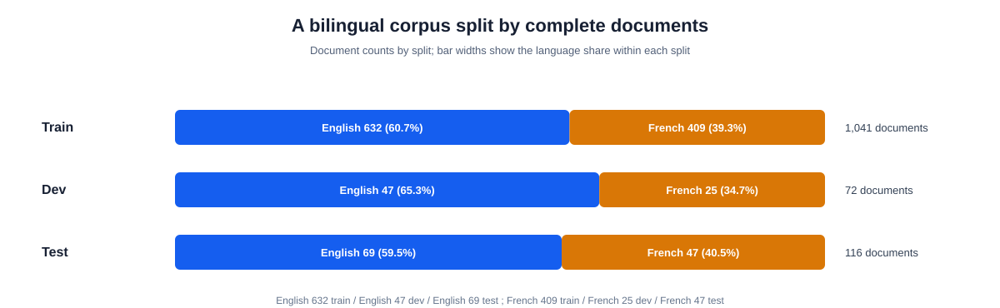
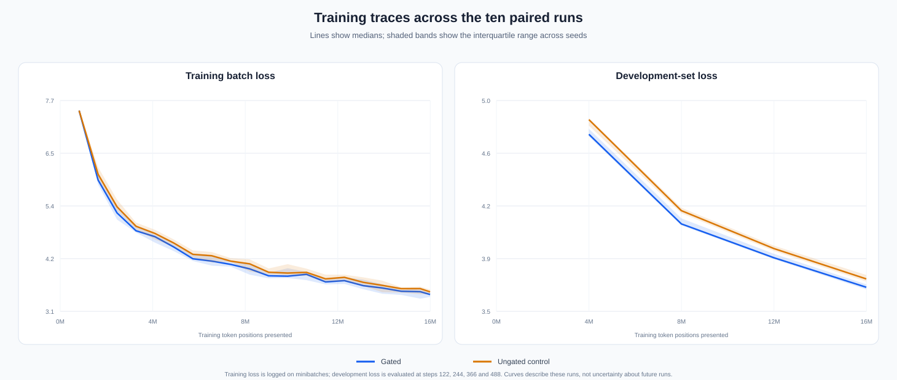
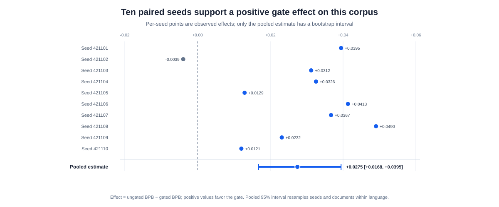
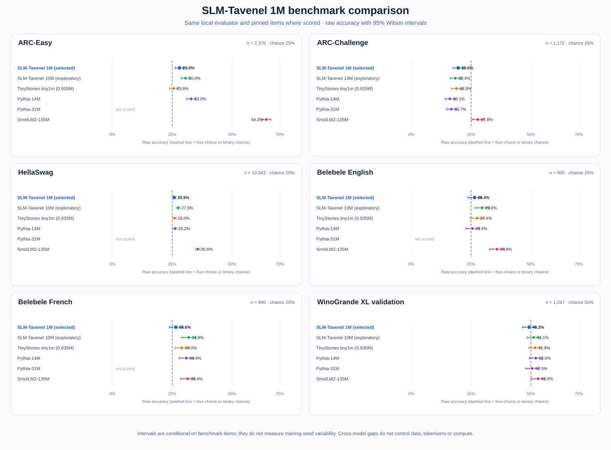

---
language:
- en
- fr
license: mit
library_name: transformers
pipeline_tag: text-generation
datasets:
- PleIAs/French-Science-Commons
tags:
- research-artifact
- experimental
- base-model
- open-weights
---

# SLM-Tavenel 1M — EXP-0010 research model

> **Experimental base model.** Project self-assessment: the public package meets the core requirements of Open Source AI Definition 1.0 under MIT terms for weights, code and Data Information. This is not OSI certification. Source license metadata and privacy limitations are disclosed separately. The model has not been instruction tuned. Published at https://huggingface.co/athenista/slm-tavenel-1m-exp0010 (revision `3bb07398ec8105d9625cf8e346425b9987c65c48`).

## Contents

- [Summary and intended use](#summary-and-intended-use)
- [Limitations](#limitations)
- [Use the model](#use-the-model)
- [Training data and provenance](#training-data-and-provenance)
- [Training and observability](#training-and-observability)
- [Evaluation](#evaluation)
- [Licensing and release status](#licensing-and-release-status)
- [Citation](#citation)

## Summary and intended use

SLM-Tavenel is a decoder-only English/French base language model trained from scratch on a filtered science-text corpus. This selected checkpoint has 1,181,920 parameters, a 1,024-token context and an 8,192-token byte-level BPE vocabulary. The architecture uses four layers, grouped-query attention, QK normalization, SwiGLU, RoPE and a head-wise attention gate. It is intended for research on small-model training, reproducibility and observable optimization behavior. It is not a conversational assistant.

The release checkpoint is gated seed `421101`. The protocol selected that seed before results were observed. The experiment trained ten paired gated/ungated seed pairs from matching shared initial weights and data order; only the preselected gated checkpoint is presented as the primary model. The final model weights for all twenty runs and their run records are included as float32 safetensors under `training_record/replicates/` so the paired study can be inspected. The original `.pt` checkpoint files and optimizer states are not included.

## Limitations

- This model is very small and trained for approximately one pass over 15.98 million training-token positions from one English/French science corpus. It does not establish broad language ability or general scientific competence.
- It is a base model without instruction, preference or safety tuning. Its continuations can be inaccurate, biased, private or otherwise unsuitable for use without review.
- The primary experiment concerns a narrow gate-versus-no-gate comparison on a small document-held-out test. It does not test general model quality or establish a causal explanation of internal behavior.
- Benchmark scores below are post-hoc, descriptive checkpoint results. Error bars over questions do not measure training-seed variation. External models have different training data, tokenizers, compute budgets and possible benchmark exposure; no superiority claim follows.
- Dataset and HAL records report CC0 for the selected rows, but the metadata audit cannot verify submitter authority. Source-rights review and manual privacy attestation are unsigned. Automated scans and a twenty-excerpt screen are limited checks, not proof that every document or model output is free of personal or sensitive information.

## Use the model

The custom Transformers implementation uses `trust_remote_code=True` and does not implement a KV cache. Pin a Hub commit after the first upload to make loading reproducible.

```bash
pip install -r requirements.txt
```

```python
from transformers import AutoModelForCausalLM, AutoTokenizer

model_id = "athenista/slm-tavenel-1m-exp0010"
revision = "REPLACE_WITH_IMMUTABLE_HUB_COMMIT"
tokenizer = AutoTokenizer.from_pretrained(
    model_id, revision=revision, trust_remote_code=True
)
model = AutoModelForCausalLM.from_pretrained(
    model_id, revision=revision, trust_remote_code=True
)

prompt = "La recherche scientifique"
inputs = tokenizer(prompt, return_tensors="pt")
outputs = model.generate(**inputs, max_new_tokens=48, do_sample=False)
print(tokenizer.decode(outputs[0], skip_special_tokens=True))
```

## Training data and provenance

The source is the `french_open_science` subset of [PleIAs/French-Science-Commons](https://huggingface.co/datasets/PleIAs/French-Science-Commons), pinned at revision `bfa114c09d7c28dcd0a8a47fe445c64b4a3c6156`. Of 3,483 English/French dataset records labeled CC0, a paginated HAL audit dated 2026-10-22 found 3,450 whose `licence_s` main-file license and all reported `fileLicenses_s` Document-file licenses were CC0 across returned versions; 33 records were excluded for missing, conflicting or non-CC0 HAL records. The filters retained 1,229 documents: 748 English and 481 French. The training split contains 15,976,924 tokens; development 931,435; document-held-out test 2,032,436 across 69 English and 47 French documents. The test text is not included in the artifact. HAL documents the file-level fields in its [licence API announcement](https://www.ccsd.cnrs.fr/en/2026/02/no-hal-deposit-without-licence-the-essential-information-you-need-to-know/). The audit establishes metadata agreement, not depositor authority or publisher permission.

The pipeline redacted 2,579 email-shaped strings, 158 phone-shaped strings and three IP-pattern matches; it excluded five documents with residual email-shaped strings and two with replacement characters. The retained text had zero matches for the configured residual scan patterns, and a deterministic screen reviewed 10 short excerpts per language. These automated and sampled checks are limited; they do not establish that the corpus contains no personal or sensitive information.



The bundle includes a record-level manifest with source IDs and URIs, source titles, declared authors, publication dates, DOI where supplied, declared license labels, language, split and pre/post-processing text hashes; it also includes the source revision, HAL snapshot, filtering decisions, pipeline configuration, split/tokenizer manifests, privacy-screen report and processing scripts. Source article text is omitted. All 1,229 retained rows have a non-empty upstream author field; 380 provide a DOI. These are source-supplied metadata fields, not independent verification of author identity or rights authority. No author identity is inferred, and missing DOI values are left blank. See the [source and privacy review dossier](../reviews/EXP-0010-SOURCE-PRIVACY-REVIEW.md) for the audited scope and remaining human decisions.

The processed-data manifest records that the repository worktree was dirty when the dataset pipeline ran. Before packaging, the pipeline was replayed from the recorded inputs and configuration into a separate scratch directory; the retained-document file, filtering-decision file and summary statistics matched the original hashes exactly. The replay configuration, manifest and comparison report are included. The original dirty-worktree marker remains visible. The ten model-training pairs ran from the recorded clean code commit.

## Training and observability

The ten paired seed pairs used 488 AdamW steps at 32,768 token positions per step (15,990,784 presentations), bfloat16 training and deterministic algorithms. Gated and ungated models shared all initial tensors except the gate-specific parameters and consumed the same seed-indexed batches. The selected model has 1,181,920 parameters; the ungated control has 1,180,768.

| Run detail | Value |
|---|---|
| Selected seed | 421101, preselected in the protocol |
| Code revision | `02396acd15ef9bcdc453bcd53aade40819e2f69f`, clean worktree |
| Hardware | NVIDIA GeForce RTX 4060 Laptop GPU, 8 GB |
| Python / PyTorch / CUDA | 3.11.9 / 2.10.0+cu130 / 13.0
| Tokenizer | tokenizers 0.22.2; 8,192-token vocabulary |

Per-step training and development losses, gradient and optimizer metrics, fixed-probe attention sink mass, attention entropy, residual statistics, gate values, per-layer weight norms and update ratios are recorded in `training_record/replicates/`. These are observability diagnostics; they do not by themselves explain why the model produces a particular output.



## Evaluation

### Predeclared primary outcome

The primary metric is the equal-language macro-average of English and French bits per byte on the document-disjoint text test. The paired effect is **ungated BPB minus gated BPB**, so a positive value favors the gate. The practical threshold was +0.01 BPB; the 95% interval resamples paired seeds and test documents within language.

Across ten paired seeds, the estimated effect was **+0.0275 BPB** (hierarchical bootstrap 95% interval **[+0.0168, +0.0395]**). The predeclared +0.01 BPB practical threshold is supported for this corpus, tokenizer and one-pass budget only.



This is evidence about a specific architecture, corpus, tokenizer and one-pass budget. It does not show that the selected checkpoint is a generally capable model or that the gate explains model behavior. Per-seed effects, document-hash-level scores and the locked analysis are in `training_record/sealed-test-bpb-results.json`.

### Same-harness multiple-choice benchmarks

Raw accuracy on identical pinned benchmark files where the checkpoint was scored, using the repository's local log-likelihood evaluator. Pythia-31M has scores for ARC-Challenge and WinoGrande only; the other entries are explicitly marked “not scored”. Chance is 25% for ARC and Belebele four-choice items, approximately 25% for HellaSwag, and 50% for binary WinoGrande. These are exploratory post-hoc results; no family-wise correction is applied to the paired intervals.

Item counts: ARC-Easy 2,376, ARC-Challenge 1,172, HellaSwag 10,042, Belebele EN 900, Belebele FR 900, WinoGrande XL validation 1,267.


| Model | Parameters | ARC-Easy | ARC-Challenge | HellaSwag | Belebele EN | Belebele FR | WinoGrande |
|---|---:|---:|---:|---:|---:|---:|---:|
| SLM-Tavenel 1M (selected candidate) | 1.18M | 0.280 | 0.196 | 0.259 | 0.264 | 0.266 | 0.493 |
| SLM-Tavenel 10M FSC pilot | 9.98M | 0.306 | 0.184 | 0.275 | 0.296 | 0.319 | 0.511 |
| [TinyStories tiny1m](https://huggingface.co/shibatch/tiny1m) | 0.935M | 0.256 | 0.189 | 0.260 | 0.274 | 0.290 | 0.518 |
| [Pythia-14M](https://huggingface.co/EleutherAI/pythia-14m) | 14.1M | 0.330 | 0.161 | 0.262 | 0.256 | 0.309 | 0.520 |
| [Pythia-31M](https://huggingface.co/EleutherAI/pythia-31m) | 30.5M | not scored | 0.167 | not scored | not scored | not scored | 0.505 |
| [SmolLM2-135M](https://huggingface.co/HuggingFaceTB/SmolLM2-135M) | 135M | 0.643 | 0.278 | 0.356 | 0.358 | 0.314 | 0.530 |



Paired item-bootstrap differences against the exploratory SLM-Tavenel 10M checkpoint and four public references are recorded in `training_record/benchmark-comparisons.json`. This comparison shows only one SLM-Tavenel 1M: the selected candidate described above. Pythia-31M was scored only on ARC-Challenge and WinoGrande XL validation; the other cells are marked “not scored” and are absent from the chart. Comparisons are conditional on these checkpoints and question samples, not on repeated training seeds. Exact-overlap filtering only addresses matches detectable by the recorded filters; external pretraining exposure is unknown.

The benchmark files are not redistributed in this model bundle. Their paths, item counts and SHA-256 digests are included in the score records. Reference model IDs and immutable revisions are in the included raw evaluation records.

## Licensing and release status

The selected weights, inference implementation, training code and Data Information are offered under MIT, an OSI-approved license. The project self-assesses the prepared package against the core OSAID 1.0 requirements; see `training_record/OSAID-1.0-SELF-ASSESSMENT.md`. This is not OSI certification or endorsement. The training dataset and HAL metadata report CC0 for selected source records, but the audit does not independently verify each submitter's authority. That provenance limitation is disclosed; it is separate from the terms and artifact requirements in the OSAID. The MIT notices do not relicense source articles or guarantee the absence of third-party claims. Source and privacy review status is described in the [data card](slm-tavenel-1m-exp0010-data-card.md).

This candidate package was prepared locally for the target Hub ID `athenista/slm-tavenel-1m-exp0010`; as of 2026-10-22 it had not been uploaded. No paper or DOI has been assigned.

## Citation

If you use the artifact, cite the SLM-Tavenel repository, the immutable Hub revision once one exists, and the shipped `training_record/results-report.md`, `training_record/protocol.md` and `training_record/replication-driver-record.json`. There is no peer-reviewed paper or DOI for this experiment.
