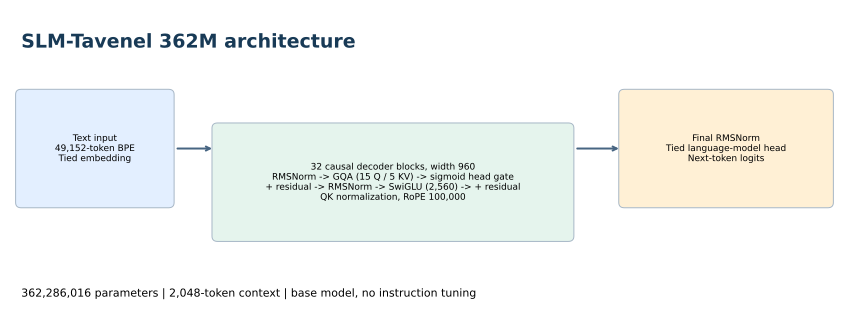
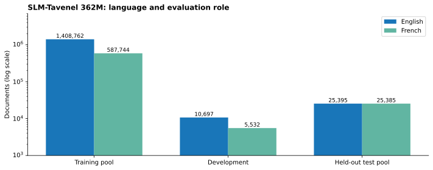
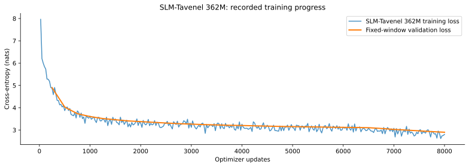
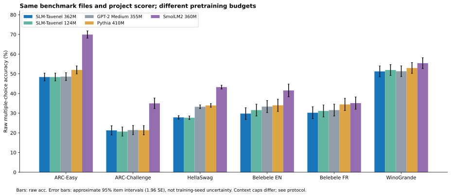

---
language:
- en
- fr
license: mit
library_name: transformers
pipeline_tag: text-generation
datasets:
- HuggingFaceFW/fineweb-edu
- epfml/FineWeb2-HQ
tags:
- slm-tavenel
- base-model
- research
- custom_code
- muon
- gated-attention
model-index:
- name: SLM-Tavenel 362M
  results:
  - task:
      type: multiple-choice
      name: ARC-Easy, project raw-accuracy protocol
    dataset:
      type: allenai/ai2_arc
      name: ARC-Easy test, 2376 items
      config: ARC-Easy
      split: test
      revision: 210d026faf9955653af8916fad021475a3f00453
    metrics:
    - type: accuracy
      name: Raw acc, not length-normalized
      value: 0.48358585858585856
---

# SLM-Tavenel 362M

**A 362,286,016-parameter English/French base language model trained from scratch on educational web text, on a single laptop GPU.** This is a research preview, not an instruction-tuned assistant. It predicts continuations and can produce incorrect, repetitive or harmful text.

The checkpoint completes 8,000 updates and **524,288,000 presented training-token positions**. Relative to SLM-Tavenel 124M, it improves held-out educational-text prediction slightly, but **does not improve the six-task benchmark mean**. We publish the negative result, the training record and export checks alongside the weights.

[Source code](https://github.com/thekester/slm-tavenel) | [Experiment and discussion](https://github.com/thekester/slm-tavenel/blob/v0.1.0-dev.42/experiments/EXP-0034-classic-360m-edu-distill-2026-10-29.md) | [Verification](verification.json) | [Provenance](provenance.json) | [Evaluation evidence](evaluation/summary.json)

## Architecture



*Figure 1. SLM-Tavenel 362M is an independent, from-scratch causal decoder. It was not grown from the 124M checkpoint and does not inherit SmolLM2 model weights.*

| Component | Value |
|---|---|
| Parameters | 362,286,016 total; 315,100,096 outside the tied token embedding |
| Blocks / width | 32 / 960 |
| Attention | Grouped-query attention: 15 query heads, 5 key/value heads; head dimension 64 |
| Attention gate | One input-dependent sigmoid output gate per query head |
| Normalization | Pre-RMSNorm, epsilon 1e-6; query/key RMS normalization |
| Feed-forward | SwiGLU, hidden width 2,560; bias-free projections |
| Positions | RoPE, theta 100,000; full causal attention |
| Context | 2,048 tokens, also the training window; no validated longer-context capability |
| Tokenizer | SmolLM2 49,152-token BPE; existing EOS ID 0 also used as PAD alias |
| Embedding / output head | Shared weights |
| Release precision | Float32 safetensors; checkpoint values preserved as in the native CPU evaluator |
| Training precision | bfloat16 device weights; float32 optimizer master weights and states on host |
| Quantization | No quantized artifact or quantization-quality validation provided |

The tokenizer is pinned to [`HuggingFaceTB/SmolLM2-360M@f8027fd0eaeea54caa13c31d31b9fdc459c38b49`](https://huggingface.co/HuggingFaceTB/SmolLM2-360M/tree/f8027fd0eaeea54caa13c31d31b9fdc459c38b49). Its vocabulary and token IDs are unchanged. Export metadata sets the context limit, right padding and PAD alias. A tokenizer containing chat markers does not make this checkpoint a chat model.

## Training data and provenance



*Figure 2. Data split by language and evaluation role. Bars count documents in the prepared pools and use a logarithmic axis. Pool size is not the number of unique documents actually sampled during training.*

| Source | Pinned revision | Selected material | Declared compilation terms |
|---|---|---|---|
| [FineWeb-Edu](https://huggingface.co/datasets/HuggingFaceFW/fineweb-edu/tree/87f09149ef4734204d70ed1d046ddc9ca3f2b8f9) | `87f09149ef4734204d70ed1d046ddc9ca3f2b8f9` | First two `sample/10BT` English shards | ODC-By 1.0; Common Crawl terms also apply |
| [FineWeb2-HQ](https://huggingface.co/datasets/epfml/FineWeb2-HQ/tree/c0c06e94fd3a44ae9e802b2b0fc533817601eb5e) | `c0c06e94fd3a44ae9e802b2b0fc533817601eb5e` | First five `fra_Latn` French shards | Declared ODC-By 1.0, inherited from FineWeb-2; Common Crawl terms also apply |

The prepared training pool contains **1,996,506 documents**: 1,408,762 English and 587,744 French. It has 2,139,672,344 encoded tokens. The model samples 524,288,000 token positions, about 24.5% of the pool's token count, through random windows; this does not imply every token in a fixed 24.5% subset was visited once. There is no teacher distillation in this run.

Processing applies length/character filters, regex-based email/phone/IP/IBAN redaction, exact normalized-text deduplication, and removal of exact normalized 13-token benchmark overlaps. The six benchmark files serve **only decontamination and evaluation**, never training. A registrable-domain hash assigns 98% / 1% / 1% of hash buckets to train / development / test; unequal site sizes mean document percentages differ. The held-out test pool has 50,780 documents; BPB below scores a fixed systematic one-in-five subsample of 10,156.

The [corpus manifest](training_record/corpus-manifest.json) records full source revisions, source-shard hashes, filters, counts, benchmark file hashes and output hashes. [Token-shard provenance](training_record/tokens-manifest.json) and pinned upstream cards in `third_party/` are included. Corpus text is not bundled with the model.

**Limits:** exact overlap removal misses paraphrases and translations. Regex redaction does not establish confidentiality. ODC-By describes the compilation and does not independently establish rights to every original web page. Source-rights and manual privacy reviews remain unsigned. This owner-authorized public research release does not claim legal clearance or OSI certification. See [NOTICE](NOTICE.md) and [publication decision](publication-decision.json).

## Training recipe and observability



*Figure 3. Logged training and fixed-window validation loss. If a step was recomputed after resuming, the figure uses its last logged value; the complete logs retain the earlier entries.*

| Setting | Value |
|---|---|
| Training seed | 20261030; one training run |
| Optimizer | Muon for matrix weights, AdamW for other parameters |
| Schedule | WSD, 300 warmup updates; final 20% decay |
| Learning rate / weight decay | 0.002 to 0.0002 / 0.1 |
| Batch | 2 sequences per microbatch, 16 accumulation steps, 2,048 positions per sequence |
| Global positions per update | 65,536; one GPU |
| Updates / presented positions | 8,000 / 524,288,000 |
| Gradient clipping | Global norm 1.0 |
| Memory controls | Activation checkpointing; optimizer master weights/states on CPU |
| Hardware | NVIDIA GeForce RTX 4060 Laptop GPU, 8 GB |
| Last training / validation loss | 2.80386 / 2.90059 nats; different sampled windows, not a benchmark accuracy |
| Logged GPU allocation peak | 3.455 GB; excludes host optimizer memory and non-PyTorch allocations |
| Final logged GPU-board energy counter | 2,885.569 Wh (2.886 kWh); excludes evaluation and whole-system electricity |

The run finished on 15 November 2026 after resuming across shutdowns. Full training configuration, final-resume manifest, per-step loss/gradient/throughput/learning-rate/energy logs and available per-layer observability are in `training_record/`. The counters are operational measurements, not a lifecycle energy or carbon assessment. Recomputed updates or unmetered work may not be fully represented by the final counter.

The manifest preserves the original dirty-worktree/resume metadata. `source_snapshot/` is a **packaging-time snapshot**, not proof of the exact executed code for every historical segment. The GitHub repository includes the trainer and corpus builder with their dependencies. Reproducing this preview requires reacquiring the pinned source shards and rebuilding/verifying the recorded inputs. Neither a clean historical code freeze nor exact training replication is claimed.

## Benchmark results



*Figure 4. Raw multiple-choice accuracy using the project evaluator and pinned benchmark files. Error bars approximate 95% item-sampling intervals; they do not measure training-seed variation. Reference training data, token budgets and context caps differ.*

| Task | Items | SLM-Tavenel 362M | SLM-Tavenel 124M | GPT-2 Medium 355M | Pythia 410M | SmolLM2 360M |
|---|---:|---:|---:|---:|---:|---:|
| ARC-Easy | 2,376 | 0.484 | 0.484 | 0.486 | 0.520 | 0.699 |
| ARC-Challenge | 1,172 | 0.212 | 0.206 | 0.214 | 0.213 | 0.350 |
| HellaSwag | 10,042 | 0.279 | 0.277 | 0.333 | 0.339 | 0.432 |
| Belebele EN | 900 | 0.298 | 0.316 | 0.333 | 0.340 | 0.416 |
| Belebele FR | 900 | 0.302 | 0.311 | 0.316 | 0.344 | 0.351 |
| WinoGrande | 1,267 | 0.512 | 0.519 | 0.513 | 0.530 | 0.554 |
| Equal-task mean | | **0.348** | **0.352** | **0.366** | **0.381** | **0.467** |

These are **raw `acc`** scores, not `acc_norm`. The same local prompts, choice-likelihood scorer and pinned benchmark files are used. The SLM runs have a 2,048-token context cap; the saved external-reference runs have a 1,024-token cap. Thus truncation exposure can differ on longer examples. These are descriptive comparisons with existing pretraining, not matched-data or matched-compute trials, and not directly interchangeable with published leaderboard scores.

The equal-task mean gives every task one-sixth weight. Chance is about 25% on four-choice tasks and 50% on WinoGrande. [Full scores and reference revisions](evaluation/summary.json), compressed item-level predictions (`evaluation/benchmarks.json.gz`) and [paired 124M comparison](evaluation/vs-124m-paired.json) are included. Repeated HellaSwag IDs remain distinct items, paired by position and checked for ID/label alignment.

The 362M minus 124M six-task mean is approximately **-0.004**, with a paired 95% interval spanning zero. Relative to GPT-2 Medium, Pythia 410M and SmolLM2 360M, its mean accuracy is lower. The larger internal model therefore has **no demonstrated downstream-task gain** here. Item bootstraps and McNemar tests do not account for training-seed variability, cross-task dependence or multiple-comparison correction.

On the same 10,156 educational-test documents, aggregate **BPB is 1.0572**, versus **1.0686** for SLM-Tavenel 124M. The paired difference is **-0.01136**, document-bootstrap 95% interval approximately **[-0.01162, -0.01110]**, conditional on the sampled documents and one checkpoint per model. Lower is better. English BPB is 1.0787 versus 1.0894; French is 1.0258 versus 1.0382. [BPB comparison](evaluation/paired-vs-124m.json) and compressed per-document NLL, byte counts and hashes (`evaluation/edu-test-bpb.json.gz`) preserve this in-domain result. The document bootstrap ignores domain clustering. External references were not scored on this split.

The 124M received about 983M token positions versus 524M for the 362M; architecture size and training budget both change. Limited training is a plausible explanation for unused extra capacity, **not a causal finding from a controlled size ablation**. A bigger parameter count alone does not guarantee better accuracy.

## Run locally

```bash
pip install "torch==2.10.0" "transformers==4.57.6" "tokenizers==0.22.2" "safetensors==0.8.0"
```

```python
import torch
from huggingface_hub import model_info
from transformers import AutoModelForCausalLM, AutoTokenizer

model_id = "athenista/slm-tavenel-362m"
revision = model_info(model_id).sha  # Resolve once; record this SHA for reproducibility.
# Review hf_config.py and hf_model.py at this revision before trusting custom code.
tokenizer = AutoTokenizer.from_pretrained(model_id, revision=revision)
model = AutoModelForCausalLM.from_pretrained(
    model_id, revision=revision, trust_remote_code=True, dtype=torch.float32
).eval()
inputs = tokenizer("La recherche scientifique permet de", return_tensors="pt")
with torch.inference_mode():
    output = model.generate(**inputs, max_new_tokens=48, do_sample=False, use_cache=True)
print(tokenizer.decode(output[0], skip_special_tokens=True))
```

This custom implementation supports a KV cache. Use unpadded single prompts or right-padded batches; left-padding behavior is not validated for this release. Keep prompt plus continuation within 2,048 tokens. BF16 on a supported GPU is possible, but this release's local parity and CPU measurements use float32. No quantized backend is supplied.

## Inference measurements and raw examples

The float32 parameter payload alone is approximately **1.45 GB** (1.35 GiB); runtime RAM also includes the framework, activations and KV cache. At 2,048 cached positions and batch size one, float32 key/value tensors account for about **160 MiB**, before other allocations. These are tensor-size calculations, not measured minimum RAM/VRAM requirements. GPU generation performance is not measured in this publication.

On the publication host (Intel Core i7-12650H), the measured median is **6.10 generated tokens/second** in float32. [verification.json](verification.json) records the protocol: six threads, batch one, 128 input tokens, 32 forced generated tokens, greedy decoding with cache, one warmup and three timed repetitions. It includes the environment, durations and median tokens/second. It is a short local throughput measurement, not a serving benchmark or a separately measured first-token latency.

[examples.json](examples.json) contains **all three fixed-probe greedy continuations**, including their token IDs, without selection for quality. Each is capped at 12 new tokens for the cache-parity test. They illustrate raw behavior, not narrative coherence, instruction following or factual reliability. No human ratings have been collected.

All three probe outputs follow, with the prompt in bold. The 12-token cap can cut a word; the first continuation is factually incorrect and the story continuation is repetitive.

> **The scientific method is based on** the idea that the body is composed of a series of cells

> **La recherche scientifique permet de** déterminer les caractéristiques de la v

> **Once upon a time, a fox found a key.** He had a long, long, and long, and long

All exported tensors match the native checkpoint values, the token-ID mapping is unchanged, native/exported logits are checked on fixed probes, and greedy cache-on/cache-off outputs are compared. These checks establish packaging consistency on those probes, not a fresh full benchmark run or complete training replication.

## Intended use, limitations and licensing

Use for research into small-model pretraining, data/compute tradeoffs, attention gates, likelihood evaluation and local inference. There is no alignment, instruction tuning, tool-use training, or comprehensive safety evaluation. Do not treat outputs as factual advice or rely on them for consequential decisions. Web-training biases, memorization, offensive content and personal-data leakage remain possible; regex filters do not rule them out. No unsupported safety score, human review or OSI certification is claimed.

Project code and author-owned weight contributions are released under **MIT**. The tokenizer is declared **Apache-2.0** by its pinned upstream card; its license text and attribution are included. Training-data sources retain their own terms. The [publication decision](publication-decision.json) authorizes this exact checkpoint as a documented research preview; it does not sign the outstanding source-rights/privacy reviews.

For attribution, cite SLM-Tavenel, the pinned repository revisions, the FineWeb/FineWeb-Edu and FineWeb2-HQ dataset creators, and the SmolLM2 tokenizer source. Full upstream cards are in `third_party/`; exact file SHA-256 values are in [package-manifest.json](package-manifest.json). The release is exploratory: one training seed, existing public benchmark exposure, incomplete historical source freezing and no independent reproduction.
