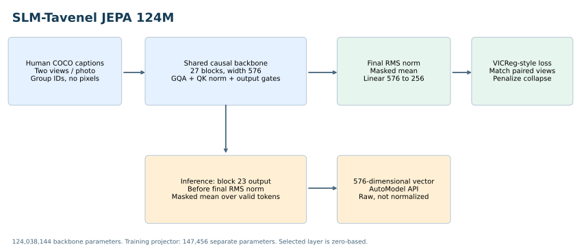
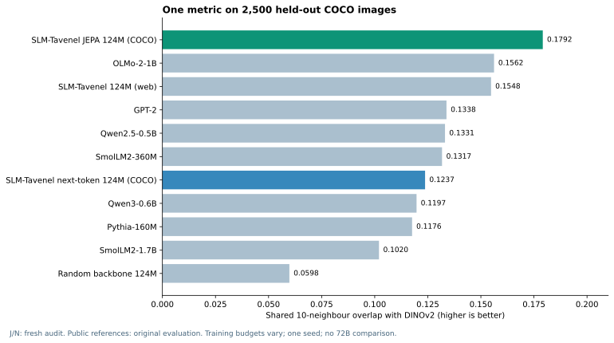
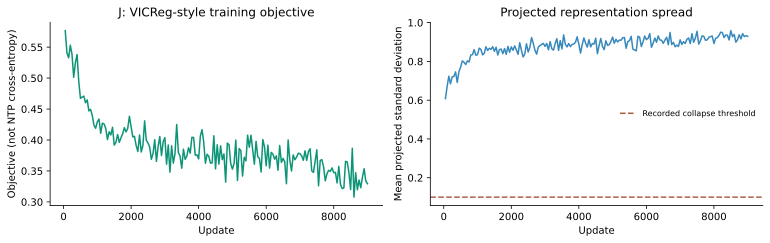

---
language:
- en
license: mit
library_name: transformers
pipeline_tag: feature-extraction
tags:
- slm-tavenel
- jepa
- vicreg
- coco
- representation-learning
- research
- custom_code
model-index:
- name: SLM-Tavenel JEPA 124M
  results:
  - task:
      type: feature-extraction
      name: Text-image representation neighbourhood alignment
    dataset:
      type: coco2017
      name: COCO 2017 validation captions and DINOv2 images, held-out 2500-image primary half
    metrics:
    - type: mutual-knn10
      name: Shared 10-neighbour overlap, fixed graph
      value: 0.17916
    source:
      name: SLM-Tavenel EXP-0046 audit, single training seed
      url: https://github.com/thekester/slm-tavenel/blob/v0.1.0-dev.41/docs/reviews/exp0046-audit-2026-11-11.md
---

# SLM-Tavenel JEPA 124M

**An English text representation model trained from scratch on human COCO captions.** It learns from two captions of the same photo using a predictor-free VICReg-style objective. Neither image pixels nor a next-token loss are used to train this checkpoint.

The public `AutoModel` returns the **576-dimensional representation measured in the experiment**. This is a research feature extractor. It is not an instruction-tuned language model, a chatbot, an image encoder or an image captioner.

[Project](https://github.com/thekester/slm-tavenel) | [Experiment](https://github.com/thekester/slm-tavenel/blob/v0.1.0-dev.41/experiments/EXP-0046-text-jepa-124m-coco-2026-11-10.md) | [Audit](https://github.com/thekester/slm-tavenel/blob/v0.1.0-dev.41/docs/reviews/exp0046-audit-2026-11-11.md) | [Local evidence](https://huggingface.co/athenista/slm-tavenel-jepa-124m/blob/ef09fef218b8fea55702bb06ecdcaa5cf2e12bf4/audit/report.json)

| At a glance | Value |
|---|---|
| Backbone parameters | **124,038,144**, including embeddings and final RMS norm |
| Published weights | Float32 safetensors, no rounding or quantization |
| Default representation | Masked mean of block 23 output, zero-based, before final RMS normalization |
| Output dimensions | **576** |
| Architecture | 27 causal transformer blocks, width 576, SwiGLU 1,536, RoPE, RMSNorm |
| Attention | 9 query heads, 3 key/value heads, head dimension 64, QK normalization and head-wise sigmoid output gate |
| Tokenizer | SmolLM2-360M byte-level BPE, 49,152 tokens; tokenizer only, no pretrained SmolLM2 weights |
| Training / evaluated caption cap | 48 / 64 tokens |
| Positional configuration | 2,048 positions; this is not evidence of useful 2,048-token representations |
| Training | 9,000 updates, 256 image groups per update, two captions per group, one seed |
| Source | COCO 2017 train annotations, 591,753 captions over 118,287 photos |
| Weight and code license | MIT for the author's contributions; tokenizer Apache-2.0; data terms documented below |



*Figure 1. Training uses caption-to-image group IDs without image pixels. The separate inference branch exposes the audited backbone representation.*

## Run on CPU

The custom implementation is included in the repository. `trust_remote_code=True` loads these local model-source files. Review them and pin a full Hub commit when using the model reproducibly. Tested versions and export checks are in [requirements.txt](https://huggingface.co/athenista/slm-tavenel-jepa-124m/blob/ef09fef218b8fea55702bb06ecdcaa5cf2e12bf4/requirements.txt) and [verification.json](https://huggingface.co/athenista/slm-tavenel-jepa-124m/blob/ef09fef218b8fea55702bb06ecdcaa5cf2e12bf4/verification.json).

```bash
pip install torch transformers==4.57.6 tokenizers==0.22.2 safetensors
```

```python
import torch
from transformers import AutoModel, AutoTokenizer

repo = "athenista/slm-tavenel-jepa-124m"
# For a frozen run, add revision="<full Hub commit>" to both calls.
tokenizer = AutoTokenizer.from_pretrained(repo)
model = AutoModel.from_pretrained(
    repo, trust_remote_code=True, dtype=torch.float32
).eval()

inputs = tokenizer(
    ["A dog runs across a grassy field.", "A train is waiting at a station."],
    add_special_tokens=False, padding=True, truncation=True,
    max_length=64, return_tensors="pt",
)
with torch.inference_mode():
    output = model(**inputs)

print(output.pooler_output.shape)  # torch.Size([2, 576])
embeddings = output.pooler_output  # raw masked-mean vectors
```

`last_hidden_state` contains token states from the selected block. `pooler_output` is their mask-weighted mean. Right padding is supported; left padding and inputs longer than 64 tokens are rejected. `output_hidden_states=True` returns the input embedding followed by all 27 pre-final-norm block outputs; the selected representation remains unchanged. `representation_layer=...` allows explicit layer probes.

The public API has no generation head. The original tied embedding/output table is retained once as the input embedding. All 27 trained blocks and the final RMS norm are preserved, although default extraction stops after block 23. The training-only 576-to-256 projector is supplied separately in [training_projection.safetensors](https://huggingface.co/athenista/slm-tavenel-jepa-124m/blob/ef09fef218b8fea55702bb06ecdcaa5cf2e12bf4/training_projection.safetensors); it is not included in the 124,038,144-parameter backbone count and is not the representation used for the headline result.

Raw vectors are not automatically centered or normalized. The published neighbour metric centers the complete evaluation cohort and then applies row-wise L2 normalization. A cosine similarity between two individual outputs does not reproduce that experiment.

## What was measured

On 5,000 COCO val2017 image-caption pairs, DINOv2 ViT-B/14 supplies frozen image features. The lowest-annotation-ID caption is used per image. One fixed half selects each text model's layer; the other **2,500 images** supply the primary shared-10-neighbour overlap. Higher overlap is better. Chance is about 0.004.

| Model | Held-out neighbour overlap | Evidence |
|---|---:|---|
| **SLM-Tavenel JEPA 124M, this checkpoint** | **0.179160** | Fresh J/N audit |
| SLM-Tavenel next-token 124M, same caption schedule | 0.123720 | Fresh J/N audit |
| SLM-Tavenel web-trained 124M | 0.1548 | Original complete evaluation |
| Random-initialized 124M | 0.0598 | Original complete evaluation |
| GPT-2 124M | 0.1338 | Original complete evaluation |
| Pythia-160M | 0.1176 | Original complete evaluation |
| SmolLM2-360M | 0.1317 | Original complete evaluation |
| Qwen2.5-0.5B | 0.1331 | Original complete evaluation |
| Qwen3-0.6B | 0.1197 | Original complete evaluation |
| OLMo-2-1B | 0.1562 | Original complete evaluation |
| SmolLM2-1.7B | 0.1020 | Original complete evaluation |



*Figure 2. J/N use fresh audit values; public-reference values are from the original complete evaluation and were checked against its logs, not independently re-extracted. Their data, training budgets and architectures are not matched.*

J minus the next-token control is **+0.05544**, with fixed-graph paired-bootstrap 95% interval **[0.0493, 0.0616]**. This interval resamples per-image scores in one shared graph. It does not include training-seed or graph/population uncertainty. N's fresh value differs by 0.00008 from its original rounded JSON value; the audit preserves both and records the unresolved numerical discrepancy.

The 440/5,000 selected evaluation captions that match training text after case/whitespace normalization include 221 in the primary half. On the remaining **2,279 images**, neighbours recomputed within that subset give J **0.191444**, N **0.126371**. This is a post-hoc sensitivity, not a new confirmatory test. Train/validation image IDs are disjoint; perceptual image duplicates and upstream public-model exposure were not established.

**Retrieval gives a different result.** With PCA-256 and a rotation fitted on separate folds, using fit-only centering, text-to-image R@1/R@5 is **0.0406 / 0.1542** for J and **0.0822 / 0.2536** for N. Layers were selected for neighbour overlap, not independently for retrieval. The model therefore should not be described as the best general retrieval or embedding model.

No 72B model, second vision encoder, general multiple-choice benchmark, language-generation quality test or human narrative evaluation supports this release. The method is inspired by [Balestriero and LeCun](https://arxiv.org/abs/2610.39302), but our causal-decoder/VICReg recipe is different from the authors' BERT/LeJEPA/SIGReg recipe and cannot be compared numerically to their 72B tables.

## Training and observability

J and N use the same backbone initialization seed **20261109**, sampled caption pairs and update count. J additionally uses a **147,456-parameter** linear training projector. Equal image/caption exposure and updates do not mean equal FLOPs, runtime or energy. The objective is invariance MSE plus a standard-deviation hinge and off-diagonal covariance penalty, implemented in [goodview.py](https://huggingface.co/athenista/slm-tavenel-jepa-124m/blob/ef09fef218b8fea55702bb06ecdcaa5cf2e12bf4/training_code/goodview.py).

Muon is used for block matrices with AdamW for the remaining groups. Peak learning rate is 0.003, minimum 0.0003, weight decay 0.1, gradient clipping 1, WSD with 300 warmup updates and a final 20% decay, bfloat16 mixed precision and activation checkpointing. Sampling draws 2,304,000 image groups with replacement and presents 4,608,000 captions across successful updates. It is not 19 full passes over all five captions of each photo.



*Figure 3. J's objective and projected standard deviation are logged every 50 updates. The standard-deviation threshold is an operational collapse rule, not proof of full rank or semantic understanding.*

The final logged J loss is **0.32935**, projected standard deviation **0.92924**, and GPU board energy **266.745 Wh**, on an RTX 4060 Laptop GPU. The loss has different units from next-token cross-entropy. The aborted earlier attempt used additional energy; CPU, whole-system energy and carbon emissions were not measured. Source logs include objective components, gradient norm, throughput, allocated memory and GPU energy. These diagnostics and architecture diagrams explain mechanics; they do not establish human-like visual understanding.

The protocol/evaluator commit predates alignment evaluation but follows J training. It is not independently evidenced as preregistration before any training. The old generic training configuration omits some custom-loop CLI details; packaging records are retrospective and do not erase that limitation. The exact source checkpoint, tokenizer, tensor hashes and original metadata are linked in [provenance.json](https://huggingface.co/athenista/slm-tavenel-jepa-124m/blob/ef09fef218b8fea55702bb06ecdcaa5cf2e12bf4/provenance.json) and [training_record](https://huggingface.co/athenista/slm-tavenel-jepa-124m/tree/ef09fef218b8fea55702bb06ecdcaa5cf2e12bf4/training_record).

## Sources, licenses and publication decision

- **COCO human captions:** [official COCO data](https://cocodataset.org/#download), declared annotation license CC BY 4.0. Attribution: Lin et al., *Microsoft COCO: Common Objects in Context*; Chen et al., *Microsoft COCO Captions: Data Collection and Evaluation Server*. Training annotation SHA-256: `4b62086319480e0739ef390d04084515defb9c213ff13605a036061e33314317`. Validation annotation SHA-256: `afe3b30e403dd7f228e2373023abbd60042a6e10ec6874d3652df034d289ebb9`.
- **Tokenizer only:** [HuggingFaceTB/SmolLM2-360M](https://huggingface.co/HuggingFaceTB/SmolLM2-360M/tree/f8027fd0eaeea54caa13c31d31b9fdc459c38b49), revision `f8027fd0eaeea54caa13c31d31b9fdc459c38b49`, declared Apache-2.0. Original token IDs and tokenizer JSON are unchanged; inference metadata limits length to 64, uses right padding and aliases PAD to the existing EOS token 0. See [NOTICE.md](https://huggingface.co/athenista/slm-tavenel-jepa-124m/blob/ef09fef218b8fea55702bb06ecdcaa5cf2e12bf4/NOTICE.md), [TOKENIZER-LICENSE.txt](https://huggingface.co/athenista/slm-tavenel-jepa-124m/blob/ef09fef218b8fea55702bb06ecdcaa5cf2e12bf4/TOKENIZER-LICENSE.txt) and [upstream card](https://huggingface.co/athenista/slm-tavenel-jepa-124m/blob/ef09fef218b8fea55702bb06ecdcaa5cf2e12bf4/third_party/smollm2_README.md).
- **Images:** used locally only by the evaluation vision encoder; they retain individual Flickr terms. No image pixels or corpus caption text are redistributed here.
- **Code and author-owned weight contributions:** MIT, see [LICENSE](https://huggingface.co/athenista/slm-tavenel-jepa-124m/blob/ef09fef218b8fea55702bb06ecdcaa5cf2e12bf4/LICENSE). The user explicitly requested public Hub publication of this checkpoint on 11 November 2026; [publication-decision.json](https://huggingface.co/athenista/slm-tavenel-jepa-124m/blob/ef09fef218b8fea55702bb06ecdcaa5cf2e12bf4/publication-decision.json) binds that decision to the published weight hash.

Source entries remain candidate, with source-rights and privacy reviews unsigned. MIT licensing of the author's contributions does not independently establish all upstream rights or certify OSI conformity. No safety, privacy-leakage or production-retrieval validation is claimed. The release is an open-weight research preview with these limitations disclosed.

## Reproduce and inspect

The [GitHub source and audit release](https://github.com/thekester/slm-tavenel/releases/tag/v0.1.0-dev.41) includes the preparation, objective, training and evaluation code. This package also includes the observed training scripts, architecture YAML, logs, data/tokenizer manifests and original/fresh audit evidence. Read [REPRODUCIBILITY.md](https://huggingface.co/athenista/slm-tavenel-jepa-124m/blob/ef09fef218b8fea55702bb06ecdcaa5cf2e12bf4/REPRODUCIBILITY.md) for the exact representation and remaining provenance gaps.

The [package manifest](https://huggingface.co/athenista/slm-tavenel-jepa-124m/blob/ef09fef218b8fea55702bb06ecdcaa5cf2e12bf4/package-manifest.json) lists file hashes. [verification.json](https://huggingface.co/athenista/slm-tavenel-jepa-124m/blob/ef09fef218b8fea55702bb06ecdcaa5cf2e12bf4/verification.json) records tensor identity, native/exported representation parity and standalone loading checks. Those checks establish packaging fidelity on the tested inputs, not scientific performance robustness. More training seeds, shuffled-positive training controls, additional vision encoders and reference re-evaluation remain future work.
