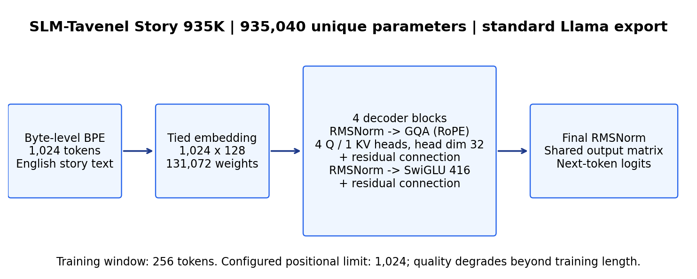
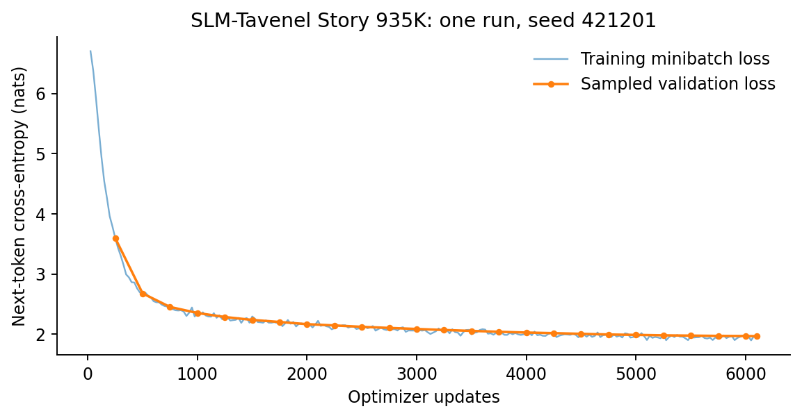
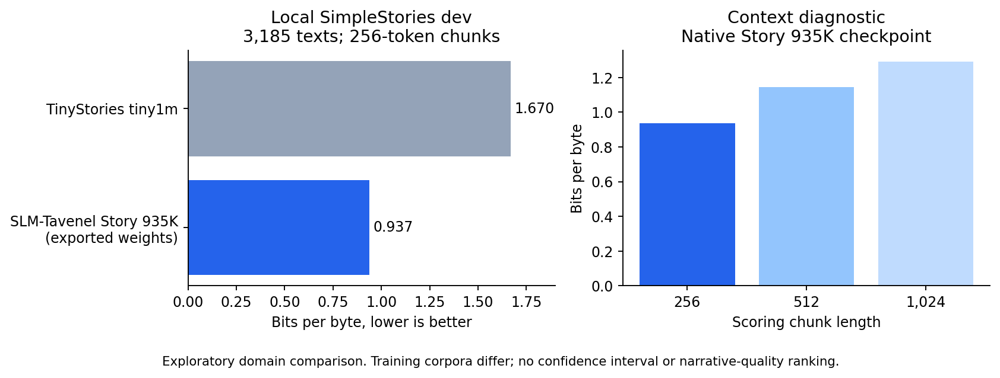
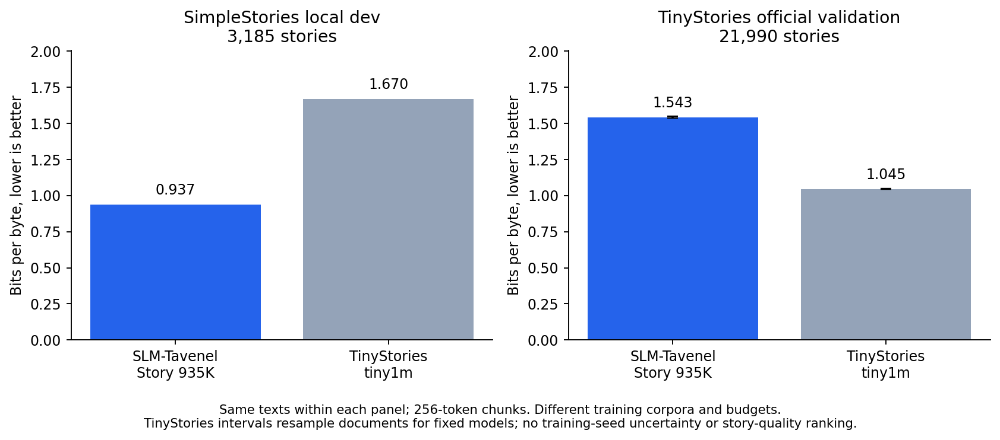
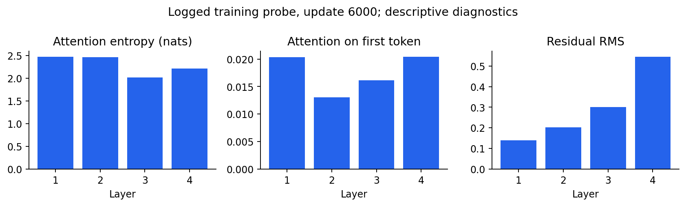
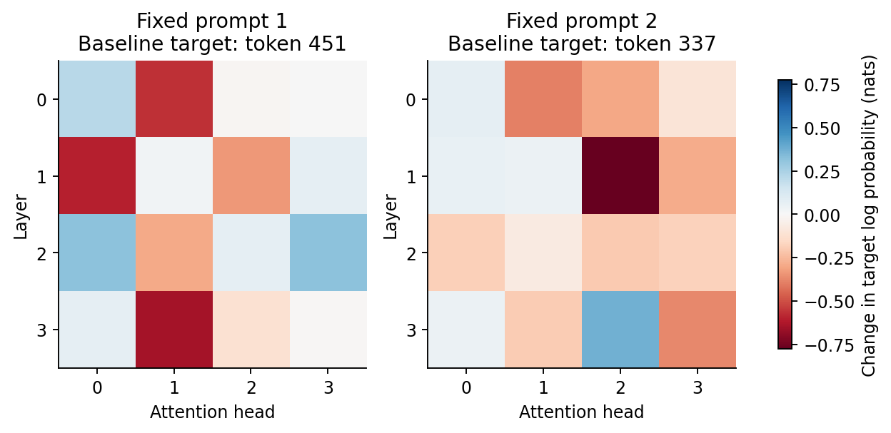

---
language:
- en
license: mit
library_name: transformers
pipeline_tag: text-generation
datasets:
- SimpleStories/SimpleStories
tags:
- slm-tavenel
- llama
- research-artifact
- experimental
- story-generation
- trained-from-scratch
- open-weights
model-index:
- name: SLM-Tavenel Story 935K
  results:
  - task:
      type: text-generation
      name: Next-token likelihood, 256-token nonoverlapping chunks
    dataset:
      type: roneneldan/TinyStories
      name: TinyStories official validation
      config: default
      split: validation
      revision: f54c09fd23315a6f9c86f9dc80f725de7d8f9c64
    metrics:
    - type: bits_per_byte
      name: BPB (SLM-Tavenel evaluator; 256-token chunks)
      value: 1.5430903852185665
    source:
      name: SLM-Tavenel frozen-model cross-source evaluation
      url: https://github.com/thekester/slm-tavenel/blob/v0.1.0-dev.39/docs/model-cards/slm-tavenel-story-935k/training_record/tinystories/summary.json
---

# SLM-Tavenel Story 935K

**An English story-continuation research model with 935,040 parameters and a 1.87 MB bfloat16 weight file.** It learns children's-story language but often loses track of characters, objects and goals. It is a base predictor, not a chat assistant or a reliable storyteller.

**Public research preview, released under MIT.** The owner explicitly authorized public weights with the remaining SimpleStories source uncertainty documented. The producer declares MIT, but the original generator-service terms have not been independently verified. See [source review](SOURCE-REVIEW.md) and [publication decision](publication-decision.json). This is not a claim of legal clearance, OSI certification or comprehensive safety validation.

[Architecture](#architecture) · [Training](#training) · [Evaluation](#evaluation) · [Examples](#raw-examples) · [Observability](#observability-and-explanation) · [Reproduce](#reproducibility-and-provenance) · [SLM-Tavenel project](https://github.com/thekester/slm-tavenel)

| Property | Value |
|---|---|
| Unique parameters, including shared embedding/output weights | **935,040** |
| Backbone | 4 pre-RMSNorm decoder blocks, width 128, SwiGLU intermediate size 416 |
| Attention | Causal grouped-query attention, 4 query heads / 1 key-value head, head dimension 32, RoPE |
| Additional attention gates / QK normalization | None |
| Tokenizer | Project byte-level BPE, 1,024 entries; trained only on training stories |
| Learned training window | **256 tokens** |
| Configured positional limit | 1,024 tokens; longer contexts perform worse and are not recommended |
| Export | Standard Transformers `LlamaForCausalLM`, safetensors bfloat16, tied embeddings |
| Inference | CPU supported; standard Transformers loading, no repository-specific remote code required |
| Training | From scratch, seed 421201, 100,007,936 presented token positions |
| Data | 60,000 SimpleStories training stories from one pinned shard; 3,185 local dev stories |
| Scope | English, synthetic stories; one run, exploratory results |

## Run locally

The package was checked with Python 3.11.9, PyTorch 2.10.0+cu130, Transformers 4.57.6, tokenizers 0.22.2 and safetensors 0.8.0. These are the recorded versions, not a claim that every other version is incompatible.

```bash
pip install torch "transformers==4.57.6" "tokenizers==0.22.2" "safetensors==0.8.0"
```

```python
import torch
from transformers import AutoModelForCausalLM, AutoTokenizer

model_id = "athenista/slm-tavenel-story-935k"
# This immutable revision contains the checked weight and tokenizer files.
revision = "62e64c2b677ea9fbc90cdee0fbfe66b589b78e83"
tokenizer = AutoTokenizer.from_pretrained(model_id, revision=revision)
model = AutoModelForCausalLM.from_pretrained(
    model_id, revision=revision, dtype=torch.float32
).eval()
torch.manual_seed(0)
inputs = tokenizer("Once upon a time, a fox found a key.", return_tensors="pt")
with torch.inference_mode():
    output = model.generate(
        **inputs, max_new_tokens=160, do_sample=True,
        temperature=0.8, top_p=0.9, pad_token_id=tokenizer.pad_token_id
    )
print(tokenizer.decode(output[0], skip_special_tokens=True))
```

Keep the prompt plus continuation within 256 tokens. CPU float32 is used for these examples even though the stored weights are bfloat16. A 4-bit or GGUF variant has not been produced or measured. [Operational measurements](training_record/verification.json) record CPU prefill latency and cached generation speed; timing is from one machine and excludes loading.

<!-- generated:inference -->
| CPU, two threads; batch 1 | Measured value |
|---|---:|
| Prefill, 128 tokens | 7.39 ms |
| 64 generated tokens, total | 0.210 s |
| Cached greedy generation | 304.1 tokens/s |

Median of three runs after one warmup, CPU float32. The generated sequences are forced to 64 new tokens for timing. This is one machine/session and excludes loading; it is not a hardware-independent speed claim.
<!-- /generated:inference -->

## Architecture



*Figure 1. The complete standard Llama computation. The embedding table and output matrix share weights. There are no attention gates or auxiliary inference models.*

| Component | Parameters |
|---|---:|
| Shared token embedding / output table | 131,072 |
| Attention projections, four blocks | 163,840 |
| SwiGLU projections, four blocks | 638,976 |
| RMSNorm weights, including final norm | 1,152 |
| **Total** | **935,040** |

## Training

| Setting | Value |
|---|---|
| Training seed | 421201, one run |
| Optimizer | AdamW, beta1 0.9, beta2 0.95, epsilon 1e-8, weight decay 0.1 |
| Schedule | Cosine, 300 warmup updates, peak LR 1e-3, minimum LR 1e-4 |
| Updates | 6,104 |
| Batch | 32 sequences × 256 tokens × 2 accumulation steps = 16,384 positions per update |
| Exposure | 100,007,936 positions; approximately four passes over 24,806,504 training-token positions |
| Precision | bfloat16 mixed precision; native checkpoint retains float32 weights |
| Gradient clipping | 1.0 |
| Hardware | One RTX 4060 Laptop GPU, 8 GB |
| Training duration / measured energy | Approximately 9.4 minutes / 7.344 Wh GPU board energy |
| Peak allocated training VRAM | 0.566 GB; excludes CUDA/driver overhead |
| Determinism | Deterministic algorithms enabled; cross-platform bitwise reproducibility is not promised |

The tokenizer was trained on a seeded sample of 30,000 local training documents. The local source split groups all stories from the same original completion on the same side. The first shard only was sampled; the model did not train on all of SimpleStories. Original manifests and their `dirty: true` code status are preserved. No new training or performance improvement is implied by exporting this checkpoint.



*Figure 2. One training seed. Training loss is a minibatch estimate; validation loss is sampled during training. The final logged validation cross-entropy is 1.9662 nats per token. This is not an independent final-test loss.*

## Evaluation

The comparison uses the project's existing likelihood evaluator, [source code](https://github.com/thekester/slm-tavenel/blob/v0.1.0-dev.39/src/slm/evaluation.py), on exactly the same **3,185 local dev stories**, totaling **3,944,858 UTF-8 bytes**. Each document is prefixed with the model's document-start/end token. Next-token log probabilities are accumulated in non-overlapping 256-token chunks and divided by the byte count. Lower bits per byte is better. Per-token perplexities are not compared across different tokenizers.

<!-- generated:benchmark-table -->
| Model | Unique parameters | Scoring context | Dev BPB |
|---|---:|---:|---:|
| **SLM-Tavenel Story 935K, exported weights** | 935,040 | 256 | **0.9370** |
| [TinyStories tiny1m](https://huggingface.co/shibatch/tiny1m/tree/fdacad8ff9dc27bd72c77d3684075a494be1ba11) | 935,040 | 256 | 1.6701 |
<!-- /generated:benchmark-table -->

The native float32 checkpoint measured 0.9370 BPB at chunk length 256, 1.1453 at 512 and 1.2914 at 1,024. The table's Story 935K result is recomputed on the exact exported bfloat16-rounded weights loaded in CPU float32; its [raw results](training_record/exported-dev-bpb.json) bind the scored data and weights by SHA-256.



*Figure 3. Both models are scored on the same local SimpleStories dev texts. The right panel varies chunk length for the native Story 935K checkpoint.*

<!-- generated:cross-source -->
**Full TinyStories validation:** 21,990 stories, 19,218,350 UTF-8 bytes, scored on both frozen exported models with the same 256-token policy. The official source revision and exact/case-whitespace overlap checks are in [dataset audit](training_record/tinystories/dataset-audit.json).

| Evaluation texts | SLM-Tavenel Story 935K BPB | TinyStories tiny1m BPB |
|---|---:|---:|
| SimpleStories local dev (3,185) | 0.937012 | 1.670079 |
| TinyStories official validation (21,990) | 1.543090 | 1.045244 |

On TinyStories, Story 935K minus tiny1m = **+0.497847 BPB**, 95% paired document-bootstrap interval **[+0.491981, +0.503727]**. A negative difference favors Story 935K. The interval describes these fixed checkpoints and documents; it excludes training-seed variation, unknown reference exposure and dependencies between synthetic story families. See [full results](training_record/tinystories/summary.json) and hashed per-item scores.

**The SimpleStories advantage reverses on TinyStories:** tiny1m has lower BPB on the official TinyStories validation texts, while Story 935K has lower BPB on its own source's dev texts. Neither result is a human narrative-coherence score or a comparison at equal training budget.

The tiny1m tokenizer is explicitly loaded as `LlamaTokenizer(legacy=True)` in the cross-corpus comparison. Its SimpleStories line was recomputed with that same loader. The previous automatically converted fast tokenizer differed by 44 tokens across 3,185 dev stories; both results and the unchanged weights are documented in [tokenizer reconciliation](training_record/tinystories/simple-dev-reference-reconciliation.json). This is a loading correction, not a trained-model improvement.



*Figure 4. Corpus-specific likelihood, not narrative preference. Only the TinyStories panel has document-bootstrap intervals; SimpleStories intervals were not computed.*
<!-- /generated:cross-source -->

**This does not establish a narrative-quality win over tiny1m.** The local dev stories share the source and domain of Story 935K's training material. tiny1m has different training data, tokenizer and budget. There is one training seed and no neutral or sealed final test. The initial SimpleStories dev comparison has no uncertainty interval; the TinyStories intervals above cover fixed checkpoints only. No completed blind human preference study is claimed. General multiple-choice accuracy has not been evaluated for this export.

Five public story prefixes also produced 15 continuations per model: one greedy continuation and two sampled seeds per prefix, under a 320-byte generation budget with visible final-token overshoot and stop reasons. [All 30 raw records](training_record/generation-comparison/generations.jsonl), [decoding settings](training_record/generation-comparison/manifest.json), the blank [human-review form](training_record/generation-comparison/blind_review.csv) and model key are included. Repetition is a mechanical diagnostic and is not presented as a coherence or preference score. Those prefixes are development probes, not an unseen test.

An [interactive local human-review form](https://github.com/thekester/slm-tavenel/blob/v0.1.0-dev.39/docs/reviews/story-blind-pilot-2026-11-10/README.md) now hides fresh randomized A/B assignments and collects grammar, coherence, relevance and preference from human readers. [The aggregate status](training_record/human-review/summary.json) currently reports no completed human form. These are the same five previously public prefixes; prior exposure must be disclosed, and 15 pairs are not 15 independent prompts. Missing ratings are never replaced with model-generated judgments.

## Raw examples

The two prompts below were supplied in the publication request. Each receives exactly one sampled continuation with seed 0, temperature 0.8, top-p 0.9 and at most 160 new tokens. The continuation is not rewritten or selected among retries; [raw token IDs and settings](training_record/examples.json) are included. These examples were already inspected during development.

<!-- generated:examples -->
**Prompt 1: Once upon a time, a fox found a key.**

>  There was a golden coin! Excited, they gathered all the animals and shared the letters with their friends. They realized that it was fun to build. They wanted to join their first socks, so they gathered in the park. 
> 
> In the end, they learned that being a hero was not just about the partners. They shared stories and laughed. Their hearts were full of joy and laughter. They learned that even though their best changes, they could overcome anything, growing together. 
> 
> When they returned home, they understood that adventures are always within. They promised to always rememb

**Prompt 2: Lily was afraid of the dark, so her brother gave her a small lamp.**

>  They looked out at the stars, but they kept climbing. In that moment, she felt the weight of her strength. "I will find a way," she thought, her heart racing.
> 
> As they entered the forest, the trees whispered secrets. They spoke of love and song, lost and alone. "If you trust me, you must face your fears," the spirit said. The children stared at them, their eyes sparkling like the stars. They were thrown into the darkness, sharing the stories of their own. The girl smiled, knowing she had found the star's magic.
<!-- /generated:examples -->

The output can be grammatical and story-like while changing characters, losing objects and adding irrelevant events. Fluency is not proof of causal consistency, factual accuracy or instruction following.

## Observability and explanation



*Figure 5. Last logged observability probe at update 6,000, before the final checkpoint at update 6,104. The probe was sampled from validation data using a fixed RNG seed. Attention entropy, mass on the first token and residual RMS describe computation; they do not independently explain narrative meaning.*

The [original observability log](training_record/observability.jsonl) also records weight norms, gradient norms and update ratios. The architecture does not have attention gates, so gate-closure rates would be inapplicable here. Logged probes are not blinded outcome measurements.



*Figure 6. Each intervention zeroes one head before its output projection. Values are changes in the log probability of the unmodified model's top next token, on the same two fixed prompts. Negative values mean that removing the head reduced that token's probability. The [raw ablation records](training_record/head-ablations.json) describe a causal effect on that narrowly specified token score, not a validated semantic role for a head or an explanation of a whole story.*

## Data, licensing and privacy

Source: [SimpleStories/SimpleStories at the pinned revision](https://huggingface.co/datasets/SimpleStories/SimpleStories/tree/e63b8adc3b1a1bdc7cac5b500d150b71346b0628). The producer declares MIT and the paper reports GPT-4o-mini-2024-07-18 generation. The source stories were generated by the upstream provider; this model was trained from scratch on those stories without making new calls to that API.

The [source review](SOURCE-REVIEW.md) distinguishes the producer's declared license from unverified original generation terms. The model weights and project code are released under MIT. This does not replace upstream obligations, establish the status of every output, or certify conformity with the Open Source AI Definition. Candidate source status and incomplete human source/privacy review are disclosed rather than signed retrospectively. Public release was explicitly authorized with those reserves; it does not change the historical source-review flags.

The [actual split audit](training_record/source-audit.json) found zero shared completion groups and zero exact or case-and-whitespace-normalized texts between train and dev. A scan of all 63,185 local stories found no email, phone, contextual-IP or valid-IBAN patterns recognized by the project's detector. It does not detect every kind of personal information, determine whether names are real, test memorization, or establish semantic independence of the splits. Real training text is excluded from this package; its metadata-only [source index](training_record/document-index.jsonl.gz) records source rows, IDs, completion groups, splits and text hashes.

## Intended use and limits

This checkpoint is intended for research into very small language models, byte-level tokenization, narrative failure modes and mechanistic probes. It is English-only and has not been instruction, preference or safety tuned. It can produce false, repetitive, biased or unsuitable content. No comprehensive safety, memorization, child-suitability or privacy evaluation has been completed. The children's-story style is not an assurance that the output is appropriate for children. Consequential decisions, factual advice and unsupervised child-facing deployment are outside the evaluated scope.

## Reproducibility and provenance

The native training-code base is commit `34a92771b3d9a95356d81a9296c6bec0844b6904`, recorded as dirty. The story-model configuration and fluency tool originate from [PR #1 at commit `14bb331`](https://github.com/thekester/slm-tavenel/pull/1); the completion-group split and 100M-token training configuration were prepared locally afterward. These previously uncommitted components are included in this publication's GitHub source, with their origin disclosed. Publishing them now does not retrospectively make the original run a clean-commit run.

| Evidence | File |
|---|---|
| Native checkpoint and exported artifact hashes | [Original export provenance](training_record/source-export-provenance.json) |
| Resolved model/training configs, seed and environment | [Run manifest](training_record/run_manifest.json) |
| Tokenizer training inputs and hash | [Tokenizer manifest](training_record/tokenizer-manifest.json) |
| Source revision, grouping and raw shard hash | [Corpus manifest](training_record/corpus-manifest.json) |
| Token counts and shard hashes | [Token-shard manifest](training_record/token-shards-manifest.json) |
| Cache checks, weight mapping and CPU timing | [Verification](training_record/verification.json) |
| Training, validation and intervention evidence | `training_record/` |
| Published package file inventory | [Package manifest](package-manifest.json) |

The native float32 weights are rounded to bfloat16 in the exported file. The tensor mapping is checked exactly; logits are compared against a native model with the same rounding and against the original checkpoint. The two differences are reported separately, so export rounding is not hidden. Cached and uncached greedy sequences are checked on the two fixed prompts. These checks validate packaging on these inputs; they do not establish model quality.

The GitHub repository contains the scripts needed to rebuild the subset, train the tokenizer, encode fixed splits, train the model, export it and reproduce these figures. See [the experiment report](https://github.com/thekester/slm-tavenel/blob/v0.1.0-dev.39/experiments/EXP-0045-story-935k-2026-11-10.md). Training data, optimizer checkpoints and weight files are not committed to Git.

## Citation

Please cite this model's pinned Hugging Face revision and the SLM-Tavenel GitHub release, and credit the dataset creators:

```bibtex
@article{finke2025parameterized,
  title={Parameterized Synthetic Text Generation with SimpleStories},
  author={Finke, Lennart and Sreedhara, Chandan and Dooms, Thomas and Allen, Mat and Zhang, Emerald and Rodriguez, Juan Diego and Nabeshima, Noa and Marshall, Thomas and Braun, Dan},
  journal={arXiv preprint arXiv:2504.09184},
  year={2025}
}
```
