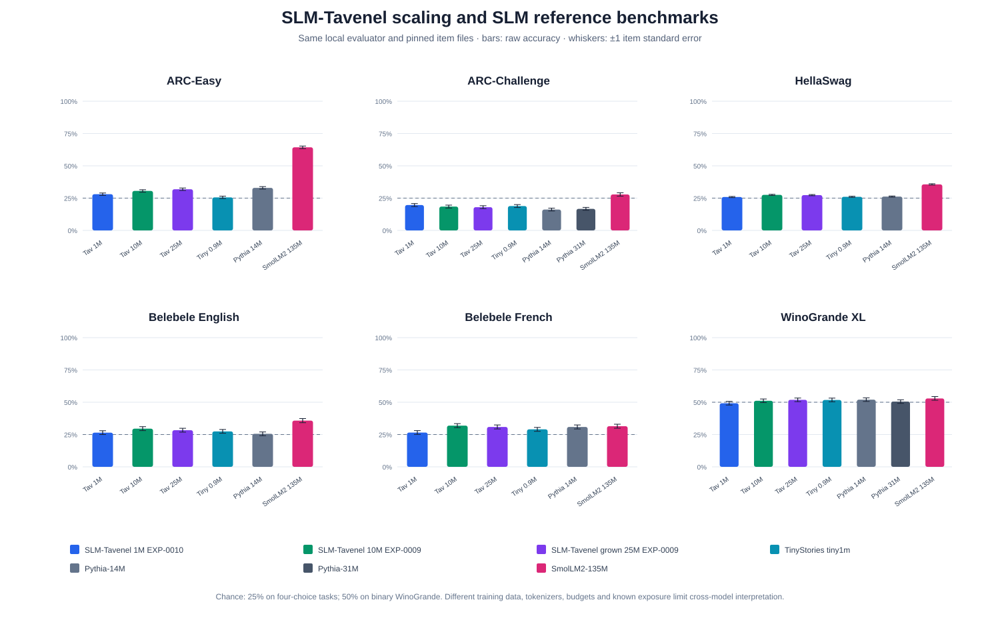
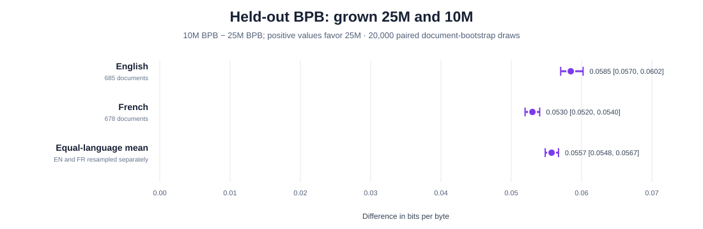

# EXP-0009 grown 25M: same-harness scaling results

**Status:** completed grown 25M checkpoint and all planned evaluations; one training trajectory, seed 1234. This report compares checkpoints and benchmark/document samples. It does not estimate run-to-run training variation.

The 25M model was function-preservingly grown from the completed 10M checkpoint, then trained for 15,000 additional steps (491.52M token positions). It is therefore an inherited initialization path with approximately twice the training token budget of the scratch 10M, not a parameter-count-only or iso-compute comparison.

Bars show raw accuracy under this repository's evaluator on identical pinned files. Whiskers show plus or minus one standard error across benchmark items for a single checkpoint; they do not show training-seed uncertainty. The dashed line marks chance (25% for four-choice tasks and 50% for WinoGrande). Pythia-31M is shown only on ARC-Challenge and WinoGrande because the other four outputs were not scored.

## Raw accuracy

| Model | Parameters | ARC-Easy | ARC-Challenge | HellaSwag | Belebele EN | Belebele FR | WinoGrande XL |
|---|---:|---:|---:|---:|---:|---:|---:|
| SLM-Tavenel 1M EXP-0010 | 1,181,920 | 0.280 | 0.196 | 0.259 | 0.264 | 0.266 | 0.493 |
| SLM-Tavenel 10M EXP-0009 | 9,978,368 | 0.306 | 0.184 | 0.275 | 0.296 | 0.319 | 0.511 |
| SLM-Tavenel grown 25M EXP-0009 | 25,723,648 | 0.319 | 0.180 | 0.273 | 0.283 | 0.309 | 0.519 |
| TinyStories tiny1m | 935,040 | 0.256 | 0.189 | 0.260 | 0.274 | 0.290 | 0.518 |
| Pythia-14M | 14,067,712 | 0.330 | 0.161 | 0.262 | 0.256 | 0.309 | 0.520 |
| Pythia-31M | 30,494,720 | not scored | 0.167 | not scored | not scored | not scored | 0.505 |
| SmolLM2-135M | 134,515,008 | 0.643 | 0.278 | 0.356 | 0.358 | 0.314 | 0.530 |

## Held-out bits per byte

Lower is better. The 1M, 10M and grown-25M checkpoints use the same fixed FSC English/French validation texts and tokenizer. The paired 10M-versus-25M document bootstrap resamples documents with replacement within language; each draw compares the same sampled documents for both checkpoints. The equal-language mean is the arithmetic mean of the two language-specific differences.

*Difference is 10M BPB minus grown-25M BPB, so positive values favor 25M. Intervals are conditional on the two saved checkpoints; they do not estimate training-seed variation or uncertainty about the source corpus.*

| SLM-Tavenel checkpoint | EN BPB | FR BPB |
|---|---:|---:|
| 1M EXP-0010, selected | 1.4904 | 1.3676 |
| 10M EXP-0009 | 1.1755 | 1.0897 |
| grown 25M EXP-0009 | **1.1171** | **1.0367** |

| Paired comparison (10M minus 25M) | Documents | BPB difference | 95% document-bootstrap interval |
|---|---:|---:|---:|
| English | 685 | +0.0585 | [+0.0570, +0.0602] |
| French | 678 | +0.0530 | [+0.0520, +0.0540] |
| Equal-language mean | 685 EN; 678 FR | +0.0557 | [+0.0548, +0.0567] |

The equal-language estimate is +0.0557 BPB (95% paired document-bootstrap interval [+0.0548, +0.0567]). This interval covers validation-document sampling for these checkpoints only; there is one seed per scale and no estimate of training-run variability. The bootstrap uses seed 20261024 and 20,000 draws. Detailed scoring provenance and checkpoint/data hashes are in `runs/fsc-scaling/comparisons/exp0009-bpb-document-bootstrap.json`.

## Paired item-bootstrap intervals

The estimates below compare per-item correctness for matched questions. The 95% intervals resample benchmark items only; they are conditional on these checkpoints and do not represent new training runs. The tasks are post-hoc secondary outcomes; no multiple-comparison correction is applied.

| Comparison (25M minus baseline) | Task | Accuracy difference | 95% paired item interval |
|---|---|---:|---:|
| 25M vs SLM-Tavenel 1M EXP-0010 | arc_easy | +0.038 | [+0.018, +0.059] |
| 25M vs SLM-Tavenel 1M EXP-0010 | arc_challenge | -0.016 | [-0.042, +0.009] |
| 25M vs SLM-Tavenel 1M EXP-0010 | hellaswag | +0.014 | [+0.007, +0.022] |
| 25M vs SLM-Tavenel 1M EXP-0010 | belebele_en | +0.019 | [-0.017, +0.053] |
| 25M vs SLM-Tavenel 1M EXP-0010 | belebele_fr | +0.043 | [+0.009, +0.078] |
| 25M vs SLM-Tavenel 1M EXP-0010 | winogrande | +0.026 | [-0.011, +0.062] |
| 25M vs SLM-Tavenel 10M EXP-0009 | arc_easy | +0.013 | [-0.004, +0.030] |
| 25M vs SLM-Tavenel 10M EXP-0009 | arc_challenge | -0.004 | [-0.023, +0.015] |
| 25M vs SLM-Tavenel 10M EXP-0009 | hellaswag | -0.002 | [-0.006, +0.002] |
| 25M vs SLM-Tavenel 10M EXP-0009 | belebele_en | -0.012 | [-0.033, +0.009] |
| 25M vs SLM-Tavenel 10M EXP-0009 | belebele_fr | -0.010 | [-0.032, +0.011] |
| 25M vs SLM-Tavenel 10M EXP-0009 | winogrande | +0.007 | [-0.018, +0.032] |

## Interpretation and provenance limits

These scores are exploratory comparisons, not a ranking or evidence of general superiority. Training corpora, tokenizers, token and compute budgets, context limits, and pretraining benchmark exposure differ across references. The external reference runs use this evaluator and these item files where scored; they are not controlled training comparisons. Exact-overlap checks for ARC-Challenge and WinoGrande are post-hoc and cannot rule out paraphrase, translation or prior exposure.

The 10M and grown 25M use the same exploratory mixed-license FSC corpus. A post-training HAL query found matching current main/document-file license metadata for 31,262 of 31,417 retained IDs; 72 had explicit mismatches, 3 conflicting declarations, 24 missing license metadata, and 56 were not found. A targeted HAL recheck on 23 October found no change among those 155 IDs. Crossref license metadata was available for 75 DOI-bearing records: 30 included the dataset-declared license URL, 15 listed only a different license or policy URL, 23 had no Crossref license field, and 7 lookups failed. A local scan of all 31,417 processed training documents found four residual public-IP-pattern matches, 54 replacement-character documents, and 20,808 documents with at least one broad title, discipline, or body-term review signal. The original EXP-0009 pipeline did not apply the later v4 publication-risk filters. These automated findings require human review and do not establish privacy clearance. Crossref metadata is discovery evidence and may apply to a different version. Neither audit proves rights-holder authority or historical license status. Human source-rights and privacy review remain unsigned. See the [dated HAL audit](../docs/reviews/EXP-0009-HAL-FILE-LICENSE-AUDIT-2026-10-22.md), [23 October review record](../docs/reviews/EXP-0009-25M-SOURCE-PRIVACY-REVIEW.md), and [resume diagnostic](../docs/reviews/EXP-0009-25M-RESUME-DIAGNOSTIC-2026-10-22.md). The full input hashes, per-item scores and comparison JSON remain in `runs/fsc-scaling/`.
