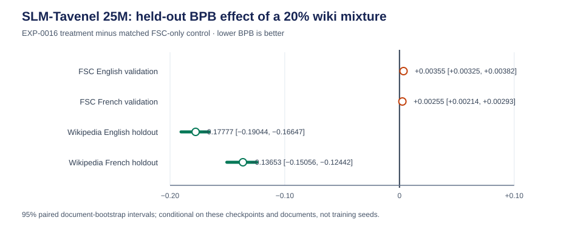

# EXP-0016: 25M continuation with a decontaminated Wikipedia mixture

**Status (2026-10-23 17:36 Paris):** complete. The 1,500-step continuation used 49.152M token positions and took about 65 minutes wall time under shared-GPU contention. The outcome is a measurable domain trade-off: Wikipedia and MOT held-out BPB improve, FSC held-out BPB regresses, and none of the six exploratory multiple-choice differences has a paired interval excluding zero. This is one seed and one matched pair, not a general capability gain. Local only; source-rights and privacy reviews remain incomplete.

## Question and motivation

Does a 20% English/French encyclopedia component improve broad text prediction or the existing multiple-choice scores compared with the FSC-only 25M continuation? EXP-0014 found that a 20% MOT news component improved news BPB but did not improve the general multiple-choice scores. This tests a distinct, knowledge-rich data domain, motivated by data-selection research including DataDecide and BETR. It does not assume the paper results transfer to this 25M model.

## Preregistered design

- Treatment initializes from the same EXP-0009 grown-25M step-15,000 checkpoint as EXP-0014 and uses AdamW, seed 20261023, 1,500 steps, 32,768 token positions/update, 49.152M positions total, the same FSC tokenizer, LR schedule, weight decay, and BF16 precision. Only the training data recipe changes.
- The treatment stream contains the complete FSC v1 training stream and a decontaminated wiki-v1 sample with an available-stream ratio of 80% FSC / 20% Wikipedia. Wiki tokens are re-encoded with the exact FSC tokenizer hash used by the 25M model; existing wiki-v1 tokens are not reused because their tokenizer hash differs.
- Select wiki documents deterministically from the original train split only. Exclude all previously designated wiki BPB holdout IDs. Filter the selected wiki sample against all six pinned multiple-choice files with exact word 13-gram overlap. This prevents known exact overlap; it cannot rule out semantic overlap.
- The hash-filtered source is consumed in its stored JSONL order until each language's token target is met; the sample is deterministic, but possible source-order effects were not separately tested.
- The matched FSC-only control is the already completed 1,500-step EXP-0014 control, which used the same start checkpoint, seed, optimizer and schedule. This avoids spending another full control run. The control's validation and benchmark files are identical.

## Outcomes

- Primary: held-out BPB on the existing FSC EN/FR validation documents and the 500-document-per-language wiki BPB holdout after rechecking it against all six benchmarks. Report per-document bootstrap intervals where raw document scores are available.
- Secondary: the six existing multiple-choice scores with paired item bootstrap intervals. These results are post-hoc and repeatedly inspected; they are not confirmatory evidence or a basis for a general capability claim.
- Report training token exposure, wall time, exact corpus/tokenizer/evaluation hashes, decontamination counts and the run manifest. Do not release this continuation.

## Interpretation and limits

### Results

Lower bits-per-byte (BPB) is better. The treatment checkpoint has 25,723,648 parameters and final validation loss 2.24829. It used 136,048,547 Wikipedia tokens, exactly 20% of the available FSC+Wikipedia training stream. Exact 13-gram overlap filtering removed zero candidate training documents and zero documents from the 500-document English and 500-document French wiki holdouts. This does not detect paraphrase, translation or semantic overlap.

| Held-out text | FSC-only control | Wiki/FSC treatment | Treatment minus control (95% paired document interval) |
|---|---:|---:|---:|
| FSC English validation | 1.10320 | 1.10674 | +0.00355 [+0.00325, +0.00382] |
| FSC French validation | 1.02415 | 1.02670 | +0.00255 [+0.00214, +0.00293] |
| Wikipedia English holdout | 1.63794 | 1.46017 | −0.17777 [−0.19044, −0.16647] |
| Wikipedia French holdout | 1.42268 | 1.28615 | −0.13653 [−0.15056, −0.12442] |

The mixture improves prediction on wiki in both languages and modestly worsens prediction on FSC. Relative to the existing EXP-0014 FSC-only control, MOT BPB also improves by 0.05881 on development text and 0.05887 on temporal-test text; those MOT comparisons are point estimates only because the control's per-document scores were not retained. The result supports a domain trade-off for this checkpoint pair, not a broad quality improvement. Document-bootstrap intervals use 20,000 paired draws with seed `20261023`; they quantify text-document sampling conditional on these two checkpoints only and do not estimate training-seed variability.

The six repeatedly inspected multiple-choice benchmarks show no statistically clear changes by paired item resampling:

| Benchmark | FSC-only control | Wiki/FSC treatment | Difference, percentage points (95% paired item interval) |
|---|---:|---:|---:|
| ARC-Easy | 0.318 | 0.323 | +0.51 [−0.76, +1.77] |
| ARC-Challenge | 0.181 | 0.187 | +0.60 [−0.85, +2.05] |
| HellaSwag | 0.274 | 0.273 | −0.07 [−0.41, +0.27] |
| Belebele English | 0.289 | 0.287 | −0.22 [−1.67, +1.22] |
| Belebele French | 0.310 | 0.314 | +0.44 [−0.89, +1.78] |
| WinoGrande XL | 0.522 | 0.515 | −0.63 [−2.68, +1.42] |

Every paired item interval includes zero. These benchmarks are secondary and post-hoc; the 20,000 paired item-bootstrap draws use seed `20261023`, are conditional on the evaluated items and checkpoints, and have no multiple-comparison correction. This pilot does not establish that Wikipedia training improves general downstream capability.

The Wikipedia source is publisher-declared CC-BY-SA-3.0/GFDL; per-page permissions, weight obligations, biographies and privacy risks remain unresolved. Therefore the result and checkpoint remain local and exploratory. Do not publish this checkpoint until source and privacy reviews are signed.

Reproduction artifacts: training run manifest (local artifact: `runs/EXP-0016-25m-wiki-mixture-2026-10-23/run_manifest.json`), full treatment evaluation with per-document scores (local artifact: `runs/EXP-0016-25m-wiki-mixture-2026-10-23/evaluation.json`), paired analysis (local artifact: `runs/EXP-0016-25m-wiki-mixture-2026-10-23/analysis.json`), primary control document scores (local artifact: `runs/EXP-0016-25m-wiki-mixture-2026-10-23/control-primary-text.json`), prepared-data manifest (local artifact: `data/processed/exp0016-wiki/manifest.json`), and [analysis script](../scripts/analyze_exp0016_25m_wiki.py). The checkpoint SHA-256 is `5fd73c9ae575023c0f86441ed0bf2b378aeda76f5eeb73aa50c89442ee752e13`; tokenizer SHA-256 is `558bab3421bc9ee280f2aa9d0c6a82a9bc482e2ecb72a75837e9c3ee7d2dbd39`; treatment token-shard manifest SHA-256 is `a36109da3d629bf657f11e269e151525f9e96ac95b14d8c5e1b2d55aaaa261a5`.

## Research references

- Magnusson et al. (2025), [DataDecide](https://arxiv.org/abs/2504.11393): small controlled data experiments and continuous likelihood proxies.
- Mizrahi et al. (2025), [BETR](https://arxiv.org/abs/2507.12466): task-aligned data ranking; use development examples only and preserve a disjoint evaluation set.
- Existing source audit: [Wikipedia wiki-v1 review](../docs/reviews/WIKIPEDIA-WIKI-V1.md).
- Matched continuation precedent: [EXP-0014](EXP-0014-25m-continuation-mixture-2026-10-23.md).
- Research scan and transfer limitations: [25M performance research](../docs/reviews/25M-PERFORMANCE-RESEARCH-2026-10-23.md).
