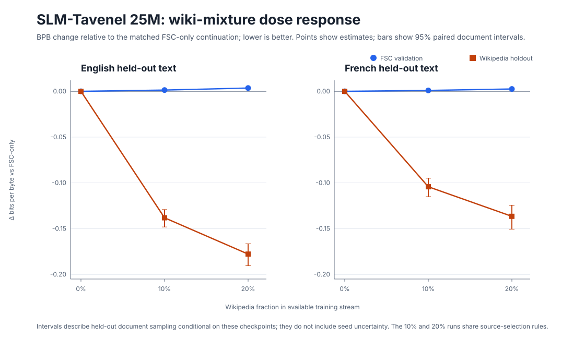

# EXP-0017: 25M continuation with 10% Wikipedia

**Status (2026-10-23 18:54 Paris):** complete. Training took about 38 minutes and the primary text plus six-benchmark evaluation about 33 minutes on a shared RTX 4060 Laptop GPU. The 10% treatment used 60,466,021 wiki tokens (30,233,010 EN; 30,233,011 FR), exactly 10.0% of the FSC+wiki available stream, and completed 1,500/1,500 steps. The checkpoint and source data remain local; FSC and Wikipedia source rights/privacy reviews are unresolved.

## Question

Does reducing the English/French wiki fraction from the 20% used in EXP-0016 to 10% preserve some of the held-out wiki BPB gain while reducing the FSC BPB regression? The 20% result demonstrated a domain trade-off in one matched checkpoint pair. It did not show a general multiple-choice gain.

## Preregistered comparison

- Initialize the 10% treatment from the same EXP-0009 grown-25M step-15,000 checkpoint as EXP-0014 and EXP-0016 (SHA-256 `ac7cb9c5c418bfadd33b0063f37c7a12bcb667896db64fe08b8bea05a95b5d8d`).
- Use the 25M gated architecture, existing FSC tokenizer, AdamW, seed `20261023`, 1,500 steps, 32,768 token positions per update, 49.152M token positions, the same learning-rate schedule, weight decay, BF16 precision, and validation split as EXP-0014/0016.
- Change only the data ratio against the matched FSC-only EXP-0014 control: 90% FSC / 10% wiki by available training-stream token counts. Balance the added wiki tokens between English and French. Select a nested deterministic subset from the same decontaminated candidate stream and salt as EXP-0016; this preserves a direct ratio comparison but does not test alternative Wikipedia sampling strategies.
- Keep the same wiki holdout documents as EXP-0016, independently exact-13-gram filtered against the six benchmark files. Report held-out FSC and wiki English/French BPB as primary outcomes. Use paired document bootstrap intervals conditional on these checkpoints.
- Existing multiple-choice benchmark items are secondary, repeatedly inspected outcomes. No broad capability claim will be made from one run or these reused items. Compare the 10% treatment with the already-completed FSC-only control, and describe the 20% EXP-0016 result as a second exploratory dose point; the 10% and 20% arms share source documents and are not independent replications.
- Record input/code/checkpoint hashes, token counts, exclusions, run time, final model hash, and evaluation output. Keep all artifacts local.

## Interpretation limits

One seed and one continuation pair cannot estimate training-seed variability. This ratio was chosen after inspecting EXP-0016, so the result is a follow-up pilot, not a confirmatory test. The data selection is deterministic but follows the source JSONL order until the target token count is reached; source-order effects are not separately tested. Exact word 13-gram filtering does not exclude paraphrase, translation, or semantic overlap. FSC and Wikipedia licensing/privacy remain unresolved.

The 2026 proxy-model study by Wang et al. also warns that fixed hyperparameters across data recipes can reverse recipe rankings. Therefore this matched, fixed-LR comparison estimates the outcome under this specific continuation recipe, not the best achievable outcome for either corpus. A recipe-specific learning-rate study should follow if this dose point is promising.

## Results

Lower bits-per-byte (BPB) is better. The model has 25,723,648 parameters and final validation loss 2.24355. It saw 49.152M token positions during this continuation. Exact word 13-gram filtering found no matching candidate wiki training documents against the six benchmark files; all 500 wiki BPB holdout documents per language were retained. This filter does not detect semantic, paraphrase, or translation overlap.

| Held-out text | FSC only, 0% | 10% wiki | 20% wiki | 10% minus 0%, paired document 95% CI | 10% minus 20%, paired document 95% CI |
|---|---:|---:|---:|---:|---:|
| FSC English validation | 1.10320 | 1.10456 | 1.10674 | +0.00136 [+0.00117, +0.00154] | −0.00218 [−0.00232, −0.00204] |
| FSC French validation | 1.02415 | 1.02507 | 1.02670 | +0.00093 [+0.00069, +0.00115] | −0.00162 [−0.00182, −0.00141] |
| Wiki English holdout | 1.63794 | 1.49982 | 1.46017 | −0.13812 [−0.14814, −0.12917] | +0.03965 [+0.03699, +0.04253] |
| Wiki French holdout | 1.42268 | 1.31844 | 1.28615 | −0.10425 [−0.11504, −0.09492] | +0.03229 [+0.02864, +0.03617] |

The 10% arm keeps about 76–78% of the 20% arm's observed wiki BPB reduction while cutting the observed FSC BPB regression by roughly 60–64%. These are point-estimate ratios for this checkpoint pair. The document-bootstrap intervals exclude zero for the four 10%-versus-0% BPB comparisons, conditional on these checkpoints and held-out documents; they do not include training-seed uncertainty. Against the 20% arm, 10% predicts the FSC validation text better and the wiki holdout worse, as expected from the dose trade-off. Since the two mixture runs share source-selection rules, this is a dose-response comparison, not an independent replication.

The repeatedly inspected multiple-choice benchmarks remain secondary and post-hoc:

| Benchmark | FSC-only control | 10% wiki | Difference, percentage points (95% paired item interval) |
|---|---:|---:|---:|
| ARC-Easy | 0.318 | 0.323 | +0.55 [−0.51, +1.60] |
| ARC-Challenge | 0.181 | 0.187 | +0.60 [−0.77, +2.05] |
| HellaSwag | 0.274 | 0.274 | +0.01 [−0.30, +0.32] |
| Belebele English | 0.289 | 0.287 | −0.22 [−1.44, +1.00] |
| Belebele French | 0.310 | 0.304 | −0.56 [−1.78, +0.67] |
| WinoGrande XL | 0.522 | 0.511 | −1.03 [−2.76, +0.71] |

All six paired item intervals include zero. The 20,000 bootstrap draws use seed `20261023`; they quantify item resampling conditional on these checkpoints only. No adjustment for repeated inspection or multiple comparisons was applied. The experiment does not establish a multiple-choice benchmark gain.

Overall, 10% is a better *observed domain compromise* than 20% at this fixed continuation recipe, but it still regresses FSC BPB relative to FSC-only and does not improve the multiple-choice suite with clear uncertainty. It is not a general SLM quality winner. As Wang et al. (2026) caution, a fixed learning rate can rank data recipes differently from recipe-specific tuning; the next meaningful follow-up is a small, predeclared learning-rate sensitivity comparison, not a claim that 10% is optimal.

The wiki collection declares CC-BY-SA-3.0/GFDL, but per-page permissions, weight obligations, privacy and the inherited FSC rights review remain unresolved. Keep the checkpoint local and exploratory; do not publish it.

Reproduction artifacts: [training config](../configs/train/exp0017-25m-wiki-10pct.yaml), run manifest (local artifact: `runs/EXP-0017-25m-wiki-10pct-2026-10-23/run_manifest.json`), checkpoint (local artifact: `runs/EXP-0017-25m-wiki-10pct-2026-10-23/checkpoints/step_00001500.pt`), evaluation (local artifact: `runs/EXP-0017-25m-wiki-10pct-2026-10-23/evaluation.json`), paired analysis vs FSC-only (local artifact: `runs/EXP-0017-25m-wiki-10pct-2026-10-23/analysis-vs-fsc.json`), paired analysis vs 20% wiki (local artifact: `runs/EXP-0017-25m-wiki-10pct-2026-10-23/analysis-vs-20pct.json`), prepared-data manifest (local artifact: `data/processed/exp0017-wiki-10pct/manifest.json`), token-data manifest (local artifact: `data/tokens/exp0017-25m-wiki-10pct-v2/manifest.json`), and [dose-response graph source](../scripts/render_exp0017_wiki_dose_response.py). Checkpoint SHA-256 `8cecf8b1ee43ef7ac5f3655b571396ffee31e2ca63fda24a9de69bb324593f47`; evaluation SHA-256 `89e1086c113c728c309d0b9183850e35ac1566aa2613800c7485f3f30cb5c099`; token-manifest SHA-256 `0b6b1614fa48aa087fcb2195c0eb653fd0fcd7affbb3d4837a6c7b1486fde516`; tokenizer SHA-256 `558bab3421bc9ee280f2aa9d0c6a82a9bc482e2ecb72a75837e9c3ee7d2dbd39`.

## Sources

- [EXP-0016 20% wiki mixture](EXP-0016-25m-wiki-mixture-2026-10-23.md)
- [EXP-0014 FSC-only control](EXP-0014-25m-continuation-mixture-2026-10-23.md)
- Wang et al. (2026), [Can Small Training Runs Reliably Guide Data Curation?](https://arxiv.org/abs/2512.24503)
- [25M performance research review](../docs/reviews/25M-PERFORMANCE-RESEARCH-2026-10-23.md)
