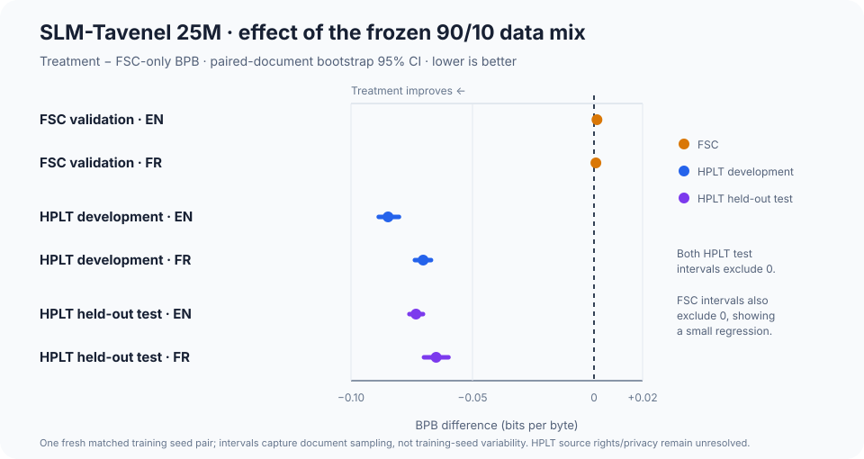

# EXP-0032: fresh-seed replication of 10% HPLT-rich continuation

**Status:** completed 2026-10-27. The matched pair uses seed `20261028`; the 10% recipe was frozen before training this seed. The HPLT BPB gain replicated on development and the held-out test split. This remains one fresh seed pair, not broad confirmation. The HPLT-derived corpus remains unresolved for per-page rights and privacy; all weights stay local.

## Question

Does the 90% FSC / 10% HPLT-rich candidate mixture retain EXP-0031's BPB trade-off at a new training seed, compared with a same-seed FSC-only control initialized from the same EXP-0009 parent?

EXP-0031 selected this dose after reviewing its development results. EXP-0032 therefore tests reproducibility across one fresh seed; it is not an independent data-recipe discovery or a test of other HPLT sampling ratios. The candidate-v2 mixture shares source documents with EXP-0030/0031.

## Frozen matched design

| Arm | Initialization | Training stream | Steps | Token positions | Seed |
|---|---|---|---:|---:|---:|
| Control | EXP-0009 grown 25M, step 15,000 | FSC scaling | 1,500 | 49,152,000 | 20261028 |
| Treatment | same checkpoint | frozen 90% FSC / 10% HPLT-rich candidate v2 | 1,500 | 49,152,000 | 20261028 |

Both arms use the 25,723,648-parameter model, tokenizer SHA-256 `558bab3421bc9ee280f2aa9d0c6a82a9bc482e2ecb72a75837e9c3ee7d2dbd39`, the same initialization, seed, sequence length, batch shape, AdamW/WSD settings and code. The treatment reuses the exact EXP-0031 sampled document set and its decontamination manifest. Only the corpus mix changes between arms.

Primary recipe comparison: paired BPB on the fixed FSC validation docs and the same HPLT candidate-v2 development sample used in EXP-0030/0031. Secondary: six pinned multiple-choice suites with paired item intervals; these tasks have been repeatedly inspected and cannot provide a fresh confirmatory result. After the development and secondary scoring is complete, score **all** documents in the pinned HPLT `test` split once for both matched checkpoints. The test split will not be used to change this recipe.

## Interpretation boundary

This adds one fresh seed pair to EXP-0031, leaving only two 25M training-seed pairs for the 90/10 recipe. It can show whether the observed development trade-off repeats once; it cannot establish broad downstream capability or a scaling law. Bootstrap intervals over documents/items do not replace more seeds. HPLT declared metadata do not establish source-page rights or privacy. No EXP-0032 weights are cleared for release.

## Results

Both runs completed 1,500 steps (49.152M token positions) from the same EXP-0009 grown-25M checkpoint. Checkpoint and tokenizer hashes are recorded in the JSON result files under `runs/EXP-0032-evaluations/`.

| Evaluation split | Language | FSC-only BPB | 90/10 BPB | Treatment − control | Paired document bootstrap 95% CI |
|---|---|---:|---:|---:|---:|
| FSC validation | EN | 1.10299 | 1.10421 | +0.00122 | [+0.00100, +0.00143] |
| FSC validation | FR | 1.02416 | 1.02493 | +0.00077 | [+0.00055, +0.00098] |
| HPLT development sample | EN | 1.59278 | 1.50827 | −0.08451 | [−0.08861, −0.08027] |
| HPLT development sample | FR | 1.36830 | 1.29799 | −0.07031 | [−0.07358, −0.06702] |
| HPLT held-out test, all documents | EN | 1.54603 | 1.47279 | **−0.07323** | **[−0.07596, −0.07037]** |
| HPLT held-out test, all documents | FR | 1.35556 | 1.29059 | **−0.06497** | **[−0.06960, −0.05989]** |

Negative differences favor the 90/10 treatment. The held-out test contains 13,870 EN and 4,712 FR documents. It confirms a substantial in-domain HPLT BPB improvement on this corpus and this seed pair. FSC BPB regresses slightly, with the same signs as EXP-0031. These splits and sources define the scope of the claim; this is not evidence of a general language-model capability gain.

Operational note: the first control test-scoring pass completed computation but failed before serializing its result because a repository-relative input path was formatted incorrectly. That output was not saved or used. The path handling was fixed, the control test was rescored and saved, and the treatment was scored once; the paired analysis uses only the two saved files and did not change the frozen recipe.

All six repeatedly used multiple-choice benchmarks remain inconclusive: every paired-item 95% interval for accuracy difference includes zero.

| Task | FSC-only accuracy | 90/10 accuracy | Difference | Paired item bootstrap 95% CI |
|---|---:|---:|---:|---:|
| ARC-Easy | 0.3161 | 0.3194 | +0.0034 | [−0.0088, +0.0152] |
| ARC-Challenge | 0.1877 | 0.1869 | −0.0009 | [−0.0154, +0.0145] |
| HellaSwag | 0.2757 | 0.2736 | −0.0022 | [−0.0054, +0.0010] |
| Belebele EN | 0.2811 | 0.2789 | −0.0022 | [−0.0144, +0.0111] |
| Belebele FR | 0.3156 | 0.3078 | −0.0078 | [−0.0211, +0.0056] |
| WinoGrande | 0.5185 | 0.5170 | −0.0016 | [−0.0197, +0.0166] |

### Decision

The 90/10 mixture is supported as an **HPLT-domain adaptation recipe**: its large test-set BPB gains replicate the direction and approximate magnitude of the development effects and EXP-0031. It should not replace the general FSC recipe on the basis of these results because it gives up a small amount of FSC BPB, and no benchmark accuracy improvement is established. More training seeds and a separately sourced held-out corpus are needed before treating this as a robust general-model improvement. The corpus rights and privacy review is still unresolved.

### Artifacts

- Development comparison: `runs/EXP-0032-evaluations/paired-development-bpb.json`
- Held-out HPLT test comparison: `runs/EXP-0032-evaluations/paired-hplt-test.json`
- Control and treatment predictions, with per-document scores and hashes: `runs/EXP-0032-evaluations/{fsc-control,hplt-10pct-treatment}/`
- Runner logs and completion status: `runs/EXP-0032-automation/`

## Reproduction

- Control: `configs/train/exp0032-25m-fsc-control-s20261028.yaml`
- Treatment: `configs/train/exp0032-25m-hplt-10pct-s20261028.yaml`
- Queue and evaluations: `scripts/run_exp0032_25m_hplt_10pct_replication.ps1`
- Preceding discovery pilot: [EXP-0031](EXP-0031-25m-hplt-10pct-2026-10-27.md)
- Input mixture manifest: `data/tokens/exp0031-25m-hplt-10pct-fsc-tokenizer/manifest.json`
- Paired results plot: `experiments/EXP-0032-hplt-bpb-deltas.svg`
